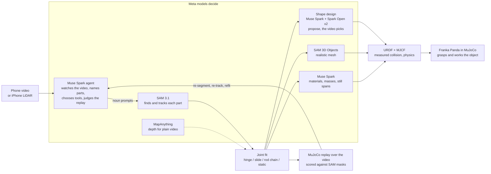

# Video2URDF

**One short video of a real articulated object in, a measured URDF/MJCF out, and a MuJoCo
replay over the video that shows the model moves like the real thing.**

Robotics developers who need a simulation model of a real object (a laptop lid, a desk lamp,
a drawer, a box flap) usually model it by hand: guess the hinge, guess the limits, tweak until
it looks right. Video2URDF measures it instead. Film the object being opened and closed; a
Muse Spark agent finds the parts with SAM 3.1, tracks them, fits each joint by least squares,
writes URDF and MJCF, replays the model in MuJoCo from the camera's own viewpoint and checks
the overlay, frame by frame, before it reports.

Built solo for the Meta Global AI Developer Hackathon (Oct 26 - Nov 4 2026). All code in this
repository was written during the hackathon; see [Built on](#built-on) for what it uses.

**Demo video (2:51):** [docs/demo.mp4](docs/demo.mp4) · https://sunghyunc.github.io/video2urdf/demo.mp4  
**Live viewer:** https://sunghyunc.github.io/video2urdf/ (the phone video, the MuJoCo replay over it,
the robot demo, and the measured model in 3D with its URDF/MJCF).

## At a glance



Every model called at runtime is a Meta model; `--open-weights` runs the same pipeline on Muse
Spark Open and SAM weights, `--glimmer` on Muse Glimmer 30B served by us.

| Measured | Result | vs |
|---|---|---|
| RBO benchmark: 13 real RGB-D videos with motion capture, agent from scratch, scored on exactly the agent's fit | laptops and books 6 of 7: hinge axis 1.7 deg, position 23 mm, angle 3.3 deg (medians); box lids 2 of 6, angle 42 deg; the other 5 refused by the fit's own checks | motion capture |
| Desk lamp seen obliquely, 2 hinges (synthetic, `fit_chain`) | axis 0.4 / 4.8 deg, angle 0.06 / 1.1 deg mean | ground truth |
| 13" MacBook Pro, iPhone LiDAR | lid 309 x 205 mm; the model covers 95% / 94% of the video's masks | spec 304 x 212 |
| Black mouse, phone circling it | 121 x 75 x 55 mm; the depth points seen on one frame lie 0.5 mm (median) from the SAM 3D mesh | spec 125 x 84 x 51 |
| Office drawer, iPhone LiDAR | pulls out 248 mm | hand fit 253 |
| LED desk lamp, iPhone LiDAR, 2 rods | Spark judged the pole's motion depth noise; refit with it fixed (our step): arm 380 mm, 2..89 deg | video |
| Shape design, three Meta models per round | lamp: best of three 0.62 / 0.63 per round, Muse Spark alone 0.60 / 0.62 (mask F-score) | measured meshes 0.69 |
| Robot tasks on the measured models | 6 of 6: lids closed and reopened, drawer out 199 mm and back (cabinet collision on), lamp arms swung, mouse carried and turned | joint values reached in physics |
| A drawer-opening policy learned on the measured drawer (PPO, trained on Modal) | 99/100 held-out placements; 19/20 unseen starts on the full Panda arm; 98% of the travel made pinching the handle | random actions 0/100 |
| SAM tracking, 1385 frames, 4 parts | 520 s -> 285 s, masks IoU 0.97-0.995 | previous pipeline |
| Scale for plain video | card x0.75 (8 frames agree); object's usual size x1.01 | expected 1.0 |

## Reproduce it

Mac or Linux, no local GPU: the heavy models run on the Meta Model API or on your own Modal
account. The sample is the iPhone LiDAR laptop capture behind this README's numbers.

```bash
git clone https://github.com/SungHyunC/video2urdf && cd video2urdf
uv sync                         # Python 3.12 (pinned in .python-version) into .venv
cp .env.example .env            # fill in the keys for the path you run
curl -L -o laptop_lidar.zip \
  https://github.com/SungHyunC/video2urdf/releases/download/sample-data-v1/laptop_lidar_stray.zip
shasum -a 256 laptop_lidar.zip  # 0ee98f444e7287a00cf9a70355312cb4b5e6e494d9aeba9d4630b6b77d008996
mkdir -p data/real/laptop_lidar && unzip -q laptop_lidar.zip -d data/real/laptop_lidar

# Meta Model API (MODEL_API_KEY): Muse Spark + SAM 3.1
.venv/bin/python scripts/run_agent.py data/real/laptop_lidar --out data/tracks_agent
# Open weights only (BASETEN_API_KEY, and SAM deployed on your Modal: see "Open weights only" below)
.venv/bin/python scripts/run_agent.py data/real/laptop_lidar --open-weights --out data/tracks_open
```

Each run writes `<out>/laptop_lidar/`: `model.urdf`, `model.xml`, `replay3d.mp4` (the model drawn
from the phone's own camera over the video), `agent/report.md` (its first line is the automatic
checks' status), `agent/log.md` (every turn and image the model saw).

What to expect: the open-weights command, run from a fresh clone on 10/31 (Muse Spark Open on
Baseten, SAM weights on Modal, shape design included), gave a lid of 306 x 213 mm (spec
304 x 212), base 10 mm, the replay covering 96% / 93% of the lid's and base's masks, and status
`needs_review`: on every laptop run the screen track slides onto the lid's back as it shuts,
which the fit flags. Runs vary; three Meta API runs gave lids of 304 to 316 mm.

## What it does

```
phone video (or iPhone LiDAR capture)
  -> Muse Spark watches the video, names the parts, prompts SAM 3.1   (agent, tool calls)
  -> SAM 3.1 finds each part on key frames and tracks it through the video
  -> joint fit: hinge or slide, axis, position, limits, from the parts' relative motion
  -> link geometry: each part's silhouette (2D) or depth (LiDAR), painted with the video
  -> URDF + MJCF
  -> MuJoCo replay rendered from the camera, scored against the video (coverage per frame);
     the fit tool names a wrong part choice (a base that holds the lid, a lid track that
     slid onto the closed lid's back)
  -> Muse Spark watches the replay, re-segments / re-tracks / refits
  -> physics: Spark judges materials and masses; joint friction measured where a part
     stands still with no hand on it, checked by letting the model go in MuJoCo
  -> report with the measured sizes and what is uncertain
```

The model is then used: a Franka Panda in MuJoCo grasps the measured object and works it (closes
and reopens a lid, pulls a drawer out by its handle and pushes it back, swings a lamp's arm,
carries a mouse; `scripts/robot_tasks.py`).

Two capture paths:

| | 2D (any phone) | 3D (iPhone LiDAR via Stray Scanner, or any RGB-D camera) |
|---|---|---|
| View | tripod, camera roughly facing the motion plane | any angle, handheld is fine |
| Scale | an ID-1 card (85.6 x 54 mm) in view; use a loyalty card, never a payment card | metric depth, no card |
| Joint fit | planar: least-squares hinge centre / slide direction from relative poses | 3D: plate planes per frame, hinge = where plate and base planes cross; slides by ICP |
| Geometry | voted silhouettes extruded to meshes | sizes from depth (lid outline, base thickness, ...) |

## Meta models, and what each does

| Model | Where | Role |
|---|---|---|
| **Muse Spark** (`muse-spark-1.3-contributor`, Meta Model API) | `video2urdf/agent.py`, `scripts/add_physics.py` | The agent: watches the whole video (mp4 input), looks at frames, chooses noun prompts for SAM, picks the parts' roles, calls track / fit / fit_lidar, watches the replay (the model drawn over the video) to judge the fit over time, refits, then judges each link's material and mass and finds when a part stood still with no hand on it (`set_physics`), and writes the report. After the fit it names the object and designs its clean visual from primitives, checking each design over the video (`video2urdf/designer.py`). Chat Completions with tool calls, images, video and structured output. |
| **SAM 3.1** (`sam-3.1`, Meta Model API) | `video2urdf/sam.py`, `scripts/track_video.py` | Concept prompts on key frames find each part; one box-anchored video request tracks all parts with stable IDs. |
| **Muse Spark Open** (open weights, Baseten) | `run_agent.py --open-weights` | The same agent on open weights (it takes video too). |
| **Muse Glimmer 30B** (open weights `meta-models/Muse-Glimmer-30B`, our own Modal Dedicated Endpoint, SGLang) | `run_agent.py --glimmer` | The same agent on a 30B dense open model we serve ourselves: tool calls and images (the endpoint drops video, so it works from frames). |
| **SAM 3.1 / SAM 3** (open weights `facebook/sam3.1`, `facebook/sam3`, on a Modal GPU) | `modal_apps/sam3_open.py`, `video2urdf/sam_open.py` | Open-weights segmentation (SAM 3.1 concept prompts) and box tracking (SAM 3's tracker), answering in the hosted API's wire format so the rest of the pipeline is unchanged. |
| **SAM 3D Objects** (open weights `facebook/sam-3d-objects`, on a Modal GPU) | `modal_apps/sam3d.py`, `scripts/sam3d_meshes.py` | A realistic, coloured mesh of each link from one frame and its SAM 3.1 mask, laid out in metres by our LiDAR depth (given as its pointmap), checked against the measured depth points; it becomes the link's visual, the measured shape stays its collision. |
| **MapAnything** (open weights `facebook/map-anything-apache`, on a Modal GPU) | `modal_apps/mapanything_open.py`, `video2urdf/pseudo_depth.py` | Metric depth, intrinsics and camera poses from a plain RGB video, written as a LiDAR-style capture so the 3D path runs without LiDAR (experimental, see below). |

Every model called at runtime is a Meta model. Switching between the Meta API and open
weights is one flag.

## Results

### Synthetic (MuJoCo-rendered videos with known joints)

| Case | Joint type | Axis / position error | Angle error |
|---|---|---|---|
| Lamp, 2 hinges, 2D | correct tree and types | hinge position 1.7 / 2.5 mm | 0.08 / 0.38 deg mean |
| Drawer, 2D | prismatic | direction 0.00 deg, position 3.2 mm | |
| Lamp seen obliquely, handheld wobble, 3D | | shoulder 0.5-0.85 deg / 4 mm, elbow 1.4-1.6 deg / 8 mm | 0.1 / 0.9 deg |
| Drawer sliding toward the camera, 3D | prismatic | direction 0.24 deg | travel 0.17 mm |

### Real objects, filmed for this project

- **13" MacBook Pro, iPhone LiDAR, no card**, agent from scratch: lid 309 x 205 mm (spec
  304 x 212), base 14 mm, lid 3.8 mm, opening 0..117 deg, hinge drawn on the real hinge;
  the replayed model covers 95% (lid) and 94% (base) of SAM's masks over the 923 frames, while
  the phone moves. The Panda then closes it to within 1 deg of its measured limit. (These are the
  agent's tracks refit with the later fit_lidar; the agent's own fit that day read 304 x 215 mm.)
- **Office pedestal drawer, iPhone LiDAR**, agent from scratch: it finds which of three
  look-alike drawers moves (the tool warns when a "fixed" part stands out like a drawer),
  measures how far the drawer's front stands out of the cabinet's front in every frame (camera
  drift cancels), and builds a cabinet carcass with a slot and the drawer as an open tray:
  pulls out 248 mm; the replay sits on the drawer shut and open.
- Laptop, 2D side view: one hinge, 0-77 deg, fit residual 1.7 mm. Spark saw its first fit was
  wrong (base tracked on 319/408 frames, 25 deg range), re-segmented on other frames and
  re-tracked: 408/408 frames.
- Monitor stand, 2D: base -> lower arm (0-30 deg) -> upper arm (-81-0 deg), residuals
  1.0 / 0.9 mm.

### The agent can't finish over its own warnings

The fit tools flag part choices the numbers contradict (a plate track that slid onto the shut
lid, a base mask that holds the plate, a replay covering under half its mask, a "fixed" drawer
front that stands out). `finish` refuses once while the last fit's warnings are unresolved, and
every run ends with a status in `agent/status.json` and the report's first line:
`checks_passed`, `needs_review` or `failed` (no model). It refuses only once, so estimated
masses or hidden sides can't loop. Passing the checks means none objected, not that the model
was verified against the real object.

On the never-seen microwave (10/31) Spark's first fit came out wrong: a door 795 x 506 mm and a
body 30 mm tall that the replay didn't cover at all. It watched the replay, re-tracked the floor
and the body, and fitted again: the door on a vertical hinge 1.3 deg off vertical, 361 x 255 mm,
the replay covering 82% of the door and 89% of the body. A laptop run whose screen mask lay on
the base on 204 open frames was refused once and finished `needs_review`, saying so. The first
version of these checks also flagged every laptop (a screen's track is meant to fall onto the shut
lid's back as it closes); that case is now an informational line, and a WARNING only when the
plate sits on the closed surface while the object is open: fresh laptop runs pass (lid
306 x 208 mm, replay 88% / 95%).

### Five fresh runs per object, and three objects it had never seen

Every LiDAR capture again, from scratch, five times each (10/31: Muse Spark on the Meta API, SAM
weights on Modal, code fixed at one commit; `data/repeat5`, not committed):

| Object | Status (5 runs) | Measured, across the runs | Reference |
|---|---|---|---|
| 13" MacBook Pro | needs_review x5 | lid 304-306 x 208-212 mm; replay lid 86-93%, base 83-96% | spec 304 x 212 |
| Office drawer | needs_review x5 | travel 242, 243, 243, 244 mm; one run 20 mm (wrong front, replay 15%) | hand fit 253 |
| Black mouse | checks_passed x5 | 121-122 x 75 x 55 mm; replay 88% | spec 125 x 84 x 51 |
| LED desk lamp | checks_passed x5 | Spark fixed the pole itself every time; arm 377-381 mm, 76-91 deg; pole 241-366 mm | arm 380, pole 351 (our refit) |

Every laptop run was refused once at `finish` for the same reason (the screen track slides onto
the lid's back as it shuts, an expected case the check flagged then; it is now informational, and
the same tracks refit pass in 3 of 5, the other 2 keeping other warnings). The drawer run that measured
the wrong front ended `needs_review`, not passed. The lamp passes with the arm's replay covering
only 19-34% of its thin mask, and the pole's length varies: the rod-chain fit had no coverage
warning then, a gap in the checks (it now warns under 25%, see below).

Then three captures filmed after the code was fixed, never used in development, run once each
with that same code: a microwave, a step trash bin and an AirPods case. **None gave a usable
model, and all three ended `needs_review` rather than passing:**

- Microwave: its door swings about a *vertical* hinge, and `fit_lidar` assumes the hinge lies in
  the base's top plane (true for lids, not for doors), so it drew the hinge along the top; the
  glossy black body also came back from SAM in fragments (replay 6% / 26%). Spark's report: timing
  right, geometry unreliable, don't use it for grasping.
- Trash bin: the base candidate was the whole bin, lid included; the hinge came out on the side
  wall. Lid 123 x 156 mm, replay 82% for the lid, 27% for the base. Spark asked for a reshoot.
- AirPods case: it never opened in the video, so it is a rigid object; the static fit found too
  few depth points on the small white case, and Spark then forced a hinge fit on it (flagged,
  replay 14-18%).

After those runs we fixed what they exposed, then ran the same three captures again (10/31).
The code changed after seeing them, so these are development results, not blind tests:

- `fit_lidar` now tells a door from a lid (its axis lies along the base's normal) and places the
  hinge on the shut door's plane, where the open frames' door points stay equidistant (the
  door's planes alone put it ~10 cm off: the open black glass door returns depth on only 0-10%
  of its mask). Three fresh agent runs all built a door model: hinge 1.3-6.0 deg off vertical
  and within 1-2.5 cm of the real hinge edge in the image, door 361-390 x 255-267 mm, replay
  82-87% of the door; one `checks_passed`, two `needs_review`. The opening reads 52-57 deg, less
  than the video seems to show, and the body is modelled only as the control-panel column.
- The static fit picks a reference frame where depth sees the object: the AirPods case now
  passes, 66.8 x 52.5 x 37 mm, replay 91%.
- The prompt names the body wall or rim as a lidded bin's base: on one rerun the trash bin's
  hinge lay along the top rear edge (replay 60% / 72%, open lid misaligned, `needs_review`), but
  two further fresh runs gave no usable model: SAM never returned a body mask without the lid.
- The rod-chain fit now warns when a rod's replay covers under 25% of its mask.

### Benchmark: RBO dataset (real RGB-D with motion capture)

The [RBO dataset](https://zenodo.org/records/1036660) (TU Berlin, CC BY 4.0) has Kinect RGB-D
videos of people operating articulated objects, with motion-captured rigid bodies. The agent
runs each sequence from scratch (same prompts and tools as on our own videos); the result is
scored against the plate's motion relative to the base from motion capture. The operators
often push the whole object around while opening it (up to 15 cm and 47 deg), so the base is
followed too.

The scorer runs the agent's own fit (`lidar.fit_lidar_hinge`, the steps `fit_lidar` takes), so
it scores exactly what the agent produced. Re-scored 10/31 with the current code on the agent's
tracks from 10/28:

| Sequence | Axis direction | Axis position | Angle error, median | Angle error, p90 | Frames measured |
|---|---|---|---|---|---|
| laptop01 | 1.8 deg | 25 mm | 1.9 deg | 38.7 deg | 146/186 |
| laptop02 | 2.1 deg | 32 mm | 3.5 deg | 8.3 deg | 201/205 |
| laptop04 | 0.9 deg | 15 mm | 2.3 deg | 5.4 deg | 162/192 |
| laptop05 | 0.9 deg | 20 mm | 3.1 deg | 5.6 deg | 158/185 |
| book03 | 1.5 deg | 17 mm | 3.7 deg | 4.4 deg | 187/329 |
| book05 | 2.2 deg | 52 mm | 9.6 deg | 13.6 deg | 172/256 |
| cardboardbox02 | 1.9 deg | 46 mm | 67.8 deg | 133.4 deg | 202/220 |
| treasurebox02 | 2.1 deg | 131 mm | 16.4 deg | 27.5 deg | 200/263 |
| book13, cardboardbox03, cardboardbox06, treasurebox03, treasurebox05 | refused: no reference frame where base, cover/lid and open indicator are all measured | | | | |
| **median of the 8 fitted** | **1.9 deg** | **29 mm** | **3.6 deg** | **10.9 deg** | |

Laptops and books are measured to a few degrees. Box lids are where it fails: in these 640 x 480
videos SAM loses the lid (and often the box) on most frames, so the fit either refuses or guesses
the open/closed state from the whole box. Angle errors are taken modulo 360 deg. The table we
published on 10/29 (all 13 fitted, median 2.5 deg / 47 mm / 3.3 deg) came from earlier code:
two later checks (no closed-surface fallback on open frames where the base shows; no reference
frame where the base is mostly hidden) refuse five of these tracks now, and on book05 dropped 44
frames the old fit had mis-measured by ~54 deg that had happened to steady its hinge (1.4 deg
then, 9.6 deg now). Neither check changes the LiDAR laptop runs. Per-sequence results:
`scripts/rbo_bench.py` writes `data/rbo/results/summary.md`.

### Open weights only

`run_agent.py --open-weights` (Muse Spark Open on Baseten + SAM 3.1 / SAM 3 on Modal):

- SAM box tracking on the synthetic lamp: 120/120 frames, IoU against the hosted API 0.970 /
  0.952, arm against ground truth 0.942 (hosted 0.960).
- Muse Spark Open driving the LiDAR laptop (SAM via the API): lid 312 x 208 mm, base 13 mm,
  0..117 deg, hinge on the real hinge, 9 turns.
- **Everything on open weights** (Muse Spark Open + SAM on Modal), LiDAR laptop from scratch,
  18 turns: lid 305 x 209 mm (13" MacBook: 304 x 212), opening 3..122 deg following the
  video (closes, then reopens), lid replay covering 91% of its masks. The base was segmented in
  fragments (keyboard, trackpad), so its thickness could not be measured; the pipeline and
  Spark's report both flag it instead of passing on a wrong number.
- **The new captures, everything on open weights** (10/30, Muse Spark Open on Baseten + SAM on
  Modal; shape design by Spark Open on Baseten and on Fireworks; `data/archive/tracks_open2`):
  the black mouse came out 121.5 x 75.1 x 54.5 mm (the Meta API run: 121.3 x 75.2 x 54.7), 0.14 kg,
  named "ergonomic computer mouse" and redesigned (mask F-score 0.90 vs 0.94 measured). The LED
  desk lamp: Spark Open's first fit missed the rods (the replay covered 6% / 4% of their masks);
  it watched the replay, re-tracked the pole and refit: pole 332 mm, arm 371 mm (0..75 deg),
  replay 73% / 42%, joint friction measured on still spans (let go in MuJoCo: 0.0-0.1 deg),
  redesigned as an "LED desk lamp".
- **From a fresh clone** (10/31), the README's open-weights command on the sample capture:
  lid 306 x 213 mm, base 10 mm, replay 96% / 93%. `finish` refused once; Spark Open then
  finished with a report starting "NEEDS REVIEW:" that names the frames measured from the closed
  lid's back (status `needs_review`). The shape design ran on Spark Open too.
- **Everything on open weights, served by us**: Muse Glimmer 30B on our own Modal endpoint +
  SAM on Modal (`--open-weights --glimmer`), LiDAR laptop from scratch, through to physics:
  lid 307 x 201 mm, opening 0..108 deg, lid replay 87%; it set masses (base 1.1 kg, lid
  0.45 kg) and the lid hinge's friction was measured at 0.164 N·m from the lid held open with
  no hand on it (released in MuJoCo: 0.1 deg). Its base candidate was the whole laptop, so the
  base replay is low (5%), which its report notes. A first try spent all its turns collecting
  candidates; the turn note now says to track once half the budget is gone.
- **Muse Glimmer on the newer captures** (10/31, same setup, one run each): the mouse
  `checks_passed`, 121.5 x 75.1 x 54.5 mm (the Meta API run: 121.3 x 75.2 x 54.7); the drawer
  `needs_review`: it took all three fronts as moving drawers, so two barely move and the replay
  covers 12% / 0% / 0%, which its report says plainly; the desk lamp came out `checks_passed` but
  with the fixed pole fit as a joint and the rods' replay covering 18% / 22%: the rod-chain fit
  didn't warn about low coverage then, so the automatic checks passed it (it now warns under 25%).
- **The RBO benchmark on open weights only** (10/31, Muse Spark Open + SAM weights, one run per
  sequence, scored like the Meta API set): laptops and books 7 of 7, hinge axis 2.8 deg, position
  33 mm, angle 2.8 deg (medians; the Meta API run: 6 of 7, 1.7 deg / 23 mm / 3.3 deg); box lids
  4 of 6 fitted but poor (angle 48 deg median), 2 never got a model. `scripts/rbo_bench.py
  --open-weights` keeps these runs apart from the Meta API ones.

### The model looks like the object: Spark designs it, the video checks it

The measured meshes have the right sizes but read as blobs: silhouettes voted over the video,
or depth points. After the fit, Muse Spark watches the video, names the object and each link's
real part, and rebuilds every link from a few primitives (boxes, rounded boxes, cylinders,
spheres, bars) in that link's frame, sized from the measured extents; sides the camera never
saw get proportions typical for that object, listed as assumptions. Every design is rendered
from the recorded camera at the recorded joint values over the video and scored against the
SAM masks (F-score counting pixels within 1% of the frame, fair to thin parts); Spark sees that
overlay, three views of its design over the measured meshes and the per-axis size differences,
and revises (up to 3 rounds). Each round three Meta models answer in parallel (Muse Spark on the
Meta API, Muse Spark Open on Baseten and on Fireworks) and the design that scores best over the
video carries on: on the LiDAR lamp Muse Spark alone scored 0.60 and 0.62 in the two rounds, the best of the three 0.62 and 0.63. The best design becomes the visual if it scores within 0.10 of the
measured meshes and Spark judges the measurement consistent with the object; collisions,
joints and physics stay measured (MJCF group 3 / URDF `<collision>`).
`design/log.md` keeps every overlay Spark saw.

| Capture | Spark's identification | Primitives | Score: design / measured |
|---|---|---|---|
| iPhone LiDAR laptop | Apple MacBook laptop (silver): body, lid, display, keyboard, trackpad, hinge barrel, logo | 7 | 0.88 / 0.89 |
| iPhone LiDAR drawer | light beech office pedestal cabinet with three drawers: carcass, fronts, handles, lock | 13 | 0.50 / 0.49 |
| iPhone LiDAR desk lamp (new, 10/30) | LED desk/task lamp: base with control panel, pole, LED bar arm, pivots | 12 | 0.62 / 0.69 (the thin arm: 0.39 / 0.42) |
| iPhone LiDAR mouse (new, 10/30) | ergonomic wireless mouse, Logitech MX Master style (shown: SAM 3D's mesh, see below) | 8 | 0.89 / 0.94 |
| 2D lamp video (`stand_2`) | white foldable LED desk lamp: base with control panel, pole, LED housing and diffuser, pivots | 11 | 0.70 / 0.71 |

Round 2 on the lamp: Spark saw its first arms were too thick against the masks and thinned
them (0.66 -> 0.70). When the measurement itself is wrong (an RGB-only capture without a
reference whose fitted box is a 2.6 m slab lying flat) Spark says so, and the design is not
applied; it also flags a scale far from the object's usual size.

```bash
.venv/bin/python scripts/design_shape.py data/tracks/my_video my_video.mov   # run_agent.py does this by default
.venv/bin/python scripts/design_shape.py data/tracks/my_video --remove        # back to the measured visuals
```

### Physics: masses, inertia, and joint friction measured from the video

A model a robot can push needs mass and friction, not just a shape. Muse Spark watches the
video and judges each link's material and mass from what the object is (the tool returns the
density that mass implies over the measured solid, as a check); inertia follows from the link's
measured mesh. Joint friction is measured where the video allows it: when a part stands still
with **no hand on it** (Spark finds those spans in the video), the hinge alone is holding it
against gravity, so its friction is at least the gravity torque at those angles (MuJoCo
computes it; the model gets 1.25x the largest). The resting end (a closed lid lying on its
base) is left out. The check: release the model in MuJoCo at the held angles for 2 s.

| Model | Masses (Spark) | Joint friction | Released at the held angles, 2 s |
|---|---|---|---|
| 13" MacBook Pro, LiDAR | base 0.90 kg + lid 0.50 kg (spec: 1.4 kg in all) | lid hinge 0.284 N·m, measured | moves 0.1 deg (11.5 deg without it) |
| Laptop, 2D side view | 0.95 + 0.45 kg | 0.038 N·m, measured (held only near upright: a lower bound) | 0.0 deg (76 deg without) |
| Monitor stand, 2D | base 0.45, arms 0.075 / 0.09 kg | 0.028 / 0.122 N·m, measured | 0.0 / 3.4 deg (21 / 56 deg without) |
| Pedestal drawer, LiDAR | cabinet 13 kg, drawer 2.5 kg | 0.98 N, estimated (gravity doesn't load a horizontal slide) | |

`scripts/physics_demo.py` renders the check: the model let go at a held angle, with the
measured friction and without, side by side (viewer tab "Physics check"; laptop +0.1 vs
+11.5 deg in 3 s, stand +0.0 vs +20.3 deg).

URDF gets `<inertial>` and `<dynamics>`, MJCF explicit inertials, `frictionloss` (stiffened:
MuJoCo's default soft friction lets a loaded hinge creep 7 deg in 2 s) and contact friction.
The robot demo uses them. Damping is not measured (the hand drives every motion we see).

### URDF Doctor: checking an existing URDF against the video

Given a URDF written some other way (by hand, from CAD, by a vendor; any frame convention),
`scripts/urdf_doctor.py` registers its base to the measured base by geometry, finds which of
its joint values reproduces each opening seen in the video, and reports what disagrees. Test
on the LiDAR laptop with URDFs in `examples/doctor/` (bugs injected on purpose):

| URDF under test | Doctor's verdict |
|---|---|
| `laptop_spec.urdf`, from the published 13" MacBook Pro dimensions | consistent: axis 2.3 deg / 8 mm from the measured hinge, +q opens, limits cover the 1..117 deg seen |
| `laptop_buggy.urdf`: hinge moved 25 mm, axis tilted 6 deg, upper limit 90 deg | 3 problems: axis 7.6 deg off, hinge 18 mm off, limits stop at 90 but the video needs 127 |
| spec + `joint_log_flipped.csv` (encoder sign reversed) | log = -1.00 x expected: sign flip |
| spec + `joint_log_offset.csv` (12 deg zero offset) | log offset by 11.3 deg |

The axis's turn *within* the base's top plane is only as sure as the measured base outline
(a few degrees on this capture); tilts out of that plane, positions, signs, offsets and limits
are what it checks reliably.

### A policy learned on the measured drawer

The drawer measured from video is also a training environment (`video2urdf/rl_drawer.py`): a
Panda hand on a force-limited mount, the measured drawer and cabinet colliding, and a reward that
counts drawer travel only while both fingers pinch the handle (pressing along their closing
direction, each at least 7 mm open on the 18 mm handle). Earlier attempts found loopholes
(ramming through the drawer front, crushing the fingers past their joint limit to hook the
handle, a mount pushing with 2 kN); each was closed before this run. PPO with 32 environments on
Modal CPUs (5M steps, 45 min; about $4 of Modal credit for everything):

| | Held-out placements (sim hand) | Full Panda arm, unseen starts |
|---|---|---|
| Opened >= 150 mm while pinching | 99 / 100 (random actions: 0 / 100) | 19 / 20 |
| Drawer travel made while pinching | 98.2% | 98.4% |
| Finger opening while holding | >= 7.3 mm | >= 8.6 mm |
| Deepest contact with anything but the handle | 0.37 mm | 0.41 mm |

The arm follows the policy under Cartesian impedance (the training mount's stiffness, damping and
60 N cap, within the Panda's joint torque limits); through `robot_tasks.py`'s joint servos it
doesn't work honestly. The arm's one failure: the hand caught the cabinet's slot edge and tilted
31 deg. One-step force spikes come from the simulated gripper snapping shut much faster than a
real Franka hand. Simulation only.

```bash
uv sync --extra rl
.venv/bin/modal run modal_apps/rl_drawer_train.py::main --steps 5000000 --envs 32 --name drawer_ppo_honest
.venv/bin/modal run modal_apps/rl_drawer_train.py::arm --name drawer_ppo_honest --seeds 20
.venv/bin/python scripts/run_drawer_policy.py data/tracks_design/drawer2_lidar --seed 20012   # the arm video
```

### More results

- **Repeatability**: three fresh Muse Spark runs on the LiDAR laptop gave lids of 316 x 216,
  304 x 215 and 304 x 214 mm (spec 304 x 212); which part the agent takes as the base still
  varies between runs, and the fit tool flags it.
- **Rods and static objects**: a desk lamp's rods are fit as 3D lines from raw LiDAR depth
  (synthetic oblique lamp: axis 0.4 / 4.8 deg); a mouse the phone circled is carved from 48 views
  and capped by depth: 121 x 75 x 55 mm (MX Master 3S: 125 x 84 x 51).
- **The robot uses the model**: a Franka Panda in MuJoCo physics closes and reopens the laptop
  lid (87 deg), pulls the drawer out by its handle with the cabinet's measured collision on
  (199 mm) and pushes it back, swings the lamp's arm (40 deg), and carries and turns the mouse.
- **Speed and scale**: SAM tracking of 1385 frames went from 520 s to 285 s (both passes at
  once, strided on fast video); plain videos get a metric scale from an ID-1 card or from the
  object's usual size.
- **Texture**: each flat face of a link takes the video frame that saw it largest and most
  head-on.

Details, numbers and commands for each: [docs/DETAILS.md](docs/DETAILS.md).

## Run it

Requires macOS or Linux, [uv](https://docs.astral.sh/uv/), ffmpeg. No local GPU.

```bash
uv sync                                  # Python 3.12 environment in .venv
cp .env.example .env                     # then fill in the keys you have
.venv/bin/python scripts/smoke_test.py   # one cheap call per backend
```

### A 2D phone video

Film on a tripod, camera facing the plane the part moves in, an ID-1 sized card in view,
open and close the object slowly.

```bash
.venv/bin/python scripts/run_agent.py my_video.mov --out data/tracks
open data/tracks/my_video/replay.mp4               # the model over the video
cat  data/tracks/my_video/agent/report.md          # Spark's report
ls   data/tracks/my_video/{model.urdf,model.xml}
```

Without the agent: `scripts/track_video.py VIDEO "laptop lid" "laptop keyboard"`, then
`scripts/fit_model.py VIDEO --ref "laptop lid=0.212"` (a known length instead of a card).

### An iPhone LiDAR capture

Record with [Stray Scanner](https://apps.apple.com/app/stray-scanner/id1557051662), export
the folder, then:

```bash
.venv/bin/python scripts/run_agent.py data/real/laptop_lidar --out data/tracks_agent
open data/tracks_agent/laptop_lidar/replay3d.mp4   # the model rendered from the phone's pose
```

The agent ends with `set_physics` (masses, friction). For a run made without it:
`.venv/bin/python scripts/add_physics.py data/tracks_agent/laptop_lidar` (Spark watches the
video once, structured output; `--reuse` re-applies the saved estimate).

### Open weights only (for the Open Weight prize check)

```bash
# 1. Muse Spark Open on Baseten: put BASETEN_API_KEY in .env.
# 2. SAM on your own Modal GPU: accept the SAM License on huggingface.co/facebook/sam3.1
#    and huggingface.co/facebook/sam3, then
.venv/bin/modal setup
.venv/bin/modal secret create huggingface HF_TOKEN=hf_...
.venv/bin/modal deploy modal_apps/sam3_open.py
.venv/bin/python scripts/check_sam_open.py --e2e          # synthetic lamp vs the hosted tracks
# 3. Run everything on open weights:
.venv/bin/python scripts/run_agent.py data/real/laptop_lidar --open-weights --out data/tracks_open
```

`--sam api` keeps the hosted segmenter while reasoning runs on open weights. The Modal app
scales to zero after 2 idle minutes (A10G, about $0.05-0.10 per video).

Muse Glimmer 30B on your own GPU instead of Baseten (a Modal Dedicated Endpoint bills while
it is up; stop it when done):

```bash
.venv/bin/modal workspace proxy-tokens create --name video2urdf --json
#   -> MODAL_PROXY_TOKEN_ID (Modal-Key) and MODAL_PROXY_TOKEN_SECRET (Modal-Secret) in .env
.venv/bin/modal endpoint create --name glimmer --model meta-models/Muse-Glimmer-30B
.venv/bin/modal endpoint info glimmer            # wait for State: live; put its URL in .env as GLIMMER_URL
.venv/bin/python scripts/run_agent.py data/real/laptop_lidar --open-weights --glimmer --out data/tracks_glimmer
.venv/bin/modal endpoint stop glimmer --yes
```

Locally, Glimmer runs under vLLM, SGLang, llama.cpp (`meta-models/Muse-Glimmer-30B-GGUF`) or
LM Studio with 24 GB+ of VRAM; point `AGENT_BASE_URL`/`AGENT_MODEL` at it.

### More commands

Plain video without LiDAR (MapAnything), the robot tasks and the viewer, SAM 3D link meshes,
URDF Doctor and the RBO benchmark: [docs/DETAILS.md](docs/DETAILS.md#more-commands).

## Limitations

- v1 handles 1-3 joints. The 3D path (`fit_lidar`) handles one hinged plate or one slide.
- Thin parts make replay IoU harsh; book covers and box lids track poorly (see the benchmark).
- A 2D side view cannot measure the width across the motion plane; it is assumed or set.
- Floor levelling removes ARKit drift in height and tilt, not along the floor.
- Doors on vertical hinges: the hinge is placed within a few cm, but the opening reads small and
  the body is only the part the camera saw. A lidded bin whose body SAM can't separate from its
  lid gives no usable model.
- The learned drawer policy is simulation only, run on the arm under Cartesian impedance control.

## Built on

Models: Muse Spark, Muse Spark Open, Muse Glimmer, SAM 3.1, SAM 3, SAM 3D Objects,
DINOv2 (used inside SAM 3D Objects), MapAnything (Meta).

| Project | License | Used for |
|---|---|---|
| [MuJoCo](https://github.com/google-deepmind/mujoco) | Apache-2.0 | simulation, rendering the replay |
| [MuJoCo Menagerie](https://github.com/google-deepmind/mujoco_menagerie) (Franka Panda) | Apache-2.0 | robot demo, fetched by `scripts/fetch_assets.sh`, not committed |
| [facebookresearch/sam3](https://github.com/facebookresearch/sam3) | SAM License | open-weights SAM on Modal |
| [facebookresearch/sam-3d-objects](https://github.com/facebookresearch/sam-3d-objects) (SAM 3D Objects) | SAM License | realistic link meshes on Modal; installed into the Modal image, not vendored |
| [facebookresearch/dinov2](https://github.com/facebookresearch/dinov2) | Apache-2.0 | visual encoder used by SAM 3D Objects |
| [MapAnything](https://github.com/facebookresearch/map-anything) (Meta), weights `facebook/map-anything-apache` | Apache-2.0 | depth, intrinsics and camera poses for videos without LiDAR, on Modal |
| [meta-sam-parser](https://pypi.org/project/meta-sam-parser/) | SAM License | parsing SAM API output; `video2urdf/fast_mask.py` is a numba port of its decoder (`LICENSES/SAM_LICENSE`) |
| [RBO dataset](https://zenodo.org/records/1036660) - R. Martín-Martín, C. Eppner, O. Brock, "The RBO Dataset of Articulated Objects and Interactions", IJRR 2019 | CC BY 4.0 | benchmark; downloaded, not redistributed |
| [three.js](https://threejs.org) | MIT | web viewer (CDN) |
| [marked](https://github.com/markedjs/marked) | MIT | the viewer's turn-by-turn logs (CDN) |
| [Remotion](https://www.remotion.dev) | Remotion License (free for individuals) | the promo video in `promo/` |
| [SGLang](https://github.com/sgl-project/sglang) | Apache-2.0 | serving Muse Glimmer on our Modal endpoint (via `modal endpoint create`) |
| [mapbox-earcut](https://github.com/skogler/mapbox_earcut_python) | ISC | triangulating mesh caps |
| OpenCV, NumPy, SciPy, numba, OpenAI Python SDK (as the OpenAI-compatible client), Modal | various OSS | |
| [Stray Scanner](https://github.com/strayrobots/scanner) | app | recording iPhone LiDAR captures |

What we built on top: the agent and its tools, the SAM tracking strategy (key-frame concept
prompts, then multi-anchor box tracking forward and over a reversed clip, both passes at once,
strided on fast video), the 2D and 3D joint fits (plates, slides, drawers, rods on hinges from raw
depth, visual hulls for static objects), link geometry, URDF/MJCF emission, the camera-pose MuJoCo
replay and its scoring, Spark's shape design loop judged over the video with three Meta models per
round, SAM 3D placement and checks, automatic scale for plain video, physics from still spans, the
robot tasks (grasp planning on the measured geometry), URDF Doctor, the viewer with its
turn-by-turn logs, and the RBO benchmark harness.
