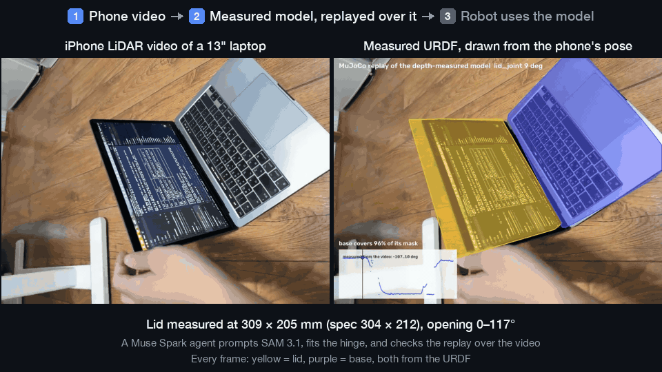
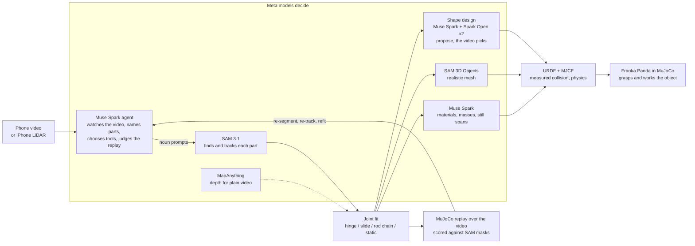

# Video2URDF

**One short video of a real articulated object in, a measured URDF/MJCF out, and a MuJoCo
replay over the video that shows the model moves like the real thing.**

- **Live site and viewer:** https://sunghyunc.github.io/video2urdf/ (the phone video, the MuJoCo
  replay over it, the robot demo, and the measured model in 3D with its URDF/MJCF)
- **Demo video (2:55, narrated):** https://sunghyunc.github.io/video2urdf/demo.mp4 · [docs/demo.mp4](docs/demo.mp4)
- **In depth:** [Results](docs/RESULTS.md) · [How it works](docs/HOW_IT_WORKS.md) · [Commands](docs/COMMANDS.md)



Built solo for the Meta Global AI Developer Hackathon (Oct 26 - Nov 4 2026). All code in this
repository was written during the hackathon; see [Built on](#built-on) for what it uses.

## What it does

Robotics developers who need a simulation model of a real object (a laptop lid, a desk lamp,
a drawer, a microwave door) usually model it by hand: guess the hinge, guess the limits, tweak until
it looks right. Video2URDF measures it instead. Film the object being opened and closed; a
Muse Spark agent finds the parts with SAM 3.1, tracks them, fits each joint by least squares,
writes URDF and MJCF, replays the model in MuJoCo from the camera's own viewpoint and checks
the overlay, frame by frame, before it reports. A simulated Franka Panda then grasps and works
the measured model, and URDF Doctor checks a URDF you already have against a video.

**Where to look**
- **The 3-minute demo** (link above): the pipeline on real objects, start to finish.
- **The viewer**: pick an object, then *Model over video* and *Robot uses it*; under the 3D view, the
  URDF/MJCF downloads and *How the Meta models built this model, turn by turn* (every turn and image).
- **The agent correcting itself**: [the side-view laptop's turn log](https://sunghyunc.github.io/video2urdf/#notebook)
  (base lost on 89 of 408 frames: re-segmented, re-tracked, refit) and [the finish gate](#the-agent-cant-finish-over-its-own-warnings).
- **Results**: [at a glance](#at-a-glance) · [RBO motion-capture benchmark](docs/RESULTS.md#benchmark-rbo-dataset-real-rgb-d-with-motion-capture) · [five fresh runs per object](docs/RESULTS.md#five-fresh-runs-per-object-and-three-objects-it-had-never-seen) · [all results](docs/RESULTS.md)
- **Open weights only**: [the exact commands](#open-weights-only-for-the-open-weight-prize-check) and [what they gave](docs/RESULTS.md#open-weights-only).
- **Why not just ask an AI?** [The same Muse Spark asked plainly for a URDF](#why-not-just-ask-an-ai-for-the-urdf), no tools.
- **URDF Doctor**: [checking an existing URDF against a video](docs/RESULTS.md#urdf-doctor-checking-an-existing-urdf-against-the-video).

## At a glance

<a id="benchmark-rbo-dataset-real-rgb-d-with-motion-capture"></a><a id="five-fresh-runs-per-object-and-three-objects-it-had-never-seen"></a>



Every model called at runtime is a Meta model; `--open-weights` runs the same pipeline on Muse
Spark Open and SAM weights, `--glimmer` on Muse Glimmer 30B served by us.

| Measured | Result | vs |
|---|---|---|
| [RBO benchmark](docs/RESULTS.md#benchmark-rbo-dataset-real-rgb-d-with-motion-capture): 13 real RGB-D videos with motion capture, agent from scratch, scored on exactly the agent's fit | laptops and books 6 of 7: hinge axis 1.7 deg, position 23 mm, angle 3.3 deg (medians); box lids 2 of 6, angle 42 deg; the other 5 refused by the fit's own checks | motion capture |
| [Desk lamp seen obliquely, 2 hinges](docs/RESULTS.md#rods-on-hinges-in-3d-and-objects-the-phone-walked-around) (synthetic, `fit_chain`) | axis 0.4 / 4.8 deg, angle 0.06 / 1.1 deg mean | ground truth |
| [13" MacBook Pro, iPhone LiDAR](docs/RESULTS.md#real-objects-filmed-for-this-project) | lid 309 x 205 mm; the model covers 95% / 94% of the video's masks | spec 304 x 212 |
| [Black mouse, phone circling it](docs/RESULTS.md#rods-on-hinges-in-3d-and-objects-the-phone-walked-around) | 121 x 75 x 55 mm; the depth points seen on one frame lie 0.5 mm (median) from the SAM 3D mesh | spec 125 x 84 x 51 |
| [Office drawer, iPhone LiDAR](docs/RESULTS.md#real-objects-filmed-for-this-project) | pulls out 248 mm | hand fit 253 |
| [LED desk lamp, iPhone LiDAR, 2 rods](docs/RESULTS.md#rods-on-hinges-in-3d-and-objects-the-phone-walked-around) | Spark judged the pole's motion depth noise; refit with it fixed (our step): arm 380 mm, 2..89 deg | video |
| [Shape design, three Meta models per round](docs/RESULTS.md#the-model-looks-like-the-object-spark-designs-it-the-video-checks-it) | lamp: best of three 0.62 / 0.63 per round, Muse Spark alone 0.60 / 0.62 (mask F-score) | measured meshes 0.69 |
| [Robot tasks on the measured models](docs/RESULTS.md#the-robot-works-the-object-grasp-open-close-carry) | 8 of the viewer's 8: lids closed and reopened, drawer out 199 mm and back (cabinet collision on), microwave door pulled open to 46 deg and pushed shut (body collision on), lamp arms swung, mouse and AirPods case carried and turned | joint values reached in physics |
| [A drawer-opening policy learned on the measured drawer](docs/RESULTS.md#a-policy-learned-on-the-measured-drawer) (PPO, trained on Modal) | 99/100 held-out placements; 19/20 unseen starts on the full Panda arm; 98% of the travel made pinching the handle | random actions 0/100 |
| [The unseen back of a microwave in a shelf](docs/RESULTS.md#the-parts-the-camera-never-saw) | front measured (477 x 269 mm), depth bounded by the video (334-387 mm), the rest from Muse Spark (a Samsung 23 L): 477 x 365 x 269 mm with its cavity | measured front, video bound |
| [SAM tracking, 1385 frames, 4 parts](docs/RESULTS.md#faster-tracking-and-scale-without-a-reference) | 520 s -> 285 s, masks IoU 0.97-0.995 | previous pipeline |
| [The downloads, loaded outside our own scripts](docs/RESULTS.md#the-downloads-loaded-outside-our-scripts) (`scripts/check_exports.py`) | all 8 models' zips: the MJCF in MuJoCo, the URDF in PyBullet, yourdfpy and Drake, joints and limits equal to the fit's; MuJoCo's own URDF import runs 7 (the side-view laptop's lid overlaps its base 13 mm at the hinge, which only the MJCF can exclude) | the fit's records |
| [The same Muse Spark asked plainly for a URDF of each video, no tools](#why-not-just-ask-an-ai-for-the-urdf) (5 answers per object) | recalls the MacBook's spec (304 x 212 mm, 5 of 5); in 8 of 19 hinge answers the joint can't open as far as the video shows; every drawer gets the same 360-400 mm; 1 of 25 doesn't load | the measured model, motion capture |
| [Scale for plain video (MapAnything depth)](docs/RESULTS.md#faster-tracking-and-scale-without-a-reference) | an ID-1 card: x0.75 on the side-view laptop, steady over 8 frames; the object's usual size: x1.01 on the laptop's RGB, already at LiDAR scale | 1.0 expected on the latter |

Everything else (synthetic ground truth, repeat runs, objects it had never seen and failed on,
physics, open weights only): [docs/RESULTS.md](docs/RESULTS.md).

## The Meta models, and what each one decides

| Model | Runs on | What it decides |
|---|---|---|
| **Muse Spark** (`muse-spark-1.3-contributor`) | Meta Model API | Runs the pipeline as an agent (below); judges each link's material and mass; names the object and designs its clean visual; estimates the sizes of a body the camera never saw |
| **SAM 3.1** (`sam-3.1`) | Meta Model API | Where each part is on every frame, from Spark's noun prompts |
| **Muse Spark Open** (open weights) | Baseten, Fireworks | The same agent with `--open-weights`; in every shape-design round it proposes alongside Muse Spark |
| **Muse Glimmer 30B** (open weights `meta-models/Muse-Glimmer-30B`) | our own Modal endpoint (SGLang) | The same agent with `--glimmer`, served by us; it works from frames (the endpoint drops video) |
| **SAM 3.1 / SAM 3** (open weights `facebook/sam3.1`, `facebook/sam3`) | a Modal GPU | Segmentation (SAM 3.1 concept prompts) and box tracking (SAM 3's tracker) on open weights, in the hosted API's wire format |
| **SAM 3D Objects** (open weights `facebook/sam-3d-objects`) | a Modal GPU | A realistic mesh of a link from one frame, its mask and our depth; kept as the visual only if it agrees with the measured depth and the video |
| **MapAnything** (open weights `facebook/map-anything-apache`) | a Modal GPU | Depth, intrinsics and camera poses for a plain video without LiDAR (experimental) |

What Muse Spark decides in a run (`video2urdf/agent.py`; Chat Completions with tool calls,
images, video and structured output):

- **What to look for**: the noun prompts for SAM 3.1, and the frames to find each part on.
- **What each part is**: which tracked part is the fixed base, the moving part, the shut lid's
  back, the floor.
- **Which fit**: a hinged plate or door, drawers, a rod chain, a rigid object, or the 2D fit for
  a side view.
- **Whether the fit is right**: it watches the model replayed over the video, then re-segments,
  re-tracks or refits.
- **Physics**: each link's material and mass, and when a part stood still with no hand on it;
  those spans are where joint friction is measured (`set_physics`; `scripts/add_physics.py` for
  older runs).
- **The report**: which numbers were measured and which were estimated.
- **The look**: after the fit it names the object and rebuilds each link from primitives,
  scored over the video and revised for up to 3 rounds (`video2urdf/designer.py`).
- **What the camera never saw**: the hidden sizes of a partly seen body, inside the bound the
  video gives (`video2urdf/completion.py`).

SAM 3.1 finds each part from those prompts on key frames, then one box-anchored video request
tracks all parts with stable IDs (`video2urdf/sam.py`); it also gives the whole-object masks for
completing an unseen body and finds an ID-1 card for scale. Switching between the Meta API and
open weights is one flag. The same table with the code behind each model, and how the tracking
works: [docs/HOW_IT_WORKS.md](docs/HOW_IT_WORKS.md#which-meta-model-decides-what).

### Why not just ask an AI for the URDF?

We asked the same Muse Spark (`muse-spark-1.3-contributor`) for a URDF of each video, plainly:
the video, three frames and one request, no tools (5 answers per object). It recognises products
and recalls their specs: the MacBook's lid came out at the spec's 304 x 212 mm in all five
answers. It can't measure the object: in 8 of 19 hinge answers the joint can't open as far as the
video shows, all three of the pedestal's drawers get the same 360-400 mm of travel, 1 of 25
answers doesn't load in MuJoCo, and nothing in an answer says which of its numbers are right.
With tools, the same model measures those numbers and checks them against the video. Its prior
for where a laptop's hinge sits is better than our fit's position, a prior we could add. Details:
[docs/RESULTS.md](docs/RESULTS.md#why-not-just-ask-an-ai-for-the-urdf); table, caveats and all
30 answers: [docs/spark_alone.md](docs/spark_alone.md).

## Run it

Mac or Linux, no local GPU: the heavy models run on the Meta Model API or on your own Modal
account. You need [uv](https://docs.astral.sh/uv/) and ffmpeg.

### Reproduce it

The sample is the iPhone LiDAR laptop capture behind this README's numbers.

```bash
git clone https://github.com/SungHyunC/video2urdf && cd video2urdf
uv sync                         # Python 3.12 (pinned in .python-version) into .venv
cp .env.example .env            # fill in the keys for the path you run
curl -L -o laptop_lidar.zip \
  https://github.com/SungHyunC/video2urdf/releases/download/sample-data-v1/laptop_lidar_stray.zip
shasum -a 256 laptop_lidar.zip  # 0ee98f444e7287a00cf9a70355312cb4b5e6e494d9aeba9d4630b6b77d008996
mkdir -p data/real/laptop_lidar && unzip -q laptop_lidar.zip -d data/real/laptop_lidar

# Meta Model API (MODEL_API_KEY): Muse Spark + SAM 3.1
.venv/bin/python scripts/run_agent.py data/real/laptop_lidar --out data/tracks_agent
# Open weights only (BASETEN_API_KEY, and SAM deployed on your Modal: see "Open weights only" below)
.venv/bin/python scripts/run_agent.py data/real/laptop_lidar --open-weights --out data/tracks_open
```

Each run writes `<out>/laptop_lidar/`: `model.urdf`, `model.xml`, `replay3d.mp4` (the model drawn
from the phone's own camera over the video), `agent/report.md` (its first line is the automatic
checks' status), `agent/log.md` (every turn and image the model saw).

What to expect: the open-weights command, run from a fresh clone on 10/31 (Muse Spark Open on
Baseten, SAM weights on Modal, shape design included), gave a lid of 306 x 213 mm (spec
304 x 212), base 10 mm, the replay covering 96% / 93% of the lid's and base's masks, and status
`needs_review`: the screen track slid onto the lid's back as it shut, which that version of the
checks flagged; that case has been an informational line since, so a run today can also end
`checks_passed`. Runs vary; three Meta API runs gave lids of 304 to 316 mm.

### Open weights only (for the Open Weight prize check)

With `--open-weights` every model call goes to open weights: Muse Spark Open on Baseten (the agent,
its physics judgement and the shape design; also on Fireworks when `FIREWORKS_API_KEY` is set) and
SAM 3.1 / SAM 3 weights in your own Modal workspace. The Meta Model API is not called, so
`MODEL_API_KEY` can stay empty.

```bash
# 0. The sample capture in data/real/laptop_lidar (see "Reproduce it" above).
# 1. Muse Spark Open: BASETEN_API_KEY in .env. A Baseten workspace that lists the model as
#    meta-models/muse-spark-open (not ...-1026) also needs BASETEN_MODEL=meta-models/muse-spark-open.
.venv/bin/python scripts/smoke_test.py   # look for "[PASS] baseten chat"; lines for keys you don't have fail, fine here
# 2. SAM weights on your Modal account. On Hugging Face, request access to facebook/sam3.1 and
#    facebook/sam3 (SAM License), wait until both are granted, and make a read token.
.venv/bin/modal setup                                       # browser login; token in ~/.modal.toml
.venv/bin/modal secret create huggingface HF_TOKEN=hf_...   # the secret the Modal app reads
.venv/bin/modal deploy modal_apps/sam3_open.py              # the first build takes minutes; ends with "App deployed"
# 3. Everything on open weights. The first SAM call downloads the 3.5 GB checkpoint into the
#    sam3-weights volume (once).
.venv/bin/python scripts/run_agent.py data/real/laptop_lidar --open-weights --out data/tracks_open
```

When it works, the run first names the model it runs (`model meta-models/muse-spark-open-1026`), then each turn
(`segment`, `track`, `fit_lidar`, `watch`, `set_physics`, `finish`), then `=== report ===`, whose
first line is the automatic checks' status, then `Shape design: <object>, applied` (or `not
applied` when the design scores below the measured meshes). The SAM calls show on modal.com under
the app `video2urdf-sam3-open`. The files land in `data/tracks_open/laptop_lidar/` (listed under
[Reproduce it](#reproduce-it), with the numbers to expect). `scripts/check_sam_open.py` checks the
mask wire format locally (`RLE ok: ...`); its `--e2e` mode compares the deployed SAM with the
hosted API's tracks of the synthetic lamp, so it needs a hosted run first (`data/tracks/lamp/`).

`--sam api` keeps the hosted segmenter while reasoning runs on open weights. The Modal app
scales to zero after 2 idle minutes (A10G, about $0.05-0.10 per video).

Muse Glimmer 30B on your own GPU instead of Baseten (a Modal Dedicated Endpoint bills while
it is up; stop it when done):

```bash
.venv/bin/modal workspace proxy-tokens create --name video2urdf --json
#   -> MODAL_PROXY_TOKEN_ID (Modal-Key) and MODAL_PROXY_TOKEN_SECRET (Modal-Secret) in .env
.venv/bin/modal endpoint create --name glimmer --model meta-models/Muse-Glimmer-30B
.venv/bin/modal endpoint info glimmer            # wait for State: live; put its URL in .env as GLIMMER_URL
.venv/bin/python scripts/run_agent.py data/real/laptop_lidar --open-weights --glimmer --out data/tracks_glimmer
.venv/bin/modal endpoint stop glimmer --yes
```

Any other OpenAI-compatible server works the same way: Glimmer under vLLM, SGLang, llama.cpp's
`llama-server` (`meta-models/Muse-Glimmer-30B-GGUF`) or LM Studio, with 24 GB+ of VRAM. Point the
agent at it without `--open-weights` (that flag selects Baseten) and keep SAM on your Modal app:

```bash
# AGENT_MODEL: the name your server serves the model under; LOCAL_KEY: any value unless the server checks keys
export LOCAL_KEY=none AGENT_API_KEY_ENV=LOCAL_KEY AGENT_BASE_URL=http://localhost:8000/v1 \
       AGENT_MODEL=muse-glimmer-30b AGENT_VIDEO=0 AGENT_MAX_IMAGES=8
.venv/bin/python scripts/run_agent.py data/real/laptop_lidar --sam open --out data/tracks_local
```

`AGENT_VIDEO=0` sends frames instead of mp4 video, for servers that drop video (our Glimmer
endpoint does). With `BASETEN_API_KEY` or `FIREWORKS_API_KEY` set, the shape design (here and with
`--glimmer`) also asks Spark Open there; add `--no-design` to keep every call on your own server.

What these runs gave (from a fresh clone, from scratch on the new captures, Glimmer through to
physics, the RBO benchmark): [docs/RESULTS.md](docs/RESULTS.md#open-weights-only).

### Your own capture

Film the object being opened and closed, slowly. With iPhone LiDAR
([Stray Scanner](https://apps.apple.com/app/stray-scanner/id1557051662)) any angle works and
handheld is fine. With a plain phone video, use a tripod, face the plane the part moves in and
keep an ID-1 sized card in view (85.6 x 54 mm; a loyalty card, never a payment card).

```bash
.venv/bin/python scripts/video2urdf.py INPUT [--robot] [--open-weights]   # -> data/runs/<name>/
.venv/bin/python scripts/video2urdf.py INPUT --check-only                   # what it would do, nothing billed but one look
```

`INPUT` can be a Stray Scanner zip or folder, any phone video, an RGB-D folder, a photo folder,
or a zip of any of these; the type is read from the content. The run folder holds the model
(`model/model.urdf`, `model/model.xml`), the replay over the video, the agent's log, a viewer
folder and `summary.md`: what was measured, what was estimated, and the status.

<a id="check-the-downloads"></a>Step by step (a 2D video, a LiDAR capture, plain video through
MapAnything, the robot tasks, the viewer, SAM 3D meshes, URDF Doctor, the RBO benchmark) and how
to check the downloads in MuJoCo, PyBullet, yourdfpy and Drake: [docs/COMMANDS.md](docs/COMMANDS.md).

## The agent

Muse Spark runs the pipeline as a tool-calling agent (`video2urdf/agent.py`,
`scripts/run_agent.py`): 14 tools and a budget of 22 turns; its instructions allow at most 3
track calls. It gets the whole video first, then frames spread over it. Every turn and every image it saw is logged in
`agent/log.md`; the viewer shows that log for each model.

| Tool | What Spark uses it for |
|---|---|
| `watch` | Watch the source video, or the latest replay (the model drawn over the video), whole or a span |
| `look` | See up to 4 frames at full resolution |
| `segment` | Run SAM 3.1 with one noun prompt on one frame; get candidates and an annotated image |
| `measure_scale` | Metric scale from a segmented ID-1 card (2D videos) |
| `track` | Track the chosen candidates through the whole video; a part can take candidates on several frames, so tracking picks it up again after it disappears |
| `combine_tracks` | Join separately tracked regions of one rigid part (a keyboard and a trackpad) |
| `retrack_part` | Re-track one part from new anchors, keeping the other tracks |
| `fit` | The 2D fit: joints, kinematic tree, URDF/MJCF and the replay |
| `fit_lidar` | One hinged plate (a lid, a door, a flap) or one slide, in 3D from depth |
| `fit_drawers` | Drawers sliding out of a cabinet, from depth |
| `fit_chain` | Thin rods on hinges in a chain (a lamp's pole and arm), from raw depth |
| `fit_static` | An object with no joints, as a box or an upright cylinder |
| `set_physics` | Each link's material, mass and friction, and the spans where a part stands still with no hand on it |
| `finish` | End with the report |

Each fit writes the model and returns its numbers, its warnings and the model drawn over the
video at its worst frames. A tool error goes back to Spark as text (the traceback goes to the
log), so one bad call doesn't end the run. Muse Spark Open runs the same loop; Muse Glimmer does
too, from frames, without `watch`.

### The agent can't finish over its own warnings

The fit tools flag part choices the numbers contradict (a plate track that slid onto the shut
lid, a base mask that holds the plate, a replay covering under half its mask, a "fixed" drawer
front that stands out). `finish` refuses once while the last fit's warnings are unresolved, and
every run ends with a status in `agent/status.json` and the report's first line:
`checks_passed`, `needs_review` or `failed` (no model). It refuses only once, so estimated
masses or hidden sides can't loop. Passing the checks means none objected, not that the model
was verified against the real object.

On the never-seen microwave (10/31) Spark's first fit came out wrong: a door 795 x 506 mm and a
body 30 mm tall that the replay didn't cover at all. It watched the replay, re-tracked the floor
and the body, and fitted again: the door on a vertical hinge 1.3 deg off vertical, 361 x 255 mm,
the replay covering 82% of the door and 89% of the body. A laptop run whose screen mask lay on
the base on 204 open frames was refused once and finished `needs_review`, saying so. The first
version of these checks also flagged every laptop (a screen's track is meant to fall onto the shut
lid's back as it closes); that case is now an informational line, and a WARNING only when the
plate sits on the closed surface while the object is open: fresh laptop runs pass (lid
306 x 208 mm, replay 88% / 95%).

## Limitations

- v1 handles 1-3 joints. The 3D path (`fit_lidar`) handles one hinged plate or one slide;
  drawers (`fit_drawers`) and rod chains (`fit_chain`) have their own fits. A joint that turns
  about two axes (a swivel plus a hinge) and parallelogram arms are not modelled.
- Thin parts make replay IoU harsh; book covers and box lids track poorly
  ([the benchmark](docs/RESULTS.md#benchmark-rbo-dataset-real-rgb-d-with-motion-capture): in its
  640 x 480 videos SAM loses box lids on most frames; 2 of 6 boxes got a fit).
- A 2D side view cannot measure the width across the motion plane; it is assumed or set.
- Floor levelling removes ARKit drift in height and tilt, not along the floor.
- Doors on vertical hinges: the hinge is placed within a few cm. The body behind a door is only
  what the camera saw until `complete_body.py` completes it, partly from estimates (labelled).
  A lidded bin whose body SAM can't separate from its lid gives no usable model.
- Plain video without LiDAR (MapAnything) is experimental. Its depth misplaces objects along the
  line of sight and tilts surfaces 10-15 deg per frame, so the fit takes up from the floor, measures
  a lid's opening and a drawer's travel from the shut state, and a base's thickness by parallax when
  the focal length is known (iPhone videos record it). On the laptop's video alone (focal 25 mm,
  scale from the object's usual size): hinge axis 1.0 deg off, base 13 mm (LiDAR 12), median opening
  error 6 deg. Still off: the lid's depth reads 10-13% short and the open lid ~15 deg too open, a
  drawer's travel 15-25% short, and the usual-size scale made a rounded mouse 22-42% too large.
  Use LiDAR or one known length for dimensions ([details](docs/RESULTS.md#plain-video-without-lidar-mapanything)).
- Masses are Muse Spark's estimates. Joint friction is measured only where a part stood still with
  no hand on it; damping is not measured.
- `checks_passed` means none of the automatic checks objected, not that the model was verified
  against the real object. Runs vary: which part the agent takes as the base still varies
  between runs.
- The robot works every published model and the side-view lids from the one command, but not the
  side-view lamp from that test: its tall arm stands where the hand starts. Everything the robot
  does is in simulation; the learned drawer policy runs on the arm under Cartesian impedance control.
- SAM 3D Objects inflates the unseen side of flat, thin parts: on the laptop and the drawer its
  meshes were rejected and the measured visuals stay.

## Built during the hackathon

All code in this repository was written solo during the hackathon (Oct 26 - Nov 4 2026), in
small commits.

What we built on top: the agent and its tools, the SAM tracking strategy (key-frame concept
prompts, then multi-anchor box tracking forward and over a reversed clip, both passes at once,
strided on fast video), the 2D and 3D joint fits (plates, slides, drawers, rods on hinges from raw
depth, visual hulls for static objects), link geometry, URDF/MJCF emission, the camera-pose MuJoCo
replay and its scoring, Spark's shape design loop judged over the video with three Meta models per
round, SAM 3D placement and checks, automatic scale for plain video, physics from still spans, the
robot tasks (grasp planning on the measured geometry), URDF Doctor, the viewer with its
turn-by-turn logs, and the RBO benchmark harness.

### Built on

Models: Muse Spark, Muse Spark Open, Muse Glimmer, SAM 3.1, SAM 3, SAM 3D Objects,
DINOv2 (used inside SAM 3D Objects), MapAnything (Meta).

| Project | License | Used for |
|---|---|---|
| [MuJoCo](https://github.com/google-deepmind/mujoco) | Apache-2.0 | simulation, rendering the replay |
| [MuJoCo Menagerie](https://github.com/google-deepmind/mujoco_menagerie) (Franka Panda) | Apache-2.0 | robot demo, fetched by `scripts/fetch_assets.sh`, not committed |
| [facebookresearch/sam3](https://github.com/facebookresearch/sam3) | SAM License | open-weights SAM on Modal |
| [facebookresearch/sam-3d-objects](https://github.com/facebookresearch/sam-3d-objects) (SAM 3D Objects) | SAM License | realistic link meshes on Modal; installed into the Modal image, not vendored |
| [facebookresearch/dinov2](https://github.com/facebookresearch/dinov2) | Apache-2.0 | visual encoder used by SAM 3D Objects |
| [MapAnything](https://github.com/facebookresearch/map-anything) (Meta), weights `facebook/map-anything-apache` | Apache-2.0 | depth, intrinsics and camera poses for videos without LiDAR, on Modal |
| [meta-sam-parser](https://pypi.org/project/meta-sam-parser/) | SAM License | parsing SAM API output; `video2urdf/fast_mask.py` is a numba port of its decoder (`LICENSES/SAM_LICENSE`) |
| [RBO dataset](https://zenodo.org/records/1036660) - R. Martín-Martín, C. Eppner, O. Brock, "The RBO Dataset of Articulated Objects and Interactions", IJRR 2019 | CC BY 4.0 | benchmark; downloaded, not redistributed |
| [three.js](https://threejs.org) | MIT | web viewer (CDN) |
| [marked](https://github.com/markedjs/marked) | MIT | the viewer's turn-by-turn logs (CDN) |
| [Remotion](https://www.remotion.dev) | Remotion License (free for individuals) | the promo video in `promo/` |
| [SGLang](https://github.com/sgl-project/sglang) | Apache-2.0 | serving Muse Glimmer on our Modal endpoint (via `modal endpoint create`) |
| [mapbox-earcut](https://github.com/skogler/mapbox_earcut_python) | ISC | triangulating mesh caps |
| [PyBullet](https://github.com/bulletphysics/bullet3), [yourdfpy](https://github.com/clemense/yourdfpy), [Drake](https://github.com/RobotLocomotion/drake) | zlib, MIT, BSD-3-Clause | checking the downloads (`scripts/check_exports.py`, fetched by `uv run --with`, not a dependency) |
| OpenCV, NumPy, SciPy, numba, OpenAI Python SDK (as the OpenAI-compatible client), Modal | various OSS | |
| [Stray Scanner](https://github.com/strayrobots/scanner) | app | recording iPhone LiDAR captures |

## Repository layout

```
video2urdf/     the library: the agent, SAM clients, joint fits, URDF/MJCF, replay, physics, design
scripts/        command-line entry points, listed by purpose in scripts/README.md
modal_apps/     GPU apps on Modal: SAM 3.1 / SAM 3 and SAM 3D Objects weights, MapAnything, RL training
tests/          unit tests
docs/           the GitHub Pages site and viewer (index.html, models/), the demo video,
                RESULTS.md, HOW_IT_WORKS.md, COMMANDS.md, spark_alone.md
examples/       URDFs and joint logs with bugs injected for URDF Doctor; three of Spark's no-tools URDFs
promo/          the promo video's Remotion source
LICENSES/       the SAM License, for video2urdf/fast_mask.py
CLAUDE.md       working notes and the day-by-day status log
```

Captures, runs and the downloaded Franka Panda live in `data/` and `third_party/`, which are not
committed. Which module does what: [docs/HOW_IT_WORKS.md](docs/HOW_IT_WORKS.md#code-map).

## License

No license has been chosen yet for this repository's own code. `video2urdf/fast_mask.py` is a
numba port of meta-sam-parser's decoder and is under the SAM License
([LICENSES/SAM_LICENSE](LICENSES/SAM_LICENSE)). The models, libraries and data it uses keep their
own licenses ([Built on](#built-on)); the Franka Panda and the RBO sequences are downloaded by
scripts, not redistributed.
