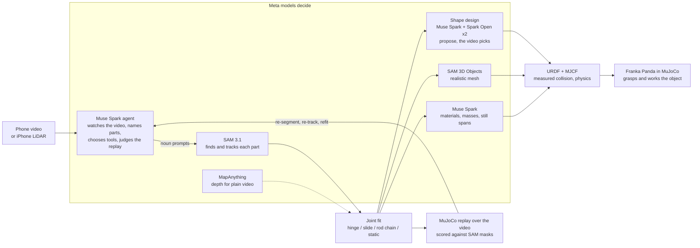

# Video2URDF

**One short video of a real articulated object in, a measured URDF/MJCF out, and a MuJoCo
replay over the video that shows the model moves like the real thing.**

Robotics developers who need a simulation model of a real object (a laptop lid, a desk lamp,
a drawer, a box flap) usually model it by hand: guess the hinge, guess the limits, tweak until
it looks right. Video2URDF measures it instead. Film the object being opened and closed; a
Muse Spark agent finds the parts with SAM 3.1, tracks them, fits each joint by least squares,
writes URDF and MJCF, replays the model in MuJoCo from the camera's own viewpoint and checks
the overlay, frame by frame, before it reports.

Built solo for the Meta Global AI Developer Hackathon (Oct 26 - Nov 4 2026). All code in this
repository was written during the hackathon; see [Built on](#built-on) for what it uses.

**Demo video (2:51):** [docs/demo.mp4](docs/demo.mp4) · https://sunghyunc.github.io/video2urdf/demo.mp4  
**Live viewer:** https://sunghyunc.github.io/video2urdf/ (the phone video, the MuJoCo replay over it,
the robot demo, and the measured model in 3D with its URDF/MJCF).

## At a glance



Every model called at runtime is a Meta model; `--open-weights` runs the same pipeline on Muse
Spark Open and SAM weights, `--glimmer` on Muse Glimmer 30B served by us.

| Measured | Result | vs |
|---|---|---|
| RBO benchmark: 13 real RGB-D videos with motion capture, agent from scratch | hinge axis 2.5 deg, angle 3.3 deg (median); laptops 0.9-2.2 deg | motion capture |
| Desk lamp seen obliquely, 2 hinges (synthetic, `fit_chain`) | axis 0.4 / 4.8 deg, angle 0.06 / 1.1 deg mean | ground truth |
| 13" MacBook Pro, iPhone LiDAR | lid 309 x 205 mm; the model covers 95% / 94% of the video's masks | spec 304 x 212 |
| Black mouse, phone circling it | 121 x 75 x 55 mm; SAM 3D mesh 0.5 mm (median) from the measured depth | spec 125 x 84 x 51 |
| Office drawer, iPhone LiDAR | pulls out 248 mm | hand fit 253 |
| LED desk lamp, iPhone LiDAR, 2 rods | Spark judged the pole fixed, arm 2..89 deg | video |
| Shape design, three Meta models per round | lamp 0.61 (best single) -> 0.66 mask F-score | measured meshes 0.66 |
| Robot tasks on the measured models | 6 of 6: lids closed and reopened, drawer out 213 mm and back, lamp arms swung, mouse carried and turned | joint values reached in physics |
| SAM tracking, 1385 frames, 4 parts | 520 s -> 285 s, masks IoU 0.97-0.995 | previous pipeline |
| Scale for plain video | card x0.75 (8 frames agree); object's usual size x1.01 | expected 1.0 |

## What it does

```
phone video (or iPhone LiDAR capture)
  -> Muse Spark watches the video, names the parts, prompts SAM 3.1   (agent, tool calls)
  -> SAM 3.1 finds each part on key frames and tracks it through the video
  -> joint fit: hinge or slide, axis, position, limits, from the parts' relative motion
  -> link geometry: each part's silhouette (2D) or depth (LiDAR), painted with the video
  -> URDF + MJCF
  -> MuJoCo replay rendered from the camera, scored against the video (coverage per frame);
     the fit tool names a wrong part choice (a base that holds the lid, a lid track that
     slid onto the closed lid's back)
  -> Muse Spark watches the replay, re-segments / re-tracks / refits
  -> physics: Spark judges materials and masses; joint friction measured where a part
     stands still with no hand on it, checked by letting the model go in MuJoCo
  -> report with the measured sizes and what is uncertain
```

The model is then used: a Franka Panda in MuJoCo grasps the measured object and works it (closes
and reopens a lid, pulls a drawer out by its handle and pushes it back, swings a lamp's arm,
carries a mouse; `scripts/robot_tasks.py`).

Two capture paths:

| | 2D (any phone) | 3D (iPhone LiDAR via Stray Scanner, or any RGB-D camera) |
|---|---|---|
| View | tripod, camera roughly facing the motion plane | any angle, handheld is fine |
| Scale | an ID-1 card (85.6 x 54 mm) in view; use a loyalty card, never a payment card | metric depth, no card |
| Joint fit | planar: least-squares hinge centre / slide direction from relative poses | 3D: plate planes per frame, hinge = where plate and base planes cross; slides by ICP |
| Geometry | voted silhouettes extruded to meshes | sizes from depth (lid outline, base thickness, ...) |

## Meta models, and what each does

| Model | Where | Role |
|---|---|---|
| **Muse Spark** (`muse-spark-1.3-contributor`, Meta Model API) | `video2urdf/agent.py`, `scripts/add_physics.py` | The agent: watches the whole video (mp4 input), looks at frames, chooses noun prompts for SAM, picks the parts' roles, calls track / fit / fit_lidar, watches the replay (the model drawn over the video) to judge the fit over time, refits, then judges each link's material and mass and finds when a part stood still with no hand on it (`set_physics`), and writes the report. After the fit it names the object and designs its clean visual from primitives, checking each design over the video (`video2urdf/designer.py`). Chat Completions with tool calls, images, video and structured output. |
| **SAM 3.1** (`sam-3.1`, Meta Model API) | `video2urdf/sam.py`, `scripts/track_video.py` | Concept prompts on key frames find each part; one box-anchored video request tracks all parts with stable IDs. |
| **Muse Spark Open** (open weights, Baseten) | `run_agent.py --open-weights` | The same agent on open weights (it takes video too). |
| **Muse Glimmer 30B** (open weights `meta-models/Muse-Glimmer-30B`, our own Modal Dedicated Endpoint, SGLang) | `run_agent.py --glimmer` | The same agent on a 30B dense open model we serve ourselves: tool calls and images (the endpoint drops video, so it works from frames). |
| **SAM 3.1 / SAM 3** (open weights `facebook/sam3.1`, `facebook/sam3`, on a Modal GPU) | `modal_apps/sam3_open.py`, `video2urdf/sam_open.py` | Open-weights segmentation (SAM 3.1 concept prompts) and box tracking (SAM 3's tracker), answering in the hosted API's wire format so the rest of the pipeline is unchanged. |
| **SAM 3D Objects** (open weights `facebook/sam-3d-objects`, on a Modal GPU) | `modal_apps/sam3d.py`, `scripts/sam3d_meshes.py` | A realistic, coloured mesh of each link from one frame and its SAM 3.1 mask, laid out in metres by our LiDAR depth (given as its pointmap), checked against the measured depth points; it becomes the link's visual, the measured shape stays its collision. |
| **MapAnything** (open weights `facebook/map-anything-apache`, on a Modal GPU) | `modal_apps/mapanything_open.py`, `video2urdf/pseudo_depth.py` | Metric depth, intrinsics and camera poses from a plain RGB video, written as a LiDAR-style capture so the 3D path runs without LiDAR (experimental, see below). |

Every model called at runtime is a Meta model. Switching between the Meta API and open
weights is one flag.

## Results

### Synthetic (MuJoCo-rendered videos with known joints)

| Case | Joint type | Axis / position error | Angle error |
|---|---|---|---|
| Lamp, 2 hinges, 2D | correct tree and types | hinge position 1.7 / 2.5 mm | 0.08 / 0.38 deg mean |
| Drawer, 2D | prismatic | direction 0.00 deg, position 3.2 mm | |
| Lamp seen obliquely, handheld wobble, 3D | | shoulder 0.5-0.85 deg / 4 mm, elbow 1.4-1.6 deg / 8 mm | 0.1 / 0.9 deg |
| Drawer sliding toward the camera, 3D | prismatic | direction 0.24 deg | travel 0.17 mm |

### Real objects, filmed for this project

- **13" MacBook Pro, iPhone LiDAR, no card**, agent from scratch: lid 309 x 205 mm (spec
  304 x 212), base 14 mm, lid 3.8 mm, opening about 0..110 deg, hinge drawn on the real hinge;
  the replayed model covers 95% (lid) and 94% (base) of SAM's masks over the 923 frames, while
  the phone moves. The Panda then closes it to within 1 deg of its measured limit.
- **Office pedestal drawer, iPhone LiDAR**, agent from scratch: it finds which of three
  look-alike drawers moves (the tool warns when a "fixed" part stands out like a drawer),
  measures how far the drawer's front stands out of the cabinet's front in every frame (camera
  drift cancels), and builds a cabinet carcass with a slot and the drawer as an open tray:
  pulls out 248 mm; the replay sits on the drawer shut and open.
- Laptop, 2D side view: one hinge, 0-77 deg, fit residual 1.7 mm. Spark saw its first fit was
  wrong (base tracked on 319/408 frames, 25 deg range), re-segmented on other frames and
  re-tracked: 408/408 frames.
- Monitor stand, 2D: base -> lower arm (0-30 deg) -> upper arm (-81-0 deg), residuals
  1.0 / 0.9 mm.

### Repeatability: the agent three times on the same laptop

Three fresh Muse Spark runs on the LiDAR laptop (`data/repeat/`, 13-19 turns each, all ended
with a model and physics): lid 316 x 216, 304 x 215, 304 x 214 mm (spec 304 x 212). In all
three SAM's screen track slid onto the lid's back as it shut (52-77% of the frames that show
both); re-tracking doesn't change that, so `fit_lidar` now measures those frames from the
closed-lid part instead. The same tracks refit with that: lid 316 x 217 / 305 x 209 /
303 x 212 mm, lid replay 75 / 95 / 92%, base 86 / 86 / 31% (run 3's base candidate was the
whole laptop; the tool flags it). The base candidate is what still varies between runs.
After tightening reference selection, a separate refit of the same run 2 and 3 tracks at
quarter-resolution replay improved base mask coverage from 15.6% to 86.0% and 31.1% to
95.0% respectively. This is not a new independent run; one refit produced a suspect 24 mm
lid thickness and remains flagged. Coverage is computed only on the usable tracked frames,
not against independent ground truth. See [validation details](docs/appearance_validation.md).

### Benchmark: RBO dataset (real RGB-D with motion capture)

The [RBO dataset](https://zenodo.org/records/1036660) (TU Berlin, CC BY 4.0) has Kinect RGB-D
videos of people operating articulated objects, with motion-captured rigid bodies. The agent
runs each sequence from scratch (same prompts and tools as on our own videos); the result is
scored against the plate's motion relative to the base from motion capture. The operators
often push the whole object around while opening it (up to 15 cm and 47 deg), so the base is
followed too.

| Sequence | Axis direction | Axis position | Angle error, median | Angle error, p90 | Frames measured |
|---|---|---|---|---|---|
| laptop01 | 2.0 deg | 24 mm | 1.9 deg | 31.7 deg | 186/186 |
| laptop02 | 2.1 deg | 31 mm | 3.3 deg | 8.1 deg | 203/205 |
| laptop04 | 2.2 deg | 12 mm | 2.0 deg | 4.0 deg | 176/192 |
| laptop05 | 0.9 deg | 19 mm | 2.5 deg | 5.4 deg | 184/185 |
| book03 | 2.5 deg | 18 mm | 1.3 deg | 3.3 deg | 188/329 |
| book05 | 2.8 deg | 63 mm | 1.4 deg | 54.0 deg | 215/256 |
| book13 | 6.7 deg | 92 mm | 16.0 deg | 45.9 deg | 124/282 |
| treasurebox03 | 11.5 deg | 37 mm | 0.9 deg | 7.3 deg | 88/224 |
| cardboardbox03 | 13.3 deg | 151 mm | 5.5 deg | 34.0 deg | 130/265 |
| cardboardbox06 | 2.5 deg | 47 mm | 40.8 deg | 132.9 deg | 187/222 |
| cardboardbox02 | 6.4 deg | 57 mm | 47.3 deg | 125.2 deg | 183/220 |
| treasurebox05 | 4.5 deg | 126 mm | 33.2 deg | 63.6 deg | 40/217 |
| treasurebox02 | 2.0 deg | 105 mm | 77.5 deg | 96.1 deg | 136/263 |
| **median of 13** | **2.5 deg** | **47 mm** | **3.3 deg** | **34.0 deg** | |

Laptops and two of the books are measured to a few degrees. Box lids are where it fails: in
these 640 x 480 videos SAM loses the lid (and often the box) on most frames, even after the
agent re-anchors it, so the closed/open state is guessed from the whole box. Angle errors are
taken modulo 360 deg. Per-sequence results: `scripts/rbo_bench.py` writes `data/rbo/results/summary.md`.

### Open weights only

`run_agent.py --open-weights` (Muse Spark Open on Baseten + SAM 3.1 / SAM 3 on Modal):

- SAM box tracking on the synthetic lamp: 120/120 frames, IoU against the hosted API 0.970 /
  0.952, arm against ground truth 0.942 (hosted 0.960).
- Muse Spark Open driving the LiDAR laptop (SAM via the API): lid 312 x 208 mm, base 13 mm,
  0..117 deg, hinge on the real hinge, 9 turns.
- **Everything on open weights** (Muse Spark Open + SAM on Modal), LiDAR laptop from scratch,
  18 turns: lid 305 x 209 mm (13" MacBook: 304 x 212), opening 3..122 deg following the
  video (closes, then reopens), lid replay covering 91% of its masks. The base was segmented in
  fragments (keyboard, trackpad), so its thickness could not be measured; the pipeline and
  Spark's report both flag it instead of passing on a wrong number.
- **Everything on open weights, served by us**: Muse Glimmer 30B on our own Modal endpoint +
  SAM on Modal (`--open-weights --glimmer`), LiDAR laptop from scratch, through to physics:
  lid 307 x 201 mm, opening 0..108 deg, lid replay 87%; it set masses (base 1.1 kg, lid
  0.45 kg) and the lid hinge's friction was measured at 0.164 N·m from the lid held open with
  no hand on it (released in MuJoCo: 0.1 deg). Its base candidate was the whole laptop, so the
  base replay is low (5%), which its report notes. A first try spent all its turns collecting
  candidates; the turn note now says to track once half the budget is gone.

### The model looks like the object: Spark designs it, the video checks it

The measured meshes have the right sizes but read as blobs: silhouettes voted over the video,
or depth points. After the fit, Muse Spark watches the video, names the object and each link's
real part, and rebuilds every link from a few primitives (boxes, rounded boxes, cylinders,
spheres, bars) in that link's frame, sized from the measured extents; sides the camera never
saw get proportions typical for that object, listed as assumptions. Every design is rendered
from the recorded camera at the recorded joint values over the video and scored against the
SAM masks (F-score counting pixels within 1% of the frame, fair to thin parts); Spark sees that
overlay, three views of its design over the measured meshes and the per-axis size differences,
and revises (up to 3 rounds). Each round three Meta models answer in parallel (Muse Spark on the
Meta API, Muse Spark Open on Baseten and on Fireworks) and the design that scores best over the
video carries on: on the LiDAR lamp the best single-model design scored 0.61, the three together 0.66. The best design becomes the visual if it scores within 0.10 of the
measured meshes and Spark judges the measurement consistent with the object; collisions,
joints and physics stay measured (MJCF group 3 / URDF `<collision>`).
`design/log.md` keeps every overlay Spark saw.

| Capture | Spark's identification | Primitives | Score: design / measured |
|---|---|---|---|
| iPhone LiDAR laptop | Apple MacBook laptop (silver): body, lid, display, keyboard, trackpad, hinge barrel, logo | 7 | 0.88 / 0.89 |
| iPhone LiDAR drawer | light beech office pedestal cabinet with three drawers: carcass, fronts, handles, lock | 13 | 0.50 / 0.49 |
| iPhone LiDAR desk lamp (new, 10/30) | LED desk/task lamp: base with control panel, pole, LED bar arm, pivots | 12 | 0.66 / 0.66 |
| iPhone LiDAR mouse (new, 10/30) | ergonomic wireless mouse, Logitech MX Master style (shown: SAM 3D's mesh, see below) | 8 | 0.89 / 0.94 |
| 2D lamp video (`stand_2`) | white foldable LED desk lamp: base with control panel, pole, LED housing and diffuser, pivots | 11 | 0.70 / 0.71 |

Round 2 on the lamp: Spark saw its first arms were too thick against the masks and thinned
them (0.66 -> 0.70). When the measurement itself is wrong (an RGB-only capture without a
reference whose fitted box is a 2.6 m slab lying flat) Spark says so, and the design is not
applied; it also flags a scale far from the object's usual size.

```bash
.venv/bin/python scripts/design_shape.py data/tracks/my_video my_video.mov   # run_agent.py does this by default
.venv/bin/python scripts/design_shape.py data/tracks/my_video --remove        # back to the measured visuals
```

### Rods on hinges in 3D, and objects the phone walked around

- **A desk lamp from iPhone LiDAR** (`video2urdf/chain3d.py`, agent tool `fit_chain`). At 256x192
  depth a rod is 2-3 pixels wide, ARKit marks it low confidence and every pixel sits on a depth
  edge, so the plate and point-tracking fits see nothing. Each frame, each rod's raw depth (the
  wall behind its edge dropped) gets a 3D line, held in the plane its image centre line spans; a
  hinge is the plane the rod's direction turns in, at the rod's near end, and a child rod is
  measured after undoing its parent's turn. Synthetic oblique lamp: axis 0.4 / 4.8 deg, angle
  0.06 / 1.1 deg mean. Real lamp (1385 frames, Spark chose `fit_chain` itself): pole 294 mm, arm
  370 mm, elbow 0..77 deg folded to open; the replay covers 75% of the pole's masks.
- **A black mouse the phone circled** (`fit_static`). Its few confident depth points made a
  59 x 27 x 25 mm box. When the phone went more than 60 deg around, the object is now carved
  from 48 views' masks (a visual hull) and capped at the depth-measured top: 121 x 75 x 55 mm
  (MX Master 3S: 125 x 84 x 51), covering 88% of its masks. Spark judged 0.14 kg (spec 141 g).
- **SAM 3D Objects on any fitted model**: placed by the replay's camera poses and joint values,
  and for static objects and rod chains judged like the shape design (over the video, within 0.10
  of the measured meshes) plus the depth check. The mouse's mesh: measured points 0.5 mm from it
  (median), mask F-score 0.89 vs 0.94; it is the mouse's visual in the viewer.

### The robot works the object: grasp, open, close, carry

`scripts/robot_tasks.py` puts the measured object in front of a Franka Panda (MuJoCo Menagerie)
and picks tasks from what was measured: a hinged plate is pinched at its free edge, closed and
opened again; a hinged rod (a lamp's arm) is pinched near its tip and swung to the far end of its
measured range and back; a drawer is pulled out by the handle Shape design drew (its collision is
switched on in this scene) and pushed back in; an object without joints is picked up, carried
aside, then brought back turned a quarter. The gripper's own actuator squeezes (~30 N, stiffer
than Menagerie's default, which holds ~1 N on an 18 mm handle; the real Panda Hand holds 70 N) and
the object moves only through finger contact; arm joints get gravity compensation. Each video
titles its tasks and shows the joint value the object actually reaches. Results: LiDAR laptop
closed 87 deg and reopened; drawer out 213 mm and back to 18 mm; LiDAR lamp's arm lowered 40 deg
and raised back; mouse carried 18 cm and returned turned 90 deg; side-view laptop closed and
reopened; side-view lamp's arm raised 33 deg and lowered back. A side-view rod is measured as a
6 mm silhouette, too thin to hold, so there the fingers hold the rod Shape design drew (14 x 9 mm),
and joints not being worked are held by friction. For the drawer, the fingers pass through the measured cabinet box, which is
coarse around the drawer slots.

```bash
.venv/bin/python scripts/robot_tasks.py data/tracks_agent2/mouse_lidar   # -> robot_tasks.mp4 in the run
```

### Faster tracking, and scale without a reference

- **SAM tracking ~1.8x faster.** The forward pass and the backward pass (a reversed clip) are
  independent requests: they now run at once, on two Modal GPU containers for the open weights
  (`track_pass`) or two Meta API requests. Videos above 40 fps are tracked on every second frame
  (`SAM_TRACK_STRIDE`, default auto) and the frames between take the nearest tracked mask.
  LiDAR lamp, 1385 frames, 4 parts, SAM 3.1/3 on Modal: 520 s -> 285 s; masks against the old run:
  IoU 0.995 / 0.993 (table, base), 0.98 / 0.97 (the two thin rods; p10 0.92 / 0.81).
- **Automatic scale for ordinary video** (`video2urdf/autoscale.py`, run by `video_to_model.py`
  when no `--scale`/`--reference` is given). MapAnything's scale can be several times off, and its
  depth stretches lengths along the line of sight. An ID-1 card found by SAM 3.1 is measured by
  its edge across the view (85.6 mm, or 54 mm); without one, Muse Spark names the object and its
  usual largest size and the object is measured on frames where it is wholly in view with its
  long axis across the view. The card wins when it lies about as far away as the object.
  Checks: on `notebook_2` the card gives x0.75, consistent over 8 frames (p90/p10 1.09); the
  laptop is cut off by the frame there, so no size-based scale is taken (it read x1.21 before
  that check). On the RGB copy of the LiDAR laptop, already at LiDAR scale, the object's usual
  size gives x1.01 (expected 1.0).

### The model looks like the object: painted with its own video

The measured shapes are boxes and outlines; `video2urdf/texture.py` paints them with the video.
Each flat face of each link takes the frame where it was seen largest and most head-on, not
hidden behind another part of the model (MuJoCo renders, from the phone's pose on that frame,
which face is in front) nor behind a hand (the point must be inside that link's SAM mask). The
face is rectified by a homography into one texture atlas; pixels outside the link's mask and
faces thinner than 1 cm take the link's colour. On the LiDAR laptop the screen shows its
wallpaper, the base its keyboard and trackpad, the shut lid the logo seen while it was
closed; the drawer's front its wood grain and handle. Shapes, and so collisions and inertia,
are unchanged. The viewer, the robot demo and the MJCF/URDF (textured OBJ visuals) use it.

### Physics: masses, inertia, and joint friction measured from the video

A model a robot can push needs mass and friction, not just a shape. Muse Spark watches the
video and judges each link's material and mass from what the object is (the tool returns the
density that mass implies over the measured solid, as a check); inertia follows from the link's
measured mesh. Joint friction is measured where the video allows it: when a part stands still
with **no hand on it** (Spark finds those spans in the video), the hinge alone is holding it
against gravity, so its friction is at least the gravity torque at those angles (MuJoCo
computes it; the model gets 1.25x the largest). The resting end (a closed lid lying on its
base) is left out. The check: release the model in MuJoCo at the held angles for 2 s.

| Model | Masses (Spark) | Joint friction | Released at the held angles, 2 s |
|---|---|---|---|
| 13" MacBook Pro, LiDAR | base 0.90 kg + lid 0.50 kg (spec: 1.4 kg in all) | lid hinge 0.284 N·m, measured | moves 0.1 deg (11.5 deg without it) |
| Laptop, 2D side view | 0.95 + 0.45 kg | 0.038 N·m, measured (held only near upright: a lower bound) | 0.0 deg (76 deg without) |
| Monitor stand, 2D | base 0.45, arms 0.075 / 0.09 kg | 0.028 / 0.122 N·m, measured | 0.0 / 3.4 deg (21 / 56 deg without) |
| Pedestal drawer, LiDAR | cabinet 13 kg, drawer 2.5 kg | 0.98 N, estimated (gravity doesn't load a horizontal slide) | |

`scripts/physics_demo.py` renders the check: the model let go at a held angle, with the
measured friction and without, side by side (viewer tab "Physics check"; laptop +0.1 vs
+11.5 deg in 3 s, stand +0.0 vs +20.3 deg).

URDF gets `<inertial>` and `<dynamics>`, MJCF explicit inertials, `frictionloss` (stiffened:
MuJoCo's default soft friction lets a loaded hinge creep 7 deg in 2 s) and contact friction.
The robot demo uses them. Damping is not measured (the hand drives every motion we see).

### URDF Doctor: checking an existing URDF against the video

Given a URDF written some other way (by hand, from CAD, by a vendor; any frame convention),
`scripts/urdf_doctor.py` registers its base to the measured base by geometry, finds which of
its joint values reproduces each opening seen in the video, and reports what disagrees. Test
on the LiDAR laptop with URDFs in `examples/doctor/` (bugs injected on purpose):

| URDF under test | Doctor's verdict |
|---|---|
| `laptop_spec.urdf`, from the published 13" MacBook Pro dimensions | consistent: axis 2.3 deg / 8 mm from the measured hinge, +q opens, limits cover the 1..117 deg seen |
| `laptop_buggy.urdf`: hinge moved 25 mm, axis tilted 6 deg, upper limit 90 deg | 3 problems: axis 7.6 deg off, hinge 18 mm off, limits stop at 90 but the video needs 127 |
| spec + `joint_log_flipped.csv` (encoder sign reversed) | log = -1.00 x expected: sign flip |
| spec + `joint_log_offset.csv` (12 deg zero offset) | log offset by 11.3 deg |

The axis's turn *within* the base's top plane is only as sure as the measured base outline
(a few degrees on this capture); tilts out of that plane, positions, signs, offsets and limits
are what it checks reliably.

## Run it

Requires macOS or Linux, [uv](https://docs.astral.sh/uv/), ffmpeg. No local GPU.

```bash
uv sync                                  # Python 3.12 environment in .venv
cp .env.example .env                     # then fill in the keys you have
.venv/bin/python scripts/smoke_test.py   # one cheap call per backend
```

### A 2D phone video

Film on a tripod, camera facing the plane the part moves in, an ID-1 sized card in view,
open and close the object slowly.

```bash
.venv/bin/python scripts/run_agent.py my_video.mov --out data/tracks
open data/tracks/my_video/replay.mp4               # the model over the video
cat  data/tracks/my_video/agent/report.md          # Spark's report
ls   data/tracks/my_video/{model.urdf,model.xml}
```

Without the agent: `scripts/track_video.py VIDEO "laptop lid" "laptop keyboard"`, then
`scripts/fit_model.py VIDEO --ref "laptop lid=0.212"` (a known length instead of a card).

### An iPhone LiDAR capture

Record with [Stray Scanner](https://apps.apple.com/app/stray-scanner/id1557051662), export
the folder, then:

```bash
.venv/bin/python scripts/run_agent.py data/real/laptop_lidar --out data/tracks_agent
open data/tracks_agent/laptop_lidar/replay3d.mp4   # the model rendered from the phone's pose
```

The agent ends with `set_physics` (masses, friction). For a run made without it:
`.venv/bin/python scripts/add_physics.py data/tracks_agent/laptop_lidar` (Spark watches the
video once, structured output; `--reuse` re-applies the saved estimate).

### Any phone video, no LiDAR (MapAnything, experimental)

[MapAnything](https://github.com/facebookresearch/map-anything) (Meta, Apache-2.0 weights
`facebook/map-anything-apache`) predicts metric depth, intrinsics and camera poses from RGB
alone. `scripts/video_to_capture.py` runs it on Modal over chunks of the video that share
anchor frames, stitches the chunks with a similarity fitted on the anchors' points, and writes
the result in the Stray Scanner layout, so the LiDAR path runs on it unchanged:

```bash
.venv/bin/modal deploy modal_apps/mapanything_open.py            # once; A10G, scales to zero
.venv/bin/python scripts/video_to_capture.py my_video.mov --focal-35mm 26   # iPhone 1x is ~26 mm
.venv/bin/python scripts/run_agent.py data/real/my_video_mapanything --sam open
# sizes off? rescale the capture by one known length (no new inference), then fit again:
.venv/bin/python scripts/video_to_capture.py my_video.mov --scale KNOWN_M/MEASURED_M
```

Checked against the LiDAR laptop by running its RGB alone (`scripts/eval_pseudo_depth.py`,
`scripts/compare_hinges.py`, same SAM tracks): MapAnything's metric scale was 3.6x too large on
this close top-down shot, but steady over the video (p10-p90 within +-4%), so one known length
can correct the overall scale. It does not eliminate local depth or camera errors. After that,
depth is within 5% of the LiDAR (median), camera rotation within 2 deg of
ARKit (median), and the hinge axis direction within 2.0-2.3 deg of the LiDAR fit; the opening
angle is off by 8-12 deg (median) and the base thickness is not measurable. It can provide an
approximate hinge estimate when the reconstruction is good; use measured depth for more reliable
dimensions. Film obliquely, as for LiDAR: on a
side view (`notebook_2.MOV`, no LiDAR) the agent put the hinge on the real hinge, but the lid is
seen edge-on, its plane fits were poor (replay covers 13% of the lid) and Spark said so and
asked for a reshoot; side views go through the 2D path instead.

These are aggregate results for earlier fits, not a guarantee for each region. A later
same-video experiment found opposite local depth errors on the floor and laptop base, with
a resulting 78 mm base thickness and badly undersized lid despite global scale adjustment.
See [validation details](docs/appearance_validation.md) before relying on RGB-only dimensions.

### Robot demo and viewer

After a fit (the agent's run does physics itself):

```bash
.venv/bin/python scripts/texture_model.py data/tracks_agent/laptop_lidar data/real/laptop_lidar/laptop_lidar.mp4
.venv/bin/python scripts/physics_demo.py data/tracks_agent/laptop_lidar
```

```bash
scripts/fetch_assets.sh                            # Franka Panda from MuJoCo Menagerie
.venv/bin/python scripts/robot_demo.py data/tracks_agent/laptop_lidar --out demo.mp4
.venv/bin/mjpython -m mujoco.viewer --mjcf=data/tracks_agent/laptop_lidar/model.xml   # interactive

.venv/bin/python scripts/export_viewer.py \
    laptop_lidar:data/tracks_agent/laptop_lidar:data/real/laptop_lidar/laptop_lidar.mp4
.venv/bin/python -m http.server 8931 --directory docs   # http://localhost:8931
```

The viewer (`docs/index.html`, three.js, no build) plays the phone video, the replay and the
robot demo next to the measured model in 3D, driven by the video's time, with joint sliders
and URDF/MJCF downloads.

### Open weights only (for the Open Weight prize check)

```bash
# 1. Muse Spark Open on Baseten: put BASETEN_API_KEY in .env.
# 2. SAM on your own Modal GPU: accept the SAM License on huggingface.co/facebook/sam3.1
#    and huggingface.co/facebook/sam3, then
.venv/bin/modal setup
.venv/bin/modal secret create huggingface HF_TOKEN=hf_...
.venv/bin/modal deploy modal_apps/sam3_open.py
.venv/bin/python scripts/check_sam_open.py --e2e          # synthetic lamp vs the hosted tracks
# 3. Run everything on open weights:
.venv/bin/python scripts/run_agent.py data/real/laptop_lidar --open-weights --out data/tracks_open
```

`--sam api` keeps the hosted segmenter while reasoning runs on open weights. The Modal app
scales to zero after 2 idle minutes (A10G, about $0.05-0.10 per video).

Muse Glimmer 30B on your own GPU instead of Baseten (a Modal Dedicated Endpoint bills while
it is up; stop it when done):

```bash
.venv/bin/modal workspace proxy-tokens create --name video2urdf --json
#   -> MODAL_PROXY_TOKEN_ID (Modal-Key) and MODAL_PROXY_TOKEN_SECRET (Modal-Secret) in .env
.venv/bin/modal endpoint create --name glimmer --model meta-models/Muse-Glimmer-30B
.venv/bin/modal endpoint info glimmer            # wait for State: live; put its URL in .env as GLIMMER_URL
.venv/bin/python scripts/run_agent.py data/real/laptop_lidar --open-weights --glimmer --out data/tracks_glimmer
.venv/bin/modal endpoint stop glimmer --yes
```

Locally, Glimmer runs under vLLM, SGLang, llama.cpp (`meta-models/Muse-Glimmer-30B-GGUF`) or
LM Studio with 24 GB+ of VRAM; point `AGENT_BASE_URL`/`AGENT_MODEL` at it.

### Realistic link meshes (SAM 3D Objects)

Object-aware appearance completion: Spark identifies the object and likely materials from
the video. By default it uses a simple visual; with `--video-texture`, observed faces can
use projected video colours and unseen faces get a synthetic material. Laptop base
and lid get straight-edged inferred panels on the fitted outline; the drawer builder completes a
cabinet and open tray with assumed hidden dimensions. The drawer template also adds
plausible visual-only fronts for other closed drawers and handles when visible; their
exact positions are guessed. If the visible drawer count is uncertain, the visual assumes
three drawers and flags that assumption in the quality report. For a book, the visible inner cover
and hinge define a hypothesized rectangular outer cover. These templates can be wrong and
leave the fitted collisions unchanged. For an apparently stationary rigid box or upright
cylinder, the RGB-D agent can generate a simple single-link shape from visible depth. Its
hidden sides and any circular cross-section are assumptions; `quality.json` flags them.
The stationarity check can mistake viewpoint or mask changes for motion, and cylinder
fitting has only been tested on synthetic depth. Other object types retain the fitted shape;
arbitrary objects and RGB-only metric dimensions are not validated. A single
command can fit an RGB-D capture and complete its appearance:

```bash
.venv/bin/python scripts/video_to_model.py data/real/laptop_lidar --out data/new_run --viewer-out data/new_viewer
```

For an articulated object filmed approximately from the side, an explicit planar path
is also available: `.venv/bin/python scripts/video_to_model.py data/real/stand.mov --planar --out data/stand_run --viewer-out data/stand_viewer`.
It classifies the object and uses a side-view silhouette model; hidden depth, thickness,
and possibly metric scale are assumed. Classification and the resulting shape must be
reviewed. This path does not use RGB depth reconstruction, SAM 3D, or video texturing.

This default creates a recognizable simplified visual and retains the fitted geometry and
articulation. Add `--video-texture` to project video colours; that optional step takes
additional time. SAM 3D is also optional.

For a plain video, deploy `modal_apps/mapanything_open.py` first and pass the video path to
the same command. MapAnything predicts depth and an uncertain scale, not LiDAR: calibrate
with a known length (`--scale KNOWN_LENGTH/MEASURED_LENGTH`, evaluated as a number) and
independently check dimensions. Depth and camera errors remain after scale calibration.
For a new video capture, `--reference FRAME X1 Y1 X2 Y2 LENGTH_MM` instead calculates that
scale from the estimated depth at two RGB-frame pixels whose real distance is known. Pick
both points on visible surfaces, away from depth edges. This is one global scale correction,
not a cure for depth or focal-length errors; the points and correction are recorded in
`mapanything.json` and `measurement_source.json`. Add repeatable
`--check-reference FRAME X1 Y1 X2 Y2 LENGTH_MM` arguments for independently measured
lengths: these are not used to fit scale, and their residual errors are recorded. Errors
over 5% are flagged for review; passing checks at a few points does not validate all depths.
To correct an already reconstructed MapAnything capture without rerunning depth inference
or modifying the original, make a new calibrated copy (replace the example pixels and
lengths with your own measurements):

```bash
.venv/bin/python scripts/calibrate_capture.py data/item_mapanything data/item_calibrated \
  --reference 8 245 115 245 225 148.1 --check-reference 8 240 140 285 140 52.9
.venv/bin/python scripts/video_to_model.py data/item.mp4 --capture-out data/item_calibrated \
  --out data/item_run --viewer-out data/item_viewer
```

The new path must not exist. The points and lengths must describe visible rigid surfaces;
the check uses a different pair and is not a substitute for measuring the finished model.
The optional viewer export writes a self-contained ZIP with URDF, MJCF, meshes and textures;
serve it locally as printed by the command. Use new output directories so earlier results
are not overwritten.

For an accepted SAM 3D visual, an experimental manual texture transfer can be run on a
new copy. Select a textured fitted mesh and a replay frame where that particular surface
is visible; repeat `--view` for distinct sides. For the local laptop experiment:

```bash
.venv/bin/python scripts/transfer_sam3d_texture.py data/appearance_trials/sam3d_alternate_open data/real/laptop_lidar/laptop_lidar.mp4 --out data/appearance_trials/my_texture_trial --link lid --view meshes/screen_tex.obj 150 --view meshes/lid_infer_tex.obj 343
```

For a new run, `scripts/video_to_model.py ... --sam3d --sam3d-video-texture` requests
the same experimental automatic transfer when a SAM 3D link passes geometric checks.
Add `--sam3d-retries 2` to try up to two more temporally separated frames after a
rejection; this uses additional remote inference and records attempts in `sam3d_attempts.json`.
Alternatively use `--auto-views` instead of `--view` to select only faces and frames
recorded as video-observed by the texture stage. Both modes are experimental; inspect
the generated texture on all sides. The 25 mm default projection tolerance is for
appearance only, and the generated shape, occlusions, texture edges and hidden surfaces
need review; it is not a measurement. The result remains marked for review.

For an existing successful 3D fit, run appearance completion separately:

```bash
.venv/bin/python scripts/infer_appearance.py data/tracks_agent/laptop_lidar data/real/laptop_lidar/laptop_lidar.mp4
```

`appearance.json` records the model's classification and material guesses; `texture.json`
identifies synthetic faces and `shape_inference.json` records the shape hypothesis.
Measured collision geometry and joint physics do not change. These synthetic surfaces and
shapes are guesses, not observations of hidden features. `--reuse` reuses the saved
classification. The classification call uses the configured Spark API and sends the video
(Glimmer uses sample frames). These templates do not reconstruct arbitrary object classes.
Use `--simple` on this standalone command to match `video_to_model.py`'s simple-colour
default. It can also resume appearance after an interrupted fit, but doing so is a resumed
run rather than evidence that the complete automatic pipeline succeeded.
To resume on a separate copy while explicitly reusing a prior classification:

```bash
.venv/bin/python scripts/resume_appearance.py FIT_DIR VIDEO.mp4 NEW_DIR \
  --appearance-from PRIOR_APPEARANCE.json --capture ORIGINAL_CAPTURE_DIR
```

`--capture` is needed when the interrupted fit has no `measurement_source.json`.
Omit `--appearance-from` to make a new classification call. The result records its
resumed provenance and the source directory is left unchanged.
New visual geometry is compared with the fitted model on sampled tracked frames; if coverage
or, for a full-part mask, IoU falls by more than five percentage points or there are fewer than five usable frames, the
new geometry is not activated. See `shape_inference.json` for the comparison and decision.

For SAM 3D meshes add `--sam3d` to `video_to_model.py`. Each mesh is checked against observed
depth points; a part whose median distance exceeds 5 mm or p90 exceeds 15 mm is saved for
inspection but not activated. Passing this check does not validate unobserved surfaces.
We also require each generated extent to be within 0.8–1.2 times the fitted extent; fitted
dimensions can themselves include assumptions, especially for hidden drawer depth.
The default passes captured or MapAnything depth to SAM 3D. Do not use the experimental
`--no-pointmap` option in a Meta-model-only submission: SAM 3D then invokes MoGe, a non-Meta
depth model.
See [appearance validation](docs/appearance_validation.md) for the tested captures and
examples of generated meshes that failed the checks.

```bash
# Request access on huggingface.co/facebook/sam-3d-objects (gated), then
.venv/bin/modal deploy modal_apps/sam3d.py
.venv/bin/modal run modal_apps/sam3d.py::download     # 12 GB of checkpoints into a Modal volume
.venv/bin/python scripts/sam3d_meshes.py data/tracks_agent/laptop_lidar \
    --video data/real/laptop_lidar/laptop_lidar.mp4 --capture data/real/laptop_lidar
```

Writes candidate meshes and `sam3d.json` (depth and size checks). Accepted candidates become
`meshes/<link>_sam3d.{obj,ply}` and visuals in `model.xml` / `model.urdf`; rejected candidates
leave the prior visual in place. In
MJCF the measured shapes move to geom group 3 (hidden in the viewer, still colliding). L40S,
scales to zero after 2 idle minutes.

### URDF Doctor

```bash
.venv/bin/python scripts/urdf_doctor.py examples/doctor/laptop_buggy.urdf data/tracks_agent/laptop_lidar
.venv/bin/python scripts/urdf_doctor.py examples/doctor/laptop_spec.urdf data/tracks_agent/laptop_lidar \
    --joint-log examples/doctor/joint_log_flipped.csv
```

### The RBO benchmark

```bash
.venv/bin/python scripts/rbo_download.py laptop01 laptop02 ...   # into data/rbo/ (not committed)
.venv/bin/python scripts/rbo_bench.py                            # agent + scoring, all downloaded sequences
cat data/rbo/results/summary.md
```

## Limitations

- v1 handles 1-3 joints. The 3D path (`fit_lidar`) handles one hinged plate or one slide.
- Thin parts make replay IoU harsh; book covers and box lids track poorly (see the benchmark).
- A 2D side view cannot measure the width across the motion plane; it is assumed or set.
- Floor levelling removes ARKit drift in height and tilt, not along the floor.

## Built on

Models: Muse Spark, Muse Spark Open, Muse Glimmer, SAM 3.1, SAM 3, SAM 3D Objects,
DINOv2 (used inside SAM 3D Objects), MapAnything (Meta).

| Project | License | Used for |
|---|---|---|
| [MuJoCo](https://github.com/google-deepmind/mujoco) | Apache-2.0 | simulation, rendering the replay |
| [MuJoCo Menagerie](https://github.com/google-deepmind/mujoco_menagerie) (Franka Panda) | Apache-2.0 | robot demo, fetched by `scripts/fetch_assets.sh`, not committed |
| [facebookresearch/sam3](https://github.com/facebookresearch/sam3) | SAM License | open-weights SAM on Modal |
| [facebookresearch/sam-3d-objects](https://github.com/facebookresearch/sam-3d-objects) (SAM 3D Objects) | SAM License | realistic link meshes on Modal; installed into the Modal image, not vendored |
| [facebookresearch/dinov2](https://github.com/facebookresearch/dinov2) | Apache-2.0 | visual encoder used by SAM 3D Objects |
| [MapAnything](https://github.com/facebookresearch/map-anything) (Meta), weights `facebook/map-anything-apache` | Apache-2.0 | depth, intrinsics and camera poses for videos without LiDAR, on Modal |
| [meta-sam-parser](https://pypi.org/project/meta-sam-parser/) | SAM License | parsing SAM API output; `video2urdf/fast_mask.py` is a numba port of its decoder (`LICENSES/SAM_LICENSE`) |
| [RBO dataset](https://zenodo.org/records/1036660) - R. Martín-Martín, C. Eppner, O. Brock, "The RBO Dataset of Articulated Objects and Interactions", IJRR 2019 | CC BY 4.0 | benchmark; downloaded, not redistributed |
| [three.js](https://threejs.org) | MIT | web viewer (CDN) |
| [marked](https://github.com/markedjs/marked) | MIT | the viewer's turn-by-turn logs (CDN) |
| [Remotion](https://www.remotion.dev) | Remotion License (free for individuals) | the promo video in `promo/` |
| [SGLang](https://github.com/sgl-project/sglang) | Apache-2.0 | serving Muse Glimmer on our Modal endpoint (via `modal endpoint create`) |
| [mapbox-earcut](https://github.com/skogler/mapbox_earcut_python) | ISC | triangulating mesh caps |
| OpenCV, NumPy, SciPy, numba, OpenAI Python SDK (as the OpenAI-compatible client), Modal | various OSS | |
| [Stray Scanner](https://github.com/strayrobots/scanner) | app | recording iPhone LiDAR captures |

What we built on top: the agent and its tools, the SAM tracking strategy (key-frame concept
prompts, then multi-anchor box tracking forward and over a reversed clip, both passes at once,
strided on fast video), the 2D and 3D joint fits (plates, slides, drawers, rods on hinges from raw
depth, visual hulls for static objects), link geometry, URDF/MJCF emission, the camera-pose MuJoCo
replay and its scoring, Spark's shape design loop judged over the video with three Meta models per
round, SAM 3D placement and checks, automatic scale for plain video, physics from still spans, the
robot tasks (grasp planning on the measured geometry), URDF Doctor, the viewer with its
turn-by-turn logs, and the RBO benchmark harness.
