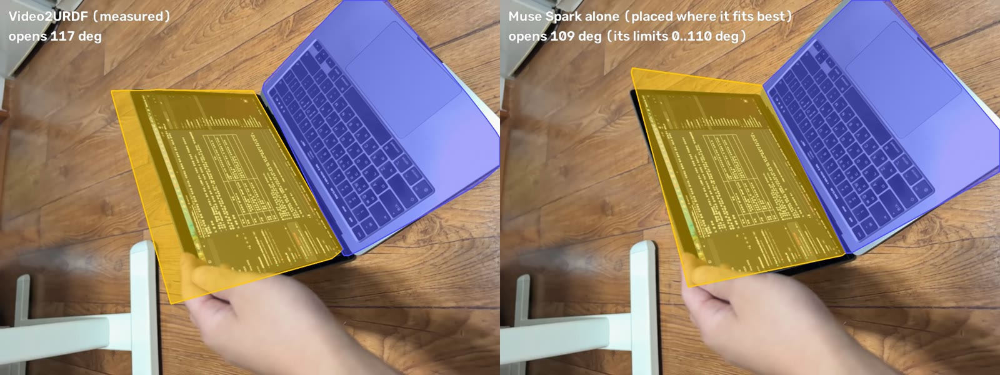

# Results

What Video2URDF measured, how each number was scored, and where it fails. The README's
[at a glance](../README.md#at-a-glance) table is the summary. The numbers shown in the
[viewer](https://sunghyunc.github.io/video2urdf/) match the published models
(`docs/models/*/model.json`); other numbers are as of the commits that added them.
How to run each step: [COMMANDS.md](COMMANDS.md).

- [Real objects, filmed for this project](#real-objects-filmed-for-this-project)
- [Benchmark: RBO dataset (real RGB-D with motion capture)](#benchmark-rbo-dataset-real-rgb-d-with-motion-capture)
- [Synthetic videos with known joints](#synthetic-mujoco-rendered-videos-with-known-joints)
- [Repeat runs, and objects it had never seen](#repeat-runs-and-objects-it-had-never-seen)
- [Open weights only](#open-weights-only)
- [Why not just ask an AI for the URDF?](#why-not-just-ask-an-ai-for-the-urdf)
- [URDF Doctor: checking an existing URDF against the video](#urdf-doctor-checking-an-existing-urdf-against-the-video)
- [Physics: masses, inertia, and joint friction](#physics-masses-inertia-and-joint-friction-measured-from-the-video)
- [The model looks like the object: Spark's shape design](#the-model-looks-like-the-object-spark-designs-it-the-video-checks-it), [video texture](#the-model-looks-like-the-object-painted-with-its-own-video), [SAM 3D Objects meshes](#realistic-meshes-sam-3d-objects)
- [The parts the camera never saw](#the-parts-the-camera-never-saw)
- [The robot works the object](#the-robot-works-the-object-grasp-open-close-carry), and [a policy learned on the measured drawer](#a-policy-learned-on-the-measured-drawer)
- [Faster tracking, and scale without a reference](#faster-tracking-and-scale-without-a-reference)
- [Plain video without LiDAR (MapAnything)](#plain-video-without-lidar-mapanything)
- [One command on seven inputs](#one-command-on-seven-inputs)
- [The downloads, loaded outside our scripts](#the-downloads-loaded-outside-our-scripts)

## Real objects, filmed for this project

- **13" MacBook Pro, iPhone LiDAR, no card**, agent from scratch: lid 309 x 205 mm (spec
  304 x 212), base 14 mm, lid 3.8 mm, opening 0..117 deg, hinge drawn on the real hinge;
  the replayed model covers 95% (lid) and 94% (base) of SAM's masks over the 923 frames, while
  the phone moves. The Panda then closes it to within 1 deg of its measured limit. (These are the
  agent's tracks refit with the later fit_lidar; the agent's own fit that day read 304 x 215 mm.)
- **Office pedestal drawer, iPhone LiDAR**, agent from scratch: it finds which of three
  look-alike drawers moves (the tool warns when a "fixed" part stands out like a drawer),
  measures how far the drawer's front stands out of the cabinet's front in every frame (camera
  drift cancels), and builds a cabinet carcass with a slot and the drawer as an open tray:
  pulls out 248 mm; the replay sits on the drawer shut and open.
- Laptop, 2D side view: one hinge, 0-77 deg, fit residual 1.7 mm. Spark saw its first fit was
  wrong (base tracked on 319/408 frames, 25 deg range), re-segmented on other frames and
  re-tracked: 408/408 frames.
- Monitor stand, 2D: base -> lower arm (0-30 deg) -> upper arm (-81-0 deg), residuals
  1.0 / 0.9 mm.

### Rods on hinges in 3D, and objects the phone walked around

- **A desk lamp from iPhone LiDAR** (`video2urdf/chain3d.py`, agent tool `fit_chain`). At 256x192
  depth a rod is 2-3 pixels wide, ARKit marks it low confidence and every pixel sits on a depth
  edge, so the plate and point-tracking fits see nothing. Each frame, each rod's raw depth (the
  wall behind its edge dropped) gets a 3D line, held in the plane its image centre line spans; a
  hinge is the plane the rod's direction turns in, at the rod's near end, and a child rod is
  measured after undoing its parent's turn. Synthetic oblique lamp: axis 0.4 / 4.8 deg, angle
  0.06 / 1.1 deg mean. Real lamp (1385 frames, Spark chose `fit_chain` itself): Spark fit both
  rods as hinges (pole 294 mm, arm 370 mm, elbow -8..77 deg) and reported the pole's motion as depth
  noise, to be treated as fixed. We refit the same tracks with the pole fixed (`fixed=rod1`, our
  step, not the agent's): pole 351 mm, arm 380 mm, 2..89 deg; the replay covers 63% / 76% / 31% of
  the base's, pole's and arm's masks.
- **A black mouse the phone circled** (`fit_static`). Its few confident depth points made a
  59 x 27 x 25 mm box. When the phone went more than 60 deg around, the object is now carved
  from 48 views' masks (a visual hull) and capped at the depth-measured top: 121 x 75 x 55 mm
  (MX Master 3S: 125 x 84 x 51), covering 88% of its masks. Spark judged 0.14 kg (spec 141 g).
- **SAM 3D Objects on any fitted model**: placed by the replay's camera poses and joint values,
  and for static objects and rod chains judged like the shape design (over the video, within 0.10
  of the measured meshes) plus the depth check. The mouse's mesh: the depth points seen on its
  frame lie 0.5 mm from it (median; one direction only: the mesh's unseen side is generated, and
  its points lie 32 mm from those depth points, median), mask F-score 0.89 vs 0.94; it is the
  mouse's visual in the viewer.

## Benchmark: RBO dataset (real RGB-D with motion capture)

The [RBO dataset](https://zenodo.org/records/1036660) (TU Berlin, CC BY 4.0) has Kinect RGB-D
videos of people operating articulated objects, with motion-captured rigid bodies. The agent
runs each sequence from scratch (same prompts and tools as on our own videos); the result is
scored against the plate's motion relative to the base from motion capture. The operators
often push the whole object around while opening it (up to 15 cm and 47 deg), so the base is
followed too.

The scorer runs the agent's own fit (`lidar.fit_lidar_hinge`, the steps `fit_lidar` takes), so
it scores exactly what the agent produced. Re-scored 10/31 with the current code on the agent's
tracks from 10/28:

| Sequence | Axis direction | Axis position | Angle error, median | Angle error, p90 | Frames measured |
|---|---|---|---|---|---|
| laptop01 | 1.8 deg | 25 mm | 1.9 deg | 38.7 deg | 146/186 |
| laptop02 | 2.1 deg | 32 mm | 3.5 deg | 8.3 deg | 201/205 |
| laptop04 | 0.9 deg | 15 mm | 2.3 deg | 5.4 deg | 162/192 |
| laptop05 | 0.9 deg | 20 mm | 3.1 deg | 5.6 deg | 158/185 |
| book03 | 1.5 deg | 17 mm | 3.7 deg | 4.4 deg | 187/329 |
| book05 | 2.2 deg | 52 mm | 9.6 deg | 13.6 deg | 172/256 |
| cardboardbox02 | 1.9 deg | 46 mm | 67.8 deg | 133.4 deg | 202/220 |
| treasurebox02 | 2.1 deg | 131 mm | 16.4 deg | 27.5 deg | 200/263 |
| book13, cardboardbox03, cardboardbox06, treasurebox03, treasurebox05 | refused: no reference frame where base, cover/lid and open indicator are all measured | | | | |
| **median of the 8 fitted** | **1.9 deg** | **29 mm** | **3.6 deg** | **10.9 deg** | |

Laptops and books are measured to a few degrees. Box lids are where it fails: in these 640 x 480
videos SAM loses the lid (and often the box) on most frames, so the fit either refuses or guesses
the open/closed state from the whole box. Angle errors are taken modulo 360 deg. The table we
published on 10/29 (all 13 fitted, median 2.5 deg / 47 mm / 3.3 deg) came from earlier code:
two later checks (no closed-surface fallback on open frames where the base shows; no reference
frame where the base is mostly hidden) refuse five of these tracks now, and on book05 dropped 44
frames the old fit had mis-measured by ~54 deg that had happened to steady its hinge (1.4 deg
then, 9.6 deg now). Neither check changes the LiDAR laptop runs. Per-sequence results:
`scripts/rbo_bench.py` writes `data/rbo/results/summary.md`.

The same benchmark on open weights only: [below](#open-weights-only).

## Synthetic (MuJoCo-rendered videos with known joints)

| Case | Joint type | Axis / position error | Angle error |
|---|---|---|---|
| Lamp, 2 hinges, 2D | correct tree and types | hinge position 1.7 / 2.5 mm | 0.08 / 0.38 deg mean |
| Drawer, 2D | prismatic | direction 0.00 deg, position 3.2 mm | |
| Lamp seen obliquely, handheld wobble, 3D | | shoulder 0.5-0.85 deg / 4 mm, elbow 1.4-1.6 deg / 8 mm | 0.1 / 0.9 deg |
| Drawer sliding toward the camera, 3D | prismatic | direction 0.24 deg | travel 0.17 mm |

## Repeat runs, and objects it had never seen

### Repeatability: the agent three times on the same laptop

Three fresh Muse Spark runs on the LiDAR laptop (`data/repeat/`, 13-19 turns each, all ended
with a model and physics): lid 316 x 216, 304 x 215, 304 x 214 mm (spec 304 x 212). In all
three SAM's screen track slid onto the lid's back as it shut (52-77% of the frames that show
both); re-tracking doesn't change that, so `fit_lidar` now measures those frames from the
closed-lid part instead. The same tracks refit with that: lid 316 x 217 / 305 x 209 /
303 x 212 mm, lid replay 75 / 95 / 92%, base 86 / 86 / 31% (run 3's base candidate was the
whole laptop; the tool flags it). The base candidate is what still varies between runs.
After tightening reference selection, a separate refit of the same run 2 and 3 tracks at
quarter-resolution replay improved base mask coverage from 15.6% to 86.0% and 31.1% to
95.0% respectively. This is not a new independent run; one refit produced a suspect 24 mm
lid thickness and remains flagged. Coverage is computed only on the usable tracked frames,
not against independent ground truth. See [validation details](appearance_validation.md).

### Five fresh runs per object, and three objects it had never seen

Every LiDAR capture again, from scratch, five times each (10/31: Muse Spark on the Meta API, SAM
weights on Modal, code fixed at one commit; `data/repeat5`, not committed):

| Object | Status (5 runs) | Measured, across the runs | Reference |
|---|---|---|---|
| 13" MacBook Pro | needs_review x5 | lid 304-306 x 208-212 mm; replay lid 86-93%, base 83-96% | spec 304 x 212 |
| Office drawer | needs_review x5 | travel 242, 243, 243, 244 mm; one run 20 mm (wrong front, replay 15%) | hand fit 253 |
| Black mouse | checks_passed x5 | 121-122 x 75 x 55 mm; replay 88% | spec 125 x 84 x 51 |
| LED desk lamp | checks_passed x5 | Spark fixed the pole itself every time; arm 377-381 mm, 76-91 deg; pole 241-366 mm | arm 380, pole 351 (our refit) |

Every laptop run was refused once at `finish` for the same reason (the screen track slides onto
the lid's back as it shuts, an expected case the check flagged then; it is now informational, and
the same tracks refit pass in 3 of 5, the other 2 keeping other warnings). The drawer run that measured
the wrong front ended `needs_review`, not passed. The lamp passes with the arm's replay covering
only 19-34% of its thin mask, and the pole's length varies: the rod-chain fit had no coverage
warning then, a gap in the checks (it now warns under 25%, see below).

Then three captures filmed after the code was fixed, never used in development, run once each
with that same code: a microwave, a step trash bin and an AirPods case. **None gave a usable
model, and all three ended `needs_review` rather than passing:**

- Microwave: its door swings about a *vertical* hinge, and `fit_lidar` assumes the hinge lies in
  the base's top plane (true for lids, not for doors), so it drew the hinge along the top; the
  glossy black body also came back from SAM in fragments (replay 6% / 26%). Spark's report: timing
  right, geometry unreliable, don't use it for grasping.
- Trash bin: the base candidate was the whole bin, lid included; the hinge came out on the side
  wall. Lid 123 x 156 mm, replay 82% for the lid, 27% for the base. Spark asked for a reshoot.
- AirPods case: it never opened in the video, so it is a rigid object; the static fit found too
  few depth points on the small white case, and Spark then forced a hinge fit on it (flagged,
  replay 14-18%).

After those runs we fixed what they exposed, then ran the same three captures again (10/31).
The code changed after seeing them, so these are development results, not blind tests:

- `fit_lidar` now tells a door from a lid (its axis lies along the base's normal) and places the
  hinge on the shut door's plane, where the open frames' door points stay equidistant (the
  door's planes alone put it ~10 cm off: the open black glass door returns depth on only 0-10%
  of its mask). Three fresh agent runs all built a door model: hinge 1.3-6.0 deg off vertical
  and within 1-2.5 cm of the real hinge edge in the image, door 361-390 x 255-267 mm, replay
  82-87% of the door; one `checks_passed`, two `needs_review`. The opening reads 52-57 deg. By eye
  the door looks wider open, because the phone sat about 35 cm from its free edge with a wide
  lens. We checked the angle by drawing the model door over the video at every opening from 0 to
  120 deg: it fits the door's mask best at 51 deg on the held-open frames, and a door at 90 deg
  would leave the frame. The body is modelled only as the control-panel column (completed
  afterwards: [The parts the camera never saw](#the-parts-the-camera-never-saw)).
- The static fit picks a reference frame where depth sees the object: the AirPods case now
  passes, 66.8 x 52.5 x 37 mm, replay 91%.
- The prompt names the body wall or rim as a lidded bin's base: on one rerun the trash bin's
  hinge lay along the top rear edge (replay 60% / 72%, open lid misaligned, `needs_review`), but
  two further fresh runs gave no usable model: SAM never returned a body mask without the lid.
- The rod-chain fit now warns when a rod's replay covers under 25% of its mask.

## Open weights only

`run_agent.py --open-weights` (Muse Spark Open on Baseten + SAM 3.1 / SAM 3 on Modal). The
commands are in the README:
[Open weights only (for the Open Weight prize check)](../README.md#open-weights-only-for-the-open-weight-prize-check).

- SAM box tracking on the synthetic lamp: 120/120 frames, IoU against the hosted API 0.970 /
  0.952, arm against ground truth 0.942 (hosted 0.960).
- Muse Spark Open driving the LiDAR laptop (SAM via the API): lid 312 x 208 mm, base 13 mm,
  0..117 deg, hinge on the real hinge, 9 turns.
- **Everything on open weights** (Muse Spark Open + SAM on Modal), LiDAR laptop from scratch,
  18 turns: lid 305 x 209 mm (13" MacBook: 304 x 212), opening 3..122 deg following the
  video (closes, then reopens), lid replay covering 91% of its masks. The base was segmented in
  fragments (keyboard, trackpad), so its thickness could not be measured; the pipeline and
  Spark's report both flag it instead of passing on a wrong number.
- **The new captures, everything on open weights** (10/30, Muse Spark Open on Baseten + SAM on
  Modal; shape design by Spark Open on Baseten and on Fireworks; `data/archive/tracks_open2`):
  the black mouse came out 121.5 x 75.1 x 54.5 mm (the Meta API run: 121.3 x 75.2 x 54.7), 0.14 kg,
  named "ergonomic computer mouse" and redesigned (mask F-score 0.90 vs 0.94 measured). The LED
  desk lamp: Spark Open's first fit missed the rods (the replay covered 6% / 4% of their masks);
  it watched the replay, re-tracked the pole and refit: pole 332 mm, arm 371 mm (0..75 deg),
  replay 73% / 42%, joint friction measured on still spans (let go in MuJoCo: 0.0-0.1 deg),
  redesigned as an "LED desk lamp".
- **From a fresh clone** (10/31), the README's open-weights command on the sample capture:
  lid 306 x 213 mm, base 10 mm, replay 96% / 93%. `finish` refused once; Spark Open then
  finished with a report starting "NEEDS REVIEW:" that names the frames measured from the closed
  lid's back (status `needs_review`). The shape design ran on Spark Open too.
- **Everything on open weights, served by us**: Muse Glimmer 30B on our own Modal endpoint +
  SAM on Modal (`--open-weights --glimmer`), LiDAR laptop from scratch, through to physics:
  lid 307 x 201 mm, opening 0..108 deg, lid replay 87%; it set masses (base 1.1 kg, lid
  0.45 kg) and the lid hinge's friction was measured at 0.164 N·m from the lid held open with
  no hand on it (released in MuJoCo: 0.1 deg). Its base candidate was the whole laptop, so the
  base replay is low (5%), which its report notes. A first try spent all its turns collecting
  candidates; the turn note now says to track once half the budget is gone.
- **Muse Glimmer on the newer captures** (10/31, same setup, one run each): the mouse
  `checks_passed`, 121.5 x 75.1 x 54.5 mm (the Meta API run: 121.3 x 75.2 x 54.7); the drawer
  `needs_review`: it took all three fronts as moving drawers, so two barely move and the replay
  covers 12% / 0% / 0%, which its report says plainly; the desk lamp came out `checks_passed` but
  with the fixed pole fit as a joint and the rods' replay covering 18% / 22%: the rod-chain fit
  didn't warn about low coverage then, so the automatic checks passed it (it now warns under 25%).
- **The RBO benchmark on open weights only** (10/31, Muse Spark Open + SAM weights, one run per
  sequence, scored like the Meta API set): laptops and books 7 of 7, hinge axis 2.8 deg, position
  33 mm, angle 2.8 deg (medians; the Meta API run: 6 of 7, 1.7 deg / 23 mm / 3.3 deg); box lids
  4 of 6 fitted but poor (angle 48 deg median), 2 never got a model. `scripts/rbo_bench.py
  --open-weights` keeps these runs apart from the Meta API ones.

## Why not just ask an AI for the URDF?

We asked the same Muse Spark that drives Video2URDF (`muse-spark-1.3-contributor`) for a URDF of
each video, plainly: the video, three frames and one request, no tools (5 answers per object,
`scripts/spark_alone.py`). Each answer was placed on the measured model by URDF Doctor and, on the
RBO laptops, scored against motion capture.



- **It recognises products and recalls their specs.** The MacBook's lid came out at the spec's
  304 x 212 mm in all five answers. On the RBO laptops, placed on our measured geometry, its hinge
  along the back edge of the base is as close to motion capture as our fit in direction on two
  of the three (1.9 / 1.0 deg against our 2.1 / 0.9; 6.5 against 1.8 on the third), and closer in
  position (8-19 mm against our 20-32 mm).
- **It can't measure this object.** In 8 of 19 hinge answers the joint range is shorter than the
  opening the video shows, so the model can't reach a pose the real object reaches (above: the lid
  opens 117 deg, Spark's model stops at its 110 deg limit). It gave all three of the pedestal's
  drawers the same 360-400 mm of travel, whatever the video shows (the one in the video was
  pulled out 248 mm; its full travel wasn't measured). Answers vary from run to run (joint ranges
  90-120 deg), 1 of 25 doesn't load in MuJoCo (impossible inertia), and nothing in an answer says
  which of its numbers are right.
- **With tools, the same model measures those numbers and checks them against the video.** Its
  prior for where a laptop's hinge sits is better than our fit's position, a prior we could add.

Table, caveats and all 30 answers: [spark_alone.md](spark_alone.md).

## URDF Doctor: checking an existing URDF against the video

Given a URDF written some other way (by hand, from CAD, by a vendor; any frame convention),
`scripts/urdf_doctor.py` registers its base to the measured base by geometry, finds which of
its joint values reproduces each opening seen in the video, and reports what disagrees. Test
on the LiDAR laptop with URDFs in `examples/doctor/` (bugs injected on purpose):

| URDF under test | Doctor's verdict |
|---|---|
| `laptop_spec.urdf`, from the published 13" MacBook Pro dimensions | consistent: axis 2.3 deg / 8 mm from the measured hinge, +q opens, limits cover the 1..117 deg seen |
| `laptop_buggy.urdf`: hinge moved 25 mm, axis tilted 6 deg, upper limit 90 deg | 3 problems: axis 7.6 deg off, hinge 18 mm off, limits stop at 90 but the video needs 127 |
| spec + `joint_log_flipped.csv` (encoder sign reversed) | log = -1.00 x expected: sign flip |
| spec + `joint_log_offset.csv` (12 deg zero offset) | log offset by 11.3 deg |

The axis's turn *within* the base's top plane is only as sure as the measured base outline
(a few degrees on this capture); tilts out of that plane, positions, signs, offsets and limits
are what it checks reliably. Commands: [COMMANDS.md](COMMANDS.md#urdf-doctor).

## Physics: masses, inertia, and joint friction measured from the video

A model a robot can push needs mass and friction, not just a shape. Muse Spark watches the
video and judges each link's material and mass from what the object is (the tool returns the
density that mass implies over the measured solid, as a check); inertia follows from the link's
measured mesh. Joint friction is measured where the video allows it: when a part stands still
with **no hand on it** (Spark finds those spans in the video), the hinge alone is holding it
against gravity, so its friction is at least the gravity torque at those angles (MuJoCo
computes it; the model gets 1.25x the largest). The resting end (a closed lid lying on its
base) is left out. The check: release the model in MuJoCo at the held angles for 2 s.

| Model | Masses (Spark) | Joint friction | Released at the held angles, 2 s |
|---|---|---|---|
| 13" MacBook Pro, LiDAR | base 0.90 kg + lid 0.50 kg (spec: 1.4 kg in all) | lid hinge 0.284 N·m, measured | moves 0.1 deg (11.5 deg without it) |
| Laptop, 2D side view | 0.95 + 0.45 kg | 0.038 N·m, measured (held only near upright: a lower bound) | 0.0 deg (76 deg without) |
| Monitor stand, 2D | base 0.45, arms 0.075 / 0.09 kg | 0.110 / 0.122 N·m, measured | 0.0 / 0.3 deg (21 / 82 deg without) |
| Pedestal drawer, LiDAR | cabinet 13 kg, drawer 2.5 kg | 0.98 N, estimated (gravity doesn't load a horizontal slide) | |

`scripts/physics_demo.py` renders the check: the model let go at a held angle, with the
measured friction and without, side by side (viewer tab "Physics check"; laptop +0.1 vs
+11.5 deg in 3 s, stand +0.0 vs +20.3 deg).

URDF gets `<inertial>` and `<dynamics>`, MJCF explicit inertials, `frictionloss` (stiffened:
MuJoCo's default soft friction lets a loaded hinge creep 7 deg in 2 s) and contact friction.
The robot demo uses them. Damping is not measured (the hand drives every motion we see).

## The model looks like the object: Spark designs it, the video checks it

The measured meshes have the right sizes but read as blobs: silhouettes voted over the video,
or depth points. After the fit, Muse Spark watches the video, names the object and each link's
real part, and rebuilds every link from a few primitives (boxes, rounded boxes, cylinders,
spheres, bars) in that link's frame, sized from the measured extents; sides the camera never
saw get proportions typical for that object, listed as assumptions. Every design is rendered
from the recorded camera at the recorded joint values over the video and scored against the
SAM masks (F-score counting pixels within 1% of the frame, fair to thin parts); Spark sees that
overlay, three views of its design over the measured meshes and the per-axis size differences,
and revises (up to 3 rounds). Each round three Meta models answer in parallel (Muse Spark on the
Meta API, Muse Spark Open on Baseten and on Fireworks) and the design that scores best over the
video carries on: on the LiDAR lamp Muse Spark alone scored 0.60 and 0.62 in the two rounds,
the best of the three 0.62 and 0.63. The best design becomes the visual if it scores within 0.10 of the
measured meshes and Spark judges the measurement consistent with the object; collisions,
joints and physics stay measured (MJCF group 3 / URDF `<collision>`).
`design/log.md` keeps every overlay Spark saw.

| Capture | Spark's identification | Primitives | Score: design / measured |
|---|---|---|---|
| iPhone LiDAR laptop | Apple MacBook laptop (silver): body, lid, display, keyboard, trackpad, hinge barrel, logo | 7 | 0.88 / 0.89 |
| iPhone LiDAR drawer | light beech office pedestal cabinet with three drawers: carcass, fronts, handles, lock | 13 | 0.50 / 0.49 |
| iPhone LiDAR desk lamp (new, 10/30) | LED desk/task lamp: base with control panel, pole, LED bar arm, pivots | 12 | 0.62 / 0.69 (the thin arm: 0.39 / 0.42) |
| iPhone LiDAR mouse (new, 10/30) | ergonomic wireless mouse, Logitech MX Master style (shown: SAM 3D's mesh, see below) | 8 | 0.89 / 0.94 |
| 2D lamp video (`stand_2`) | white foldable LED desk lamp: base with control panel, pole, LED housing and diffuser, pivots | 11 | 0.70 / 0.71 |

Round 2 on the lamp: Spark saw its first arms were too thick against the masks and thinned
them (0.66 -> 0.70). When the measurement itself is wrong (an RGB-only capture without a
reference whose fitted box is a 2.6 m slab lying flat) Spark says so, and the design is not
applied; it also flags a scale far from the object's usual size.

```bash
.venv/bin/python scripts/design_shape.py data/tracks/my_video my_video.mov   # run_agent.py does this by default
.venv/bin/python scripts/design_shape.py data/tracks/my_video --remove        # back to the measured visuals
```

## The model looks like the object: painted with its own video

The measured shapes are boxes and outlines; `video2urdf/texture.py` paints them with the video.
Each flat face of each link takes the frame where it was seen largest and most head-on, not
hidden behind another part of the model (MuJoCo renders, from the phone's pose on that frame,
which face is in front) nor behind a hand (the point must be inside that link's SAM mask). The
face is rectified by a homography into one texture atlas; pixels outside the link's mask and
faces thinner than 1 cm take the link's colour. On the LiDAR laptop the screen shows its
wallpaper, the base its keyboard and trackpad, the shut lid the logo seen while it was
closed; the drawer's front its wood grain and handle. Shapes, and so collisions and inertia,
are unchanged. The viewer, the robot demo and the MJCF/URDF (textured OBJ visuals) use it.

## Realistic meshes (SAM 3D Objects)

SAM 3D Objects builds a realistic, coloured mesh of a link from one frame, its SAM 3.1 mask and
our depth as its pointmap; it is kept as the link's visual only if it passes the checks
([the gates](COMMANDS.md#realistic-link-meshes-sam-3d-objects)). The mouse's mesh passed and is
its visual in the viewer: the depth points seen on its frame lie 0.5 mm from it (median, one
direction only), mask F-score 0.89 vs 0.94 for the measured hull
([above](#rods-on-hinges-in-3d-and-objects-the-phone-walked-around)).
On the LiDAR laptop and drawer (10/31) every candidate was rejected: the meshes matched the seen
surfaces (0.8-2.9 mm) but came out far too big, e.g. a lid 81 mm thick and 332 x 245 mm across
(measured about 309 x 205 x 4 mm), so the measured visuals stay. Flat, thin parts are where SAM 3D
inflates the unseen side. Earlier candidates and why they failed:
[appearance_validation.md](appearance_validation.md#sam-3d-objects).

## The parts the camera never saw

A microwave in a shelf can't be filmed from behind, so its fit held only the door and the strip of
buttons SAM tracked: a door and a floating panel a robot could reach straight through. When a body
is known to be partial, `scripts/complete_body.py` (`video2urdf/completion.py`) builds the rest:
measured where the video saw it, bounded by what the video rules out, and estimated otherwise,
every estimate labelled with its source.

| | Microwave (never seen in development) |
|---|---|
| Measured: the front, from LiDAR inside SAM 3.1 masks of the whole object | 477 x 269 mm |
| Bounded by the video: the depth | 334-387 mm (the cavity's back wall seen through the open door; a wall seen just behind its top) |
| Estimated by Muse Spark | recognised a Samsung 23 L (MS23K series, ~489 x 275 x 374 mm); depth 365 mm, cavity width and height, walls, 10 kg |
| Completed body | 477 x 365 x 269 mm with a cavity behind the door; the whole object's masks covered 50% -> 85% |
| Collision | a probe pushed into the back, the top or the open door stops on the body (it used to pass through) |

When neither the video nor Spark gives a size, a typical size for the category is used and marked
as such. Bodies the video already measured (the laptop, the drawer, the lamp, the mouse) are left
untouched. `scripts/complete_body.py RUN VIDEO --remove` restores the measured-only model.

## The robot works the object: grasp, open, close, carry

`scripts/robot_tasks.py` puts the measured object in front of a Franka Panda (MuJoCo Menagerie)
and picks tasks from what was measured: a hinged plate is pinched at its free edge, closed and
opened again; a hinged rod (a lamp's arm) is pinched near its tip and swung to the far end of its
measured range and back; a drawer is pulled out by the handle Shape design drew (its collision is
switched on in this scene) and pushed back in; an object without joints is picked up, carried
aside, then brought back turned a quarter. The gripper's own actuator squeezes (~30 N, stiffer
than Menagerie's default, which holds ~1 N on an 18 mm handle; the real Panda Hand holds 70 N) and
the object moves only through finger contact; arm joints get gravity compensation. Each video
titles its tasks and shows the joint value the object actually reaches. Results: LiDAR laptop
closed 87 deg and reopened; drawer out 199 mm and back to 0 mm; LiDAR lamp's arm lowered 40 deg
and raised back; mouse carried 18 cm and returned turned 90 deg; side-view laptop closed and
reopened; side-view lamp's arm raised 33 deg and lowered back. A side-view rod is measured as a
6 mm silhouette, too thin to hold, so there the fingers hold the rod Shape design drew (14 x 9 mm),
and joints not being worked are held by friction. The drawer and the cabinet keep their measured
collision (the cabinet has an open slot, the drawer is an open tray): the pads hold the handle's
outer part with the fingertips 2 mm off the drawer's front, and the hand's deepest contact with
anything but the handle is 1.2 mm, MuJoCo's soft contact. `robot_tasks.py` prints that depth for
every part the hand touches.

The AirPods case is carried and turned like the mouse. A door (a plate on a vertical hinge) is
worked from the front: the Panda pinches the microwave door's free edge, pulls it open to 46 deg
(85% of the measured range) and pushes it shut, against the completed body's collision. In all,
the robot works 8 of the viewer's 8 models.

## A policy learned on the measured drawer

The drawer measured from video is also a training environment (`video2urdf/rl_drawer.py`): a
Panda hand on a force-limited mount, the measured drawer and cabinet colliding, and a reward that
counts drawer travel only while both fingers pinch the handle (pressing along their closing
direction, each at least 7 mm open on the 18 mm handle). Earlier attempts found loopholes
(ramming through the drawer front, crushing the fingers past their joint limit to hook the
handle, a mount pushing with 2 kN); each was closed before this run. PPO with 32 environments on
Modal CPUs (5M steps, 45 min; about $4 of Modal credit for everything):

| | Held-out placements (sim hand) | Full Panda arm, unseen starts |
|---|---|---|
| Opened >= 150 mm while pinching | 99 / 100 (random actions: 0 / 100) | 19 / 20 |
| Drawer travel made while pinching | 98.2% | 98.4% |
| Finger opening while holding | >= 7.3 mm | >= 8.6 mm |
| Deepest contact with anything but the handle | 0.37 mm | 0.41 mm |

The arm follows the policy under Cartesian impedance (the training mount's stiffness, damping and
60 N cap, within the Panda's joint torque limits); through `robot_tasks.py`'s joint servos it
doesn't work honestly. The arm's one failure: the hand caught the cabinet's slot edge and tilted
31 deg. One-step force spikes come from the simulated gripper snapping shut much faster than a
real Franka hand. Simulation only.

```bash
uv sync --extra rl
.venv/bin/modal run modal_apps/rl_drawer_train.py::main --steps 5000000 --envs 32 --name drawer_ppo_honest
.venv/bin/modal run modal_apps/rl_drawer_train.py::arm --name drawer_ppo_honest --seeds 20
.venv/bin/python scripts/run_drawer_policy.py data/tracks_design/drawer2_lidar --seed 20012   # the arm video
```

## Faster tracking, and scale without a reference

- **SAM tracking ~1.8x faster.** The forward pass and the backward pass (a reversed clip) are
  independent requests: they now run at once, on two Modal GPU containers for the open weights
  (`track_pass`) or two Meta API requests. Videos above 40 fps are tracked on every second frame
  (`SAM_TRACK_STRIDE`, default auto) and the frames between take the nearest tracked mask.
  LiDAR lamp, 1385 frames, 4 parts, SAM 3.1/3 on Modal: 520 s -> 285 s; masks against the old run:
  IoU 0.995 / 0.993 (table, base), 0.98 / 0.97 (the two thin rods; p10 0.92 / 0.81).
- **Automatic scale for ordinary video** (`video2urdf/autoscale.py`, run by `video_to_model.py`
  when no `--scale`/`--reference` is given). MapAnything's scale can be several times off, and its
  depth stretches lengths along the line of sight. An ID-1 card found by SAM 3.1 is measured by
  its edge across the view (85.6 mm, or 54 mm); without one, Muse Spark names the object and its
  usual largest size and the object is measured on frames where it is wholly in view with its
  long axis across the view. The card wins when it lies about as far away as the object.
  Checks: on `notebook_2` the card gives x0.75, consistent over 8 frames (p90/p10 1.09); the
  laptop is cut off by the frame there, so no size-based scale is taken (it read x1.21 before
  that check). On the RGB copy of the LiDAR laptop, already at LiDAR scale, the object's usual
  size gives x1.01 (expected 1.0).

## Plain video without LiDAR (MapAnything)

MapAnything (Meta, Apache-2.0 weights) predicts metric depth, intrinsics and camera poses from
RGB alone, so the 3D path can run on a plain phone video (experimental;
[commands](COMMANDS.md#any-phone-video-no-lidar-mapanything-experimental)).

Checked against the LiDAR laptop by running its RGB alone (`scripts/eval_pseudo_depth.py`,
`scripts/compare_hinges.py`, same SAM tracks): MapAnything's metric scale was 3.6x too large on
this close top-down shot, but steady over the video (p10-p90 within +-4%), so one known length
can correct the overall scale. It does not eliminate local depth or camera errors. After that,
depth is within 5% of the LiDAR (median), camera rotation within 2 deg of
ARKit (median), and the hinge axis direction within 2.0-2.3 deg of the LiDAR fit; the opening
angle is off by 8-12 deg (median) and the base thickness is not measurable. It can provide an
approximate hinge estimate when the reconstruction is good; use measured depth for more reliable
dimensions. Film obliquely, as for LiDAR: on a
side view (`notebook_2.MOV`, no LiDAR) the agent put the hinge on the real hinge, but the lid is
seen edge-on, its plane fits were poor (replay covers 13% of the lid) and Spark said so and
asked for a reshoot; side views go through the 2D path instead.

These are aggregate results for earlier fits, not a guarantee for each region. A later
same-video experiment found opposite local depth errors on the floor and laptop base, with
a resulting 78 mm base thickness and badly undersized lid despite global scale adjustment.
See [validation details](appearance_validation.md) before relying on RGB-only dimensions.

## One command on seven inputs

`scripts/video2urdf.py` ([how to run it](COMMANDS.md#any-capture-one-command)) was tried on the
laptop, microwave and AirPods-case captures, a side-view MOV, the same
MOV turned 90 deg and cut to 60 fps, and an RGB-only video: all seven produced a model (six passed
the checks; the RGB-only laptop came out 321 x 195 mm against LiDAR's 306 x 210 and needs review).
The simulated robot worked three of the seven at the time; the door task was added after this
test (on the published microwave it pulls the door open to 46 deg and pushes it shut). The two
side-view lids failed because their measured hinge friction was too small to hold the lid at the
video's reference pose: it fell to its limit before the hand arrived. Now a lid starts at a pose
where it rests (left alone for 4.5 s in simulation, it moves less than 1 deg), the gripper eases
shut and open on plates, and the closing stops before the hand would touch the base or the
pedestal. On the same two runs the robot now closes the lid 61 and 62 deg (of a 78 and 77 deg
range) and opens it back to 0 deg. On the published LiDAR laptop the lid no longer springs 10 deg
open when it is let go (reopened to +0.3 deg; the fingers press 0.4 mm into the lid, was 6.3 mm).
The side-view lamp from the transposed MOV still fails: its tall arm stands where the hand starts,
and the first move knocks it down 26 deg.

## The downloads, loaded outside our scripts

The viewer's "Download model" zip of each of the 8 published models was loaded the way a user
would (`scripts/check_exports.py`): the MJCF in MuJoCo, the URDF in PyBullet, yourdfpy and
Drake, with joints and limits equal to the fit's records. MuJoCo's own URDF import runs 7 of
the 8: the side-view laptop's lid overlaps its base 13 mm at the hinge, which only the MJCF can
exclude. [How to run the check](COMMANDS.md#check-the-downloads).
