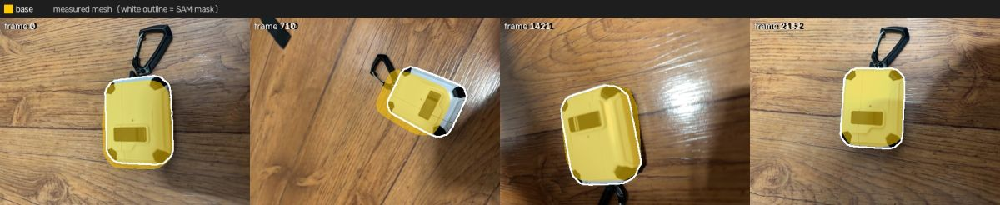
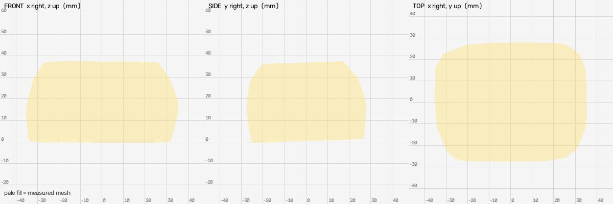
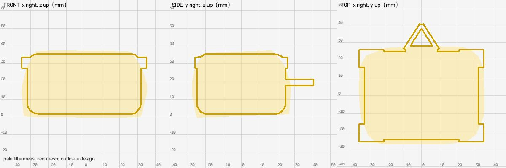
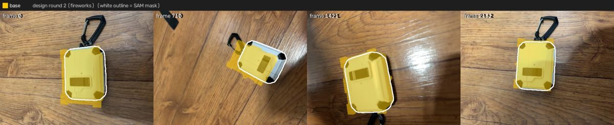
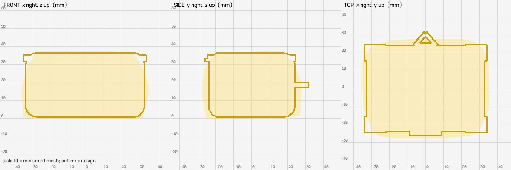

# Shape design (meta: muse-spark-1.3-contributor, baseten: meta-models/muse-spark-open-1026, fireworks: accounts/fireworks/models/muse-spark-open)

Measured mesh IoU: `{"base": {"iou": 0.838, "mask_covered": 0.895, "f_near": 0.93, "frames": 16}}`

## Round 1: rugged protective earbud case with carabiner (from fireworks, accounts/fireworks/models/muse-spark-open)

Candidates: meta 0.848, baseten 0.892, fireworks 0.899

Parts: `{"base": "rugged white case body with black corner bumpers, front latch and carabiner clip"}`

Mean near-F 0.899 (measured mesh 0.930); per link `{"base": {"iou": 0.767, "mask_covered": 0.906, "f_near": 0.899, "frames": 16}}`

Assumptions: ['main body size set to 64x50x34mm inside measured 70.1x55.2x37.5mm so corner bumpers reach measured extents', 'corner bumper thickness and faceting simplified to flat black boxes on top face', 'carabiner protrudes beyond measured bbox to ~y=40mm (measured mesh truncates carabiner as seen in overlay where carabiner lies outside yellow fill) - kept small to remain near measured extents', 'case thickness and corner rounding inferred from video - measured cross-section 36.2mm used for z', 'bottom face assumed flat white matching top, small hinge seam not modelled separately']

Notes: Single static link. White rugged case with four black corner protectors and central black latch on front edge, carabiner clip on opposite edge. Model keeps x/y/z within ~5% of measured pale fill except deliberate small carabiner protrusion that was missing from measurement.

## Round 2: rugged protective earbud case with carabiner (from fireworks, accounts/fireworks/models/muse-spark-open)

Candidates: meta 0.888, baseten 0.906, fireworks 0.908

Parts: `{"base": "rugged white case body with black corner bumpers, front latch and carabiner clip"}`

Mean near-F 0.908 (measured mesh 0.930); per link `{"base": {"iou": 0.784, "mask_covered": 0.905, "f_near": 0.908, "frames": 16}}`

Assumptions: ['reduced Y extent to match measured 55.2mm by shortening carabiner to 7mm protrusion beyond body (apex at y=31 vs +40 before)', 'inset corner bumpers flush inside body footprint so X/Y outline stays smooth and within pale fill, small 3.5mm height on top face only', 'body height increased to 36mm to stay within 10% of measured 37.5mm height', 'bottom face assumed flat white, hinge seam approximated by rounded_box shape']

Notes: Fits measured bbox x 66 vs 70.1 (-5.8%), y 55 vs 55.2, z 36 vs 37.5; carabiner and bumpers now stay inside SAM masks and pale fill in overlays.

## Result

Best round 2 (mean near-F 0.908 vs measured 0.930): applied
