# Video2URDF agent: drawer2_lidar.mp4

model muse-spark-1.3-contributor

look [0, 265, 530, 795]

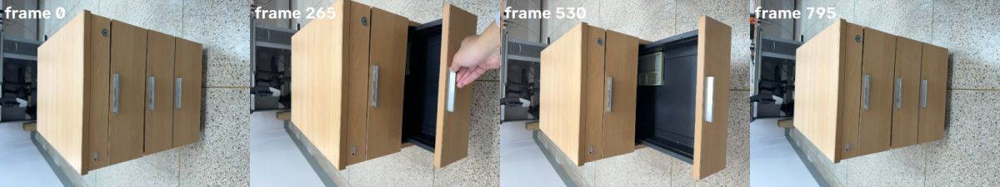

## Spark (4s)

Drawer cabinet spotted — I'll map which drawers move and when to build the slide model.

**look** `{"frames": [0, 200, 265, 400, 530, 650, 795]}`

look [0, 200, 265, 400]

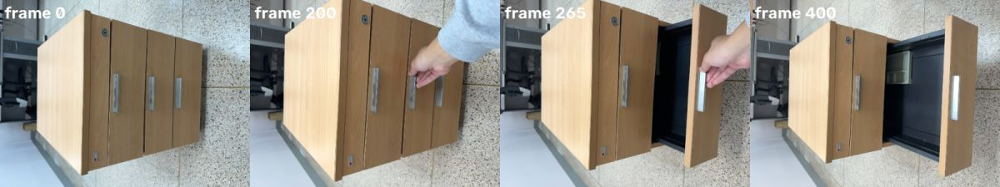

> Showing frames [0, 200, 265, 400] (left to right).

## Spark (3s)


**look** `{"frames": [530, 650, 795]}`

look [530, 650, 795]

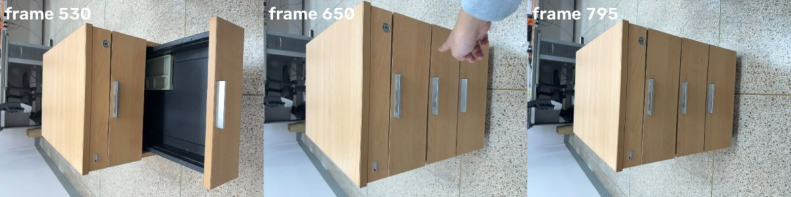

> Showing frames [530, 650, 795] (left to right).

## Spark (23s)

I've identified the active bottom drawer — now I'll segment the parts to track the motion.

**segment** `{"frame": 0, "prompt": "tiled floor"}`

segment 'tiled floor' frame 0

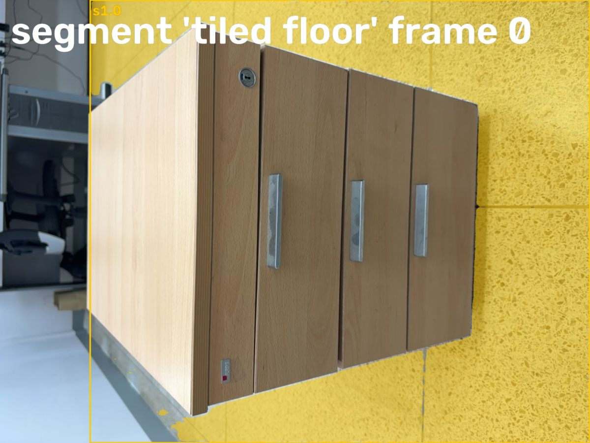

> segment 'tiled floor' on frame 0:
> s1.0: box (293, 0, 1919, 1439), confidence 0.88, area 36.0% of frame
> Check the annotated image.

**segment** `{"frame": 0, "prompt": "wooden side panel"}`

segment 'wooden side panel' frame 0

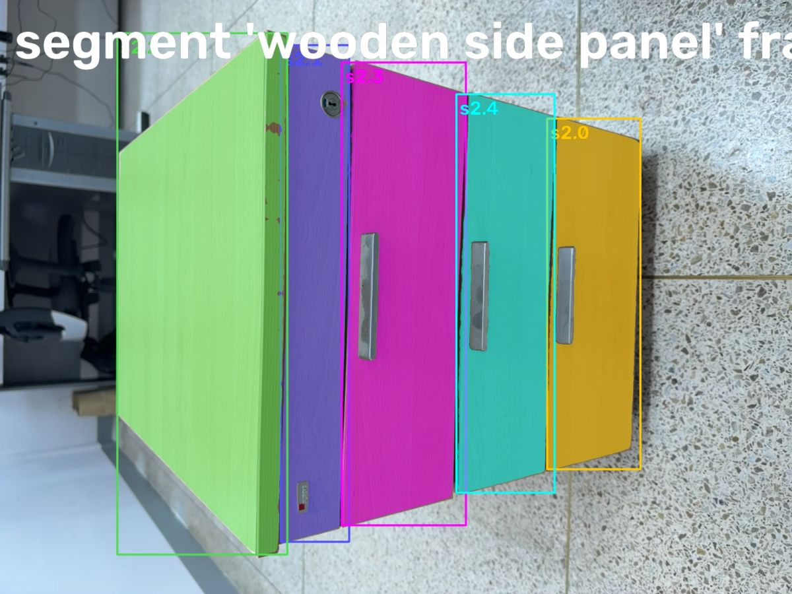

> segment 'wooden side panel' on frame 0:
> s2.0: box (1326, 287, 1552, 1137), confidence 0.96, area 5.6% of frame
> s2.1: box (680, 109, 846, 1313), confidence 0.96, area 5.9% of frame
> s2.2: box (284, 80, 696, 1344), confidence 0.88, area 14.3% of frame
> s2.3: box (828, 151, 1129, 1273), confidence 0.96, area 9.7% of frame
> s2.4: box (1106, 228, 1344, 1194), confidence 0.96, area 6.6% of frame
> Check the annotated image.

**segment** `{"frame": 0, "prompt": "wooden drawer front"}`

> segment 'wooden drawer front' on frame 0: no match. Rephrase or try another frame.

**segment** `{"frame": 400, "prompt": "wooden drawer front"}`

segment 'wooden drawer front' frame 400

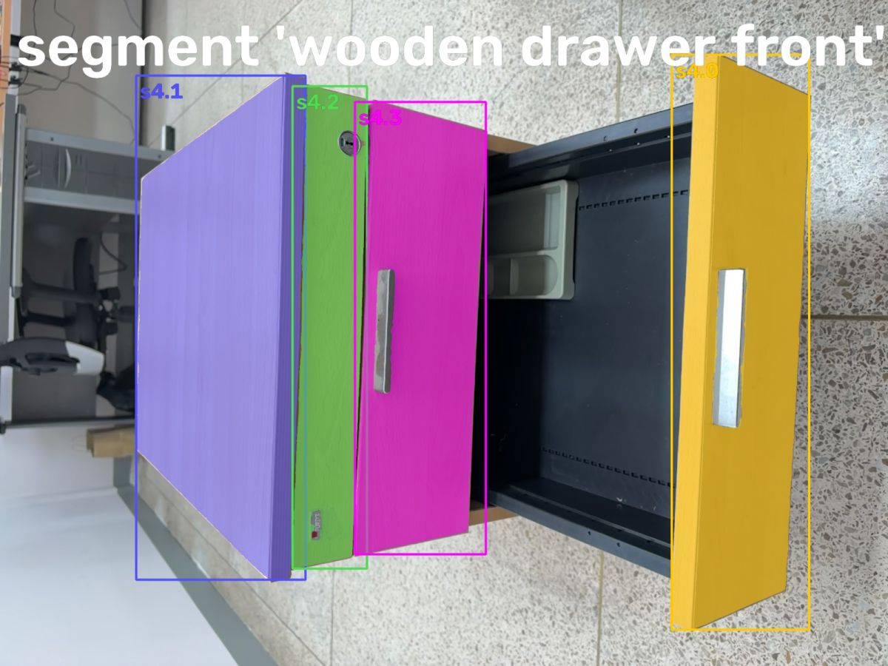

> segment 'wooden drawer front' on frame 400:
> s4.0: box (1452, 118, 1749, 1361), confidence 0.77, area 9.8% of frame
> s4.1: box (294, 163, 660, 1253), confidence 0.69, area 10.9% of frame
> s4.2: box (632, 186, 793, 1229), confidence 0.68, area 4.7% of frame
> s4.3: box (767, 220, 1050, 1198), confidence 0.81, area 7.9% of frame
> Check the annotated image.

## Spark (36s)


**segment** `{"frame": 400, "prompt": "speckled tile floor"}`

segment 'speckled tile floor' frame 400

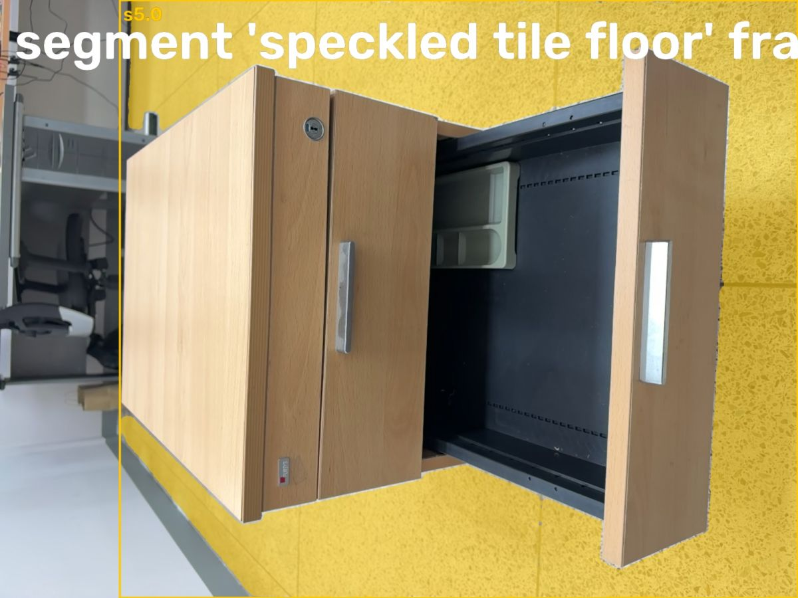

> segment 'speckled tile floor' on frame 400:
> s5.0: box (288, 0, 1919, 1439), confidence 0.89, area 31.4% of frame
> Check the annotated image.

**segment** `{"frame": 0, "prompt": "cabinet side panel"}`

segment 'cabinet side panel' frame 0

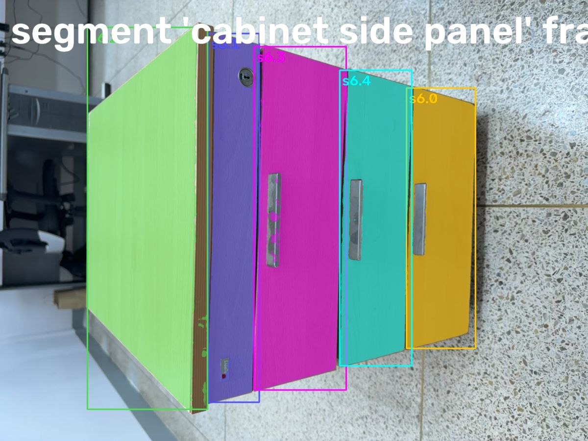

> segment 'cabinet side panel' on frame 0:
> s6.0: box (1327, 287, 1552, 1137), confidence 0.58, area 5.6% of frame
> s6.1: box (680, 109, 846, 1313), confidence 0.58, area 6.0% of frame
> s6.2: box (285, 89, 677, 1336), confidence 0.55, area 12.1% of frame
> s6.3: box (829, 152, 1130, 1273), confidence 0.54, area 9.8% of frame
> s6.4: box (1109, 229, 1344, 1194), confidence 0.56, area 6.6% of frame
> Check the annotated image.

**segment** `{"frame": 400, "prompt": "cabinet side panel"}`

> segment 'cabinet side panel' on frame 400: no match. Rephrase or try another frame.

## Spark (50s)


**segment** `{"frame": 0, "prompt": "silver drawer handle"}`

segment 'silver drawer handle' frame 0

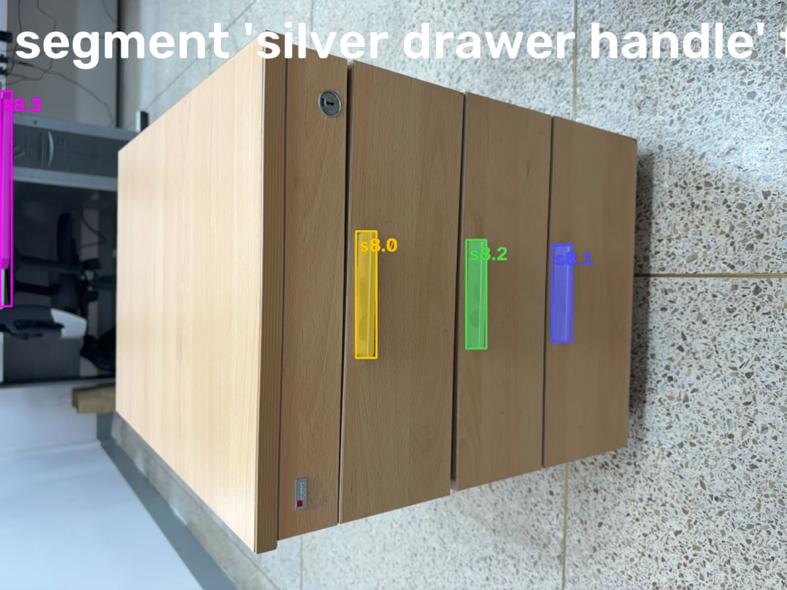

> segment 'silver drawer handle' on frame 0:
> s8.0: box (868, 564, 918, 873), confidence 0.79, area 0.5% of frame
> s8.1: box (1346, 597, 1395, 834), confidence 0.78, area 0.4% of frame
> s8.2: box (1137, 585, 1186, 850), confidence 0.78, area 0.4% of frame
> s8.3: box (0, 222, 28, 747), confidence 0.57, area 0.4% of frame
> Check the annotated image.

**segment** `{"frame": 400, "prompt": "silver drawer handle"}`

segment 'silver drawer handle' frame 400

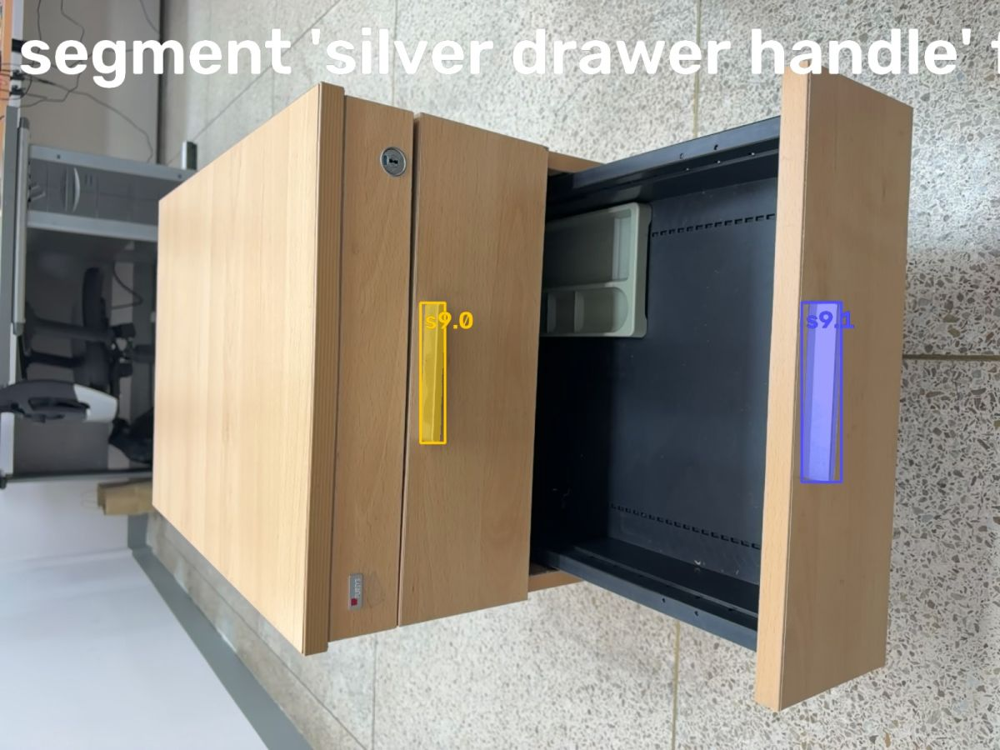

> segment 'silver drawer handle' on frame 400:
> s9.0: box (807, 581, 854, 850), confidence 0.83, area 0.4% of frame
> s9.1: box (1539, 580, 1615, 925), confidence 0.75, area 0.8% of frame
> Check the annotated image.

## Spark (52s)


**segment** `{"frame": 0, "prompt": "drawer"}`

> segment 'drawer' on frame 0: no match. Rephrase or try another frame.

**segment** `{"frame": 650, "prompt": "drawer"}`

> segment 'drawer' on frame 650: no match. Rephrase or try another frame.

## Spark (31s)

The fronts look nearly identical, so I need to pinpoint the moving drawer before fitting.

**look** `{"frames": [150, 210, 250, 300]}`

look [150, 210, 250, 300]

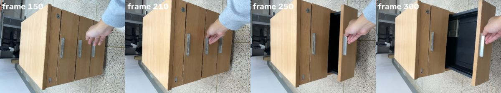

> Showing frames [150, 210, 250, 300] (left to right).

## Spark (55s)


**look** `{"frames": [100, 180, 350, 600]}`

look [100, 180, 350, 600]

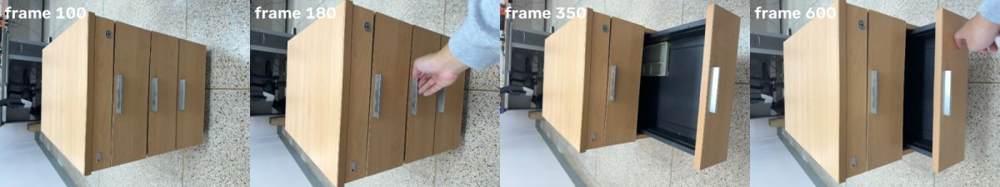

> Showing frames [100, 180, 350, 600] (left to right).

## Spark (98s)


## Spark (65s)


**segment** `{"frame": 0, "prompt": "stone tiles"}`

> segment 'stone tiles' on frame 0: no match. Rephrase or try another frame.

**segment** `{"frame": 100, "prompt": "stone tiles"}`

> segment 'stone tiles' on frame 100: no match. Rephrase or try another frame.

**segment** `{"frame": 0, "prompt": "rightmost drawer"}`

segment 'rightmost drawer' frame 0

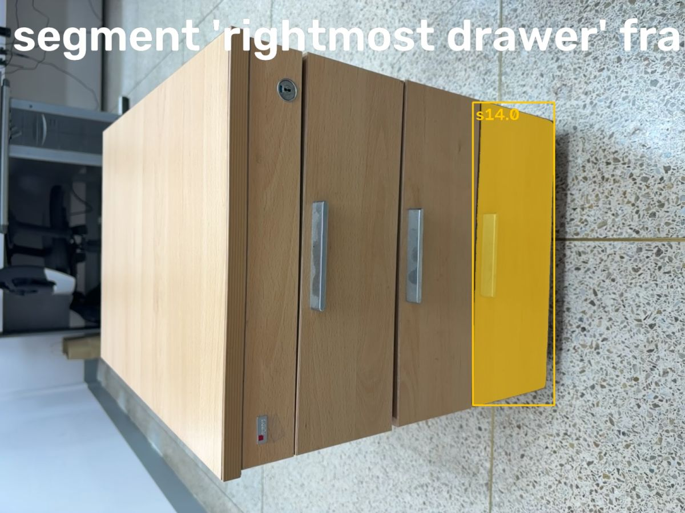

> segment 'rightmost drawer' on frame 0:
> s14.0: box (1325, 287, 1553, 1137), confidence 0.83, area 6.0% of frame
> Check the annotated image.

## Spark (94s)


## Spark (51s)

I've got the drawer candidates; now I'll isolate the static background to anchor the model.

**segment** `{"frame": 100, "prompt": "gray tiled background"}`

segment 'gray tiled background' frame 100

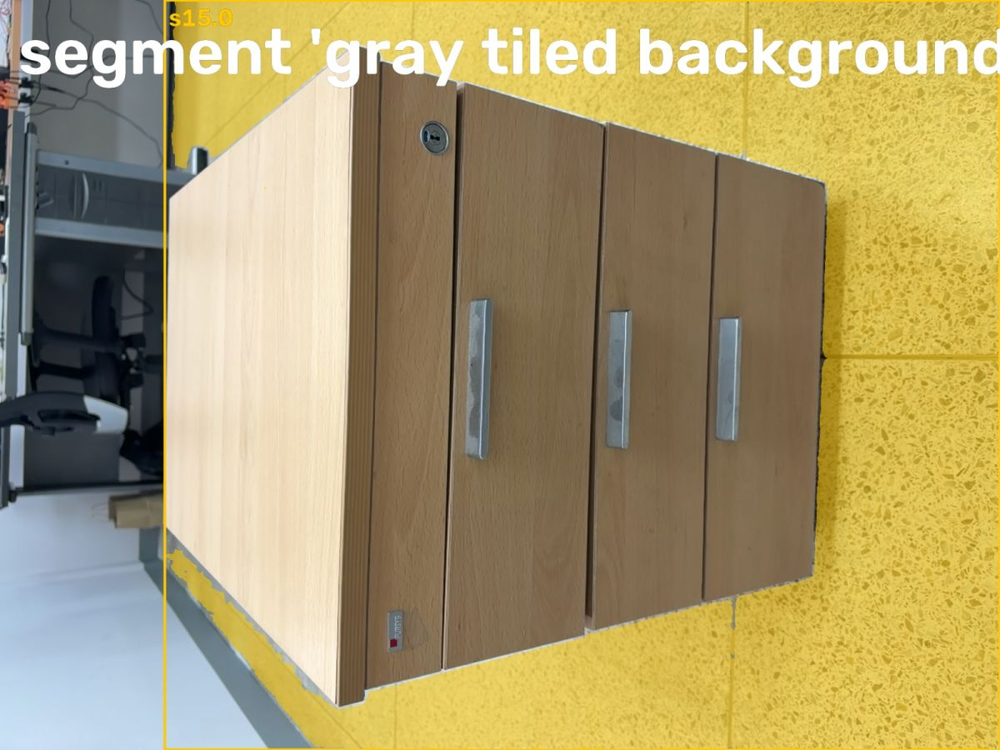

> segment 'gray tiled background' on frame 100:
> s15.0: box (316, 0, 1919, 1439), confidence 0.90, area 35.6% of frame
> Check the annotated image.

**segment** `{"frame": 0, "prompt": "middle drawer with handle"}`

> segment 'middle drawer with handle' on frame 0: no match. Rephrase or try another frame.

**segment** `{"frame": 0, "prompt": "beige cabinet top"}`

> segment 'beige cabinet top' on frame 0: no match. Rephrase or try another frame.

## Spark (49s)


**track** `{"parts": [{"candidate": "s15.0", "name": "floor"}, {"candidate": "s6.2", "name": "side"}, {"candidate": "s6.3", "name": "drawer_top"}, {"candidate": "s6.4", "name": "drawer_middle"}, {"candidates": ["s14.0", "s4.0"], "name": "drawer_bottom"}]}`

> Tracked: floor 796/796 frames, side 796/796 frames, drawer_top 573/796 frames, drawer_middle 796/796 frames, drawer_bottom 796/796 frames

## Spark (29s)

Tracking held across the full sequence, so I'll fit the prismatic drawer joint.

**fit_drawers** `{"base": ["side", "drawer_top", "drawer_middle"], "drawers": [{"first_frame": 150, "last_frame": 650, "part": "drawer_bottom"}], "floor": "floor"}`

```
Traceback (most recent call last):
  File "/Users/gimseonghyeon/orca/workspaces/META_AI/houndshark/video2urdf/agent.py", line 468, in run
    result = getattr(self, f"tool_{c.function.name}")(**args)
             ^^^^^^^^^^^^^^^^^^^^^^^^^^^^^^^^^^^^^^^^^^^^^^^^
  File "/Users/gimseonghyeon/orca/workspaces/META_AI/houndshark/video2urdf/agent.py", line 408, in tool_fit_drawers
    fix = c.level_with(slug(floor))
          ^^^^^^^^^^^^^^^^^^^^^^^^^
  File "/Users/gimseonghyeon/orca/workspaces/META_AI/houndshark/video2urdf/lidar.py", line 125, in level_with
    n, d = plane(t)
           ^^^^^^^^
  File "/Users/gimseonghyeon/orca/workspaces/META_AI/houndshark/video2urdf/lidar.py", line 112, in plane
    n, d, _ = fit_plane(c, rng)
              ^^^^^^^^^^^^^^^^^
  File "/Users/gimseonghyeon/orca/workspaces/META_AI/houndshark/video2urdf/lift3d.py", line 323, in fit_plane
    n = np.linalg.svd(p - centroid, full_matrices=False)[2][2]
        ~~~~~~~~~~~~~~~~~~~~~~~~~~~~~~~~~~~~~~~~~~~~~~~~~~~^^^
IndexError: index 2 is out of bounds for axis 0 with size 1
```

> error: IndexError: index 2 is out of bounds for axis 0 with size 1 (in fit_plane, lift3d.py:323)

## Spark (21s)

That fit failed — the static background was likely the wall, not the floor. I'll re-anchor and refit.

**segment** `{"frame": 0, "prompt": "white office floor"}`

> segment 'white office floor' on frame 0: no match. Rephrase or try another frame.

## Spark (12s)

The floor reference is off — I'll locate the true ground plane under the cabinet.

**segment** `{"frame": 0, "prompt": "white floor"}`

segment 'white floor' frame 0

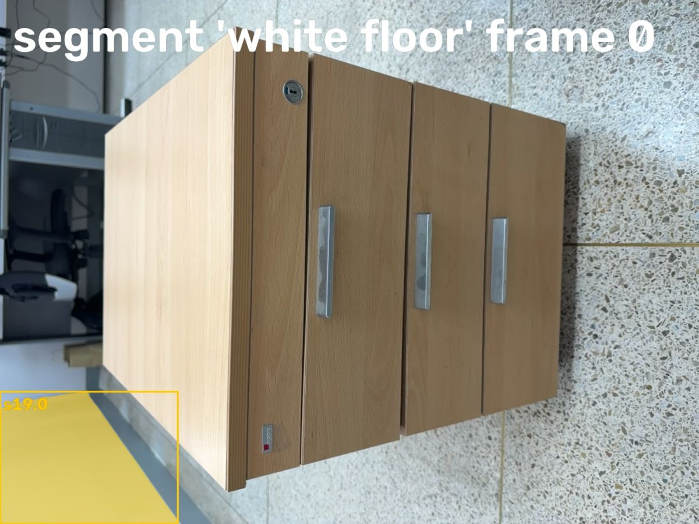

> segment 'white floor' on frame 0:
> s19.0: box (0, 1076, 488, 1439), confidence 0.62, area 4.7% of frame
> Check the annotated image.

## Spark (25s)

I've corrected the floor reference — now I'll re-track and complete the kinematic model.

**track** `{"parts": [{"candidate": "s19.0", "name": "floor"}, {"candidate": "s6.2", "name": "side"}, {"candidate": "s6.3", "name": "drawer_top"}, {"candidate": "s6.4", "name": "drawer_middle"}, {"candidates": ["s14.0", "s4.0"], "name": "drawer_bottom"}]}`

> Tracked: floor 796/796 frames, side 796/796 frames, drawer_top 796/796 frames, drawer_middle 796/796 frames, drawer_bottom 796/796 frames

## Spark (6s)

Tracking held across the full sequence, so I'll fit the prismatic drawer joint.

**fit_drawers** `{"base": ["side", "drawer_top", "drawer_middle"], "drawers": [{"first_frame": 150, "last_frame": 650, "part": "drawer_bottom"}], "floor": "floor"}`

```
Traceback (most recent call last):
  File "/Users/gimseonghyeon/orca/workspaces/META_AI/houndshark/video2urdf/agent.py", line 468, in run
    result = getattr(self, f"tool_{c.function.name}")(**args)
             ^^^^^^^^^^^^^^^^^^^^^^^^^^^^^^^^^^^^^^^^^^^^^^^^
  File "/Users/gimseonghyeon/orca/workspaces/META_AI/houndshark/video2urdf/agent.py", line 413, in tool_fit_drawers
    summary = lidar.fit_and_build_slides(c, b, slug(floor) if floor else None, spec, log=lines.append)
              ^^^^^^^^^^^^^^^^^^^^^^^^^^^^^^^^^^^^^^^^^^^^^^^^^^^^^^^^^^^^^^^^^^^^^^^^^^^^^^^^^^^^^^^^
  File "/Users/gimseonghyeon/orca/workspaces/META_AI/houndshark/video2urdf/lidar.py", line 612, in fit_and_build_slides
    nxt.append((max(y0, hy0), z0, min(y1, hy1), hz0))
ValueError: no upright face of cabinet seen next to a drawer
```

> error: ValueError: no upright face of cabinet seen next to a drawer (in fit_and_build_slides, lidar.py:612)

## Spark (61s)


**fit_drawers** `{"base": ["drawer_top", "drawer_middle"], "drawers": [{"first_frame": 150, "last_frame": 650, "part": "drawer_bottom"}], "floor": "floor"}`

```
Traceback (most recent call last):
  File "/Users/gimseonghyeon/orca/workspaces/META_AI/houndshark/video2urdf/agent.py", line 468, in run
    result = getattr(self, f"tool_{c.function.name}")(**args)
             ^^^^^^^^^^^^^^^^^^^^^^^^^^^^^^^^^^^^^^^^^^^^^^^^
  File "/Users/gimseonghyeon/orca/workspaces/META_AI/houndshark/video2urdf/agent.py", line 413, in tool_fit_drawers
    summary = lidar.fit_and_build_slides(c, b, slug(floor) if floor else None, spec, log=lines.append)
              ^^^^^^^^^^^^^^^^^^^^^^^^^^^^^^^^^^^^^^^^^^^^^^^^^^^^^^^^^^^^^^^^^^^^^^^^^^^^^^^^^^^^^^^^
  File "/Users/gimseonghyeon/orca/workspaces/META_AI/houndshark/video2urdf/lidar.py", line 612, in fit_and_build_slides
    nxt.append((max(y0, hy0), z0, min(y1, hy1), hz0))
ValueError: no upright face of cabinet seen next to a drawer
```

> error: ValueError: no upright face of cabinet seen next to a drawer (in fit_and_build_slides, lidar.py:612)

## Spark (15s)


**finish** `{"report": "drawer2_lidar.mp4: wooden 3-drawer pedestal cabinet. Only the bottom drawer moves (operated ~frame 150-650, open frames ~250-600, shut at 0 and 795). Top and middle drawer fronts stay shut throughout.\n\nTracking: in one track call tracked floor (white floor patch s19.0, 796/796), cabinet left side panel (s6.2, 796/796), top drawer front (s6.3, 796/796), middle drawer front (s6.4, 796/796), bottom/moving drawer front with two candidates shut s14.0 on frame 0 + open s4.0 on frame 400 (796/796). No ID swap was evident.\n\nfit_drawers FAILED twice: \"no upright face of cabinet seen next to a drawer\". First attempt base=[side, drawer_top, drawer_middle], floor=white floor patch. Second attempt base=[drawer_top, drawer_middle]. So no URDF/MJCF + replay was produced.\n\nLikely cause: video is rotated ~90 deg (cabinet appears on its side, image is portrait-rotated) and the only visible floor is a small white triangle at image edge (4.7% of frame). The fitter could not find a vertical cabinet face adjacent to the drawer in world coordinates. First track also used the speckled wall as \"floor\", which is vertical, not ground.\n\nNo joint travel / sizes can be reported reliably; all dimensions unmeasured. Do not use a model from this capture.\n\nReshoot: hold phone upright (gravity vector correct, no 90-deg rotation), keep 1-2 sqm of true ground floor visible in front of cabinet for whole video, frame the cabinet front 3/4 view so the cabinet side/top and all three fronts are visible shut at start, then open ONLY the bottom drawer fully and close it. Keep hand off the fronts except while pulling. Then fit_drawers with floor=true floor, base=side+other two fronts, drawer=bottom front (shut+open candidates), first_frame~start of pull, last_frame~seated shut."}`

> done
