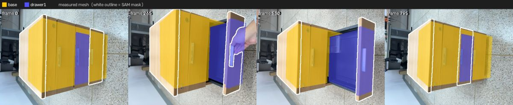
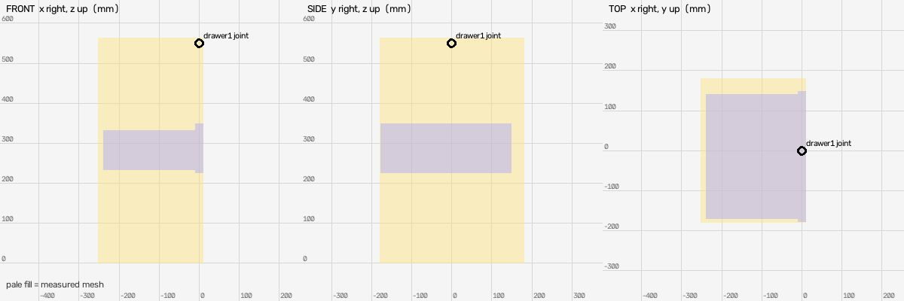
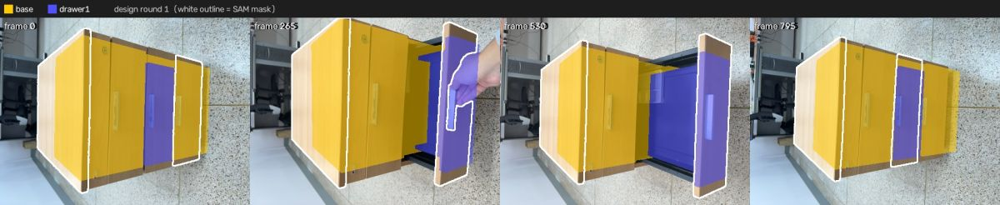
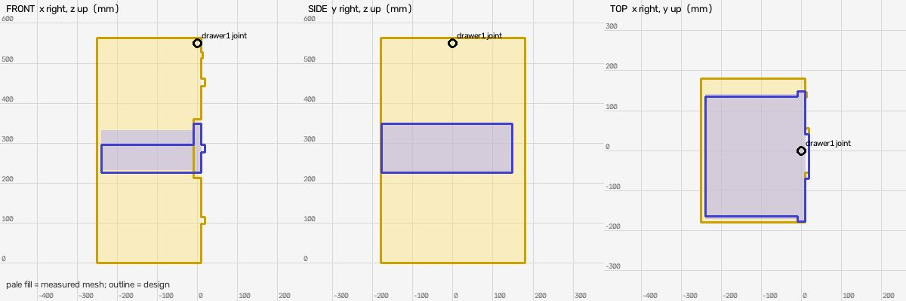
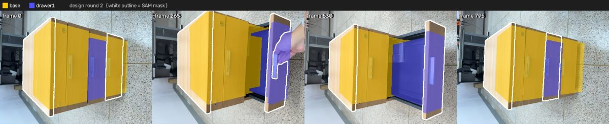
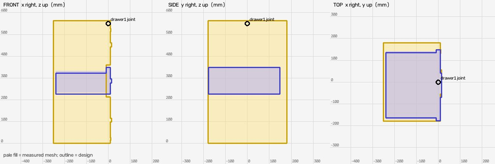

# Shape design (muse-spark-1.3-contributor)

Measured mesh IoU: `{"base": {"iou": 0.262, "mask_covered": 0.62, "f_near": 0.455, "frames": 16}, "drawer1": {"iou": 0.335, "mask_covered": 0.559, "f_near": 0.532, "frames": 16}}`

## Round 1: light beech office pedestal cabinet with three drawers

Parts: `{"base": "cabinet carcass with top panel, side/back/bottom panels and two fixed drawer fronts (top small drawer and bottom deep drawer) with handles and lock", "drawer1": "middle pull-out drawer - wood drawer front with handle plus black metal drawer box"}`

Mean near-F 0.503 (measured mesh 0.494); per link `{"base": {"iou": 0.255, "mask_covered": 0.619, "f_near": 0.445, "frames": 16}, "drawer1": {"iou": 0.363, "mask_covered": 0.565, "f_near": 0.56, "frames": 16}}`

Assumptions: ['x is front-back depth (front at x~9, back at x~-251), y is left-right width, z is up with top at z~13 and floor at z~-550', 'back face and underside never clearly seen: assumed flat back at x=-251 and flat bottom at z=-550, carcass recessed 18mm behind wood fronts', '12mm shadow gaps assumed between drawer fronts and around middle drawer', 'silver bar handles not measured: assumed 110mm long along y, 18mm tall, 10mm proud of front', 'drawer metal box height 70mm and bottom thickness 12mm estimated from dark interior in video; side inset 13mm each side', 'top lock diameter and bottom label estimated from video, placed on top drawer front', 'wood colours sampled from video: light beech top/sides and slightly darker mid-brown fronts; interior near-black metal']

Notes: 3-drawer pedestal where only middle drawer was moved, so top and bottom fronts are modelled as part of base. Base top panel contains child joint origin (0,0,0). Drawer1 front exactly fills measured bbox -239..9, -178.1..148.6, -324.1..-202, box extends behind it; handle protrudes 10mm beyond measured max, <5% size change.

## Round 2: light beech office pedestal cabinet with three drawers

Parts: `{"base": "cabinet carcass with top panel, side/back/bottom panels and two fixed drawer fronts (top small drawer and bottom deep drawer) with handles, top lock and bottom label", "drawer1": "middle pull-out drawer - wood drawer front with handle plus black metal drawer box"}`

Mean near-F 0.5 (measured mesh 0.494); per link `{"base": {"iou": 0.259, "mask_covered": 0.619, "f_near": 0.45, "frames": 16}, "drawer1": {"iou": 0.353, "mask_covered": 0.566, "f_near": 0.549, "frames": 16}}`

Assumptions: ['x is front-back depth (front at x~9, back at x~-251), y is left-right width, z is up with top at z~13.6 and floor at z~-550', 'back face and underside never clearly seen: assumed flat back at x=-251 and flat bottom at z=-550, carcass recessed 18mm behind wood fronts', '12mm shadow gaps assumed between drawer fronts and around middle drawer', 'silver bar handles: 110mm long along y, 18mm tall, 6mm proud of front to keep overall x extent within 6mm of measured', 'drawer metal box 90mm tall, bottom 12mm thick, estimated from dark interior in video; side inset to match measured drawer width', 'top lock and bottom red label estimated from video, placed on right side of top/bottom drawer fronts']

Notes: 3-drawer pedestal where only middle drawer was moved, so top and bottom fronts are part of base. Base joint at (0,0,0) in top panel. Drawer front exactly fills measured bbox, handle protrudes 6mm (2.3% over). Solid carcass intentionally overlaps closed drawer box interior; only fronts/handles affect outer silhouette.

## Result

Best round 1 (mean near-F 0.503 vs measured 0.494): applied
