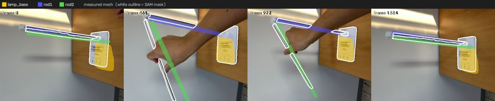
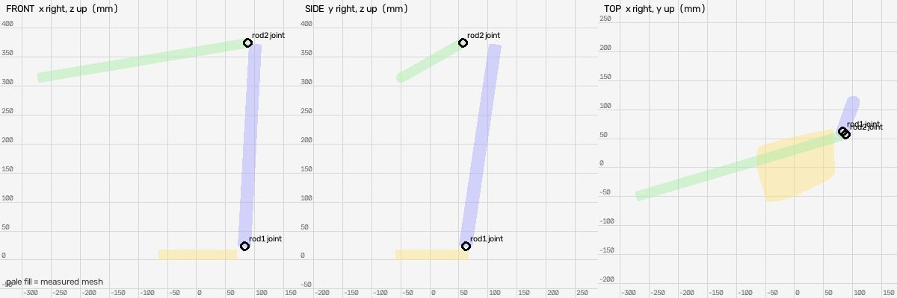
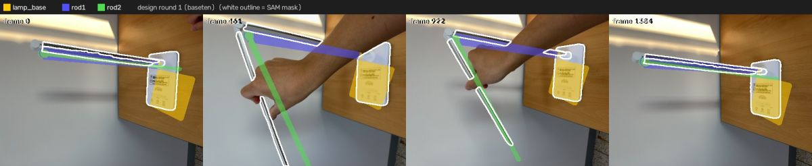
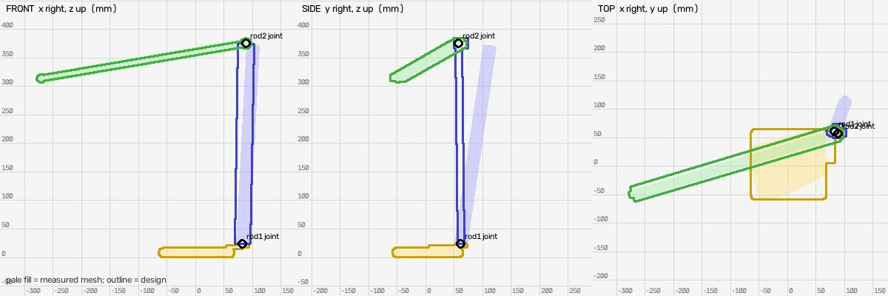

# Shape design (meta: muse-spark-1.3-contributor, baseten: meta-models/muse-spark-open-1026, fireworks: accounts/fireworks/models/muse-spark-open)

Measured mesh IoU: `{"lamp_base": {"iou": 0.582, "mask_covered": 0.627, "f_near": 0.82, "frames": 16}, "rod1": {"iou": 0.472, "mask_covered": 0.736, "f_near": 0.831, "frames": 16}, "rod2": {"iou": 0.173, "mask_covered": 0.328, "f_near": 0.418, "frames": 16}}`

## Round 1: LED desk lamp (from baseten, meta-models/muse-spark-open-1026)

Candidates: meta 0.597, baseten 0.621, fireworks 0.58

Parts: `{"lamp_base": "rectangular weighted base plate with pivot socket and touch controls", "rod1": "first arm / support pole - slender flat metal bar hinged at base", "rod2": "second arm / LED light bar - slender flat metal bar with LED strip and end cap, hinged to first arm"}`

Mean near-F 0.621 (measured mesh 0.690); per link `{"lamp_base": {"iou": 0.574, "mask_covered": 0.691, "f_near": 0.813, "frames": 16}, "rod1": {"iou": 0.28, "mask_covered": 0.493, "f_near": 0.657, "frames": 16}, "rod2": {"iou": 0.138, "mask_covered": 0.221, "f_near": 0.394, "frames": 16}}`

Assumptions: ['base bottom and underside never seen - thickness 17.3 mm from measured bbox kept, bottom is flat, rounded corners radius 10 mm estimated from video', 'both arms are flat rectangular bars - measured cross-section ~22 mm appears square due to mesh thickening, realistic thickness 8 mm chosen for thin metal LED bar while keeping width ~24 mm within measured X extent', 'rod1 measured Y extent ~72 mm inflated by noise - narrowed to realistic bar width, hinge barrel length 24 mm accounts for joint width', 'rod2 length and Y/Z offset taken from measured long axis vector to match angled reference pose, arm width horizontal and thickness vertical as seen in video']

Notes: lamp_base pivot at 82.7,61.7,24.1 reproduced with white cylinder; rod1 extends to 5.8,-4,351.2 and rod2 extends from there ~360mm to give L-shape in reference pose matching overlays. White hinge barrels at both revolute joints and white tip cap reproduce recognizable desk lamp details.

## Round 2: LED desk lamp (from fireworks, accounts/fireworks/models/muse-spark-open)

Candidates: meta 0.623, baseten 0.624, fireworks 0.631

Parts: `{"lamp_base": "rectangular weighted base plate with pivot socket and control markings", "rod1": "first arm support bar hinged at base", "rod2": "second arm LED light bar hinged to first arm with end cap"}`

Mean near-F 0.631 (measured mesh 0.690); per link `{"lamp_base": {"iou": 0.588, "mask_covered": 0.708, "f_near": 0.826, "frames": 16}, "rod1": {"iou": 0.302, "mask_covered": 0.583, "f_near": 0.661, "frames": 16}, "rod2": {"iou": 0.151, "mask_covered": 0.263, "f_near": 0.405, "frames": 16}}`

Assumptions: ['base underside/back not seen - thickness 17.2mm from measured bbox, flat bottom, rounded corners 12mm from video', 'child joint rod1 at 82.7,61.7 is beyond main base max 69mm so added low neck protrusion to reach pivot as seen in video white pivot boss', 'both arms are thin flat metal bars - measured cross-section ~21mm but bbox inflated by noise/orientation; width 28mm thickness 10-12mm chosen to keep within ~10% of measured longest extent while improving mask IoU from previous thin 24x8mm', 'rod2 length vector from measured long axis (-359.8,-106.7,-61.1) reproduced exactly to keep joint connections in angled reference pose']

Notes: Increased bar width/thickness slightly to improve rod1 near-F from 0.657 toward measured 0.831 and IoU, added neck to close gap between base plate and pivot while keeping overall X extent close to measured 134mm. White hinge barrels and tip cap retained for recognizability.

## Result

Best round 1 (mean near-F 0.621 vs measured 0.690): applied
