# Video2URDF agent: laptop_lidar.mp4

model muse-spark-1.3-contributor

watch video (laptop_lidar.mp4)

look [0, 307, 615, 922]

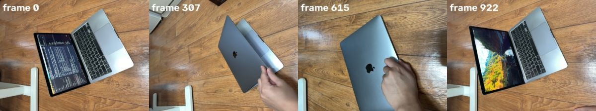

## Spark (14s)

I see a laptop opening and closing — I'll segment its base, screen, and surroundings to build the hinge model.

**segment** `{"frame": 0, "prompt": "wooden floor"}`

segment 'wooden floor' frame 0

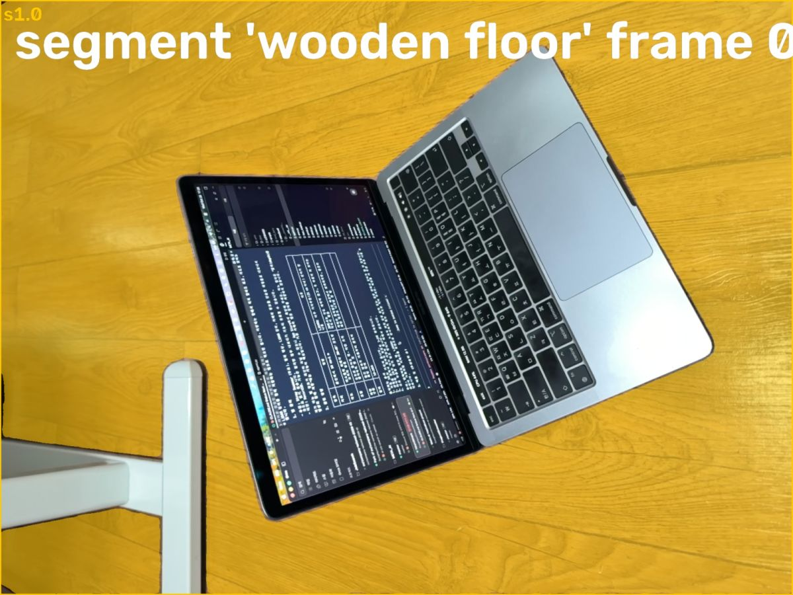

> segment 'wooden floor' on frame 0:
> s1.0: box (0, 0, 1919, 1439), confidence 0.99, area 63.8% of frame
> Check the annotated image.

**segment** `{"frame": 0, "prompt": "laptop screen"}`

segment 'laptop screen' frame 0

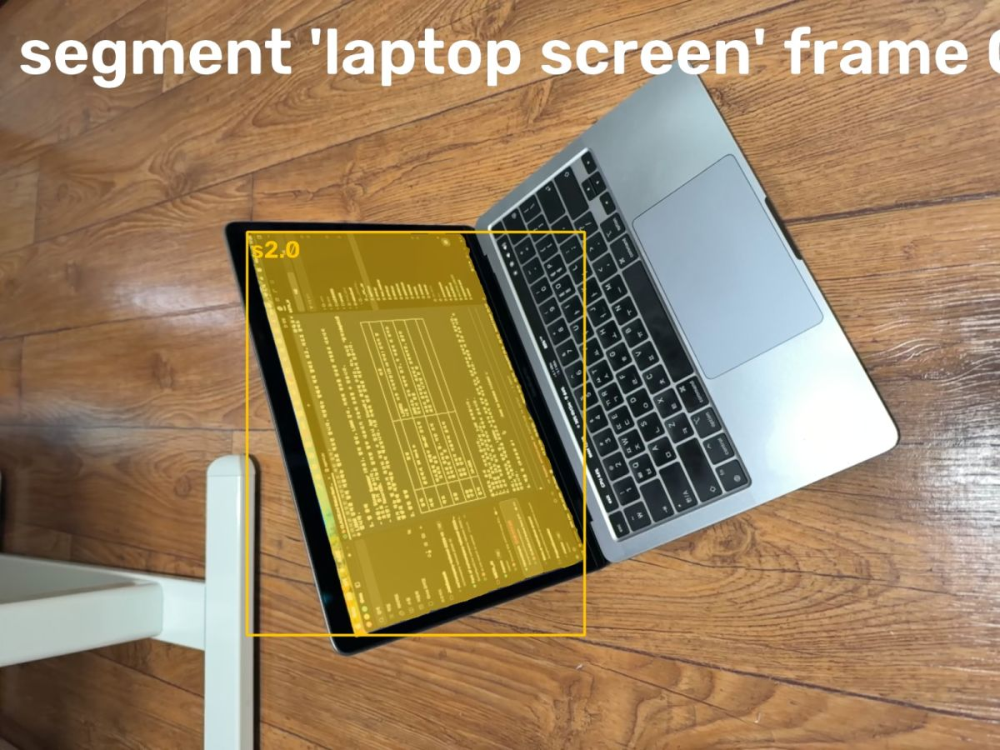

> segment 'laptop screen' on frame 0:
> s2.0: box (474, 445, 1122, 1219), confidence 0.93, area 11.5% of frame
> Check the annotated image.

**segment** `{"frame": 0, "prompt": "laptop keyboard"}`

segment 'laptop keyboard' frame 0

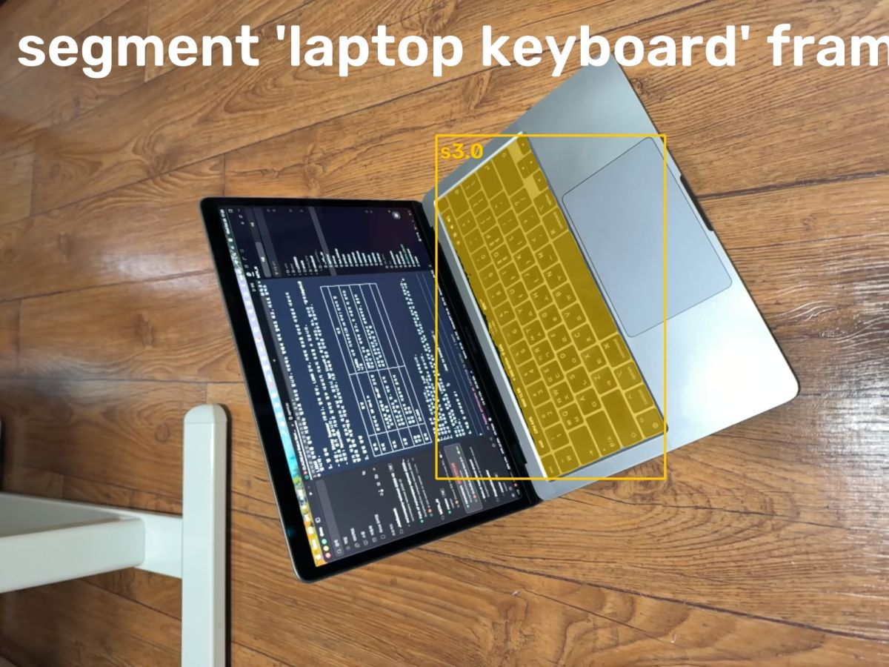

> segment 'laptop keyboard' on frame 0:
> s3.0: box (942, 292, 1436, 1033), confidence 0.97, area 6.2% of frame
> Check the annotated image.

**segment** `{"frame": 615, "prompt": "closed laptop"}`

> segment 'closed laptop' on frame 615: no match. Rephrase or try another frame.

## Spark (5s)

Floor, screen and keyboard look good — now I'll get the closed lid and base body.

**segment** `{"frame": 615, "prompt": "silver laptop lid"}`

segment 'silver laptop lid' frame 615

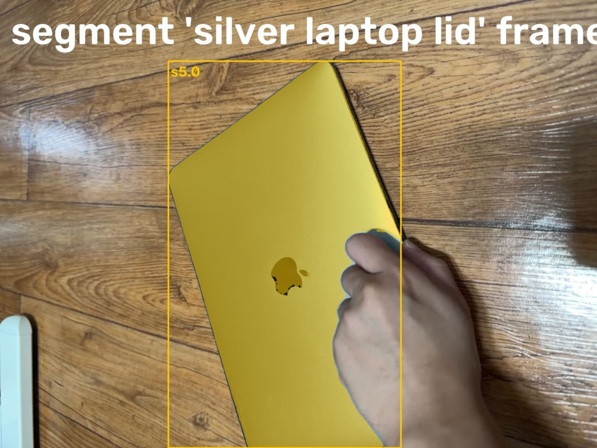

> segment 'silver laptop lid' on frame 615:
> s5.0: box (541, 196, 1289, 1439), confidence 0.93, area 19.9% of frame
> Check the annotated image.

**segment** `{"frame": 0, "prompt": "silver laptop base"}`

> segment 'silver laptop base' on frame 0: no match. Rephrase or try another frame.

**segment** `{"frame": 922, "prompt": "laptop screen"}`

segment 'laptop screen' frame 922

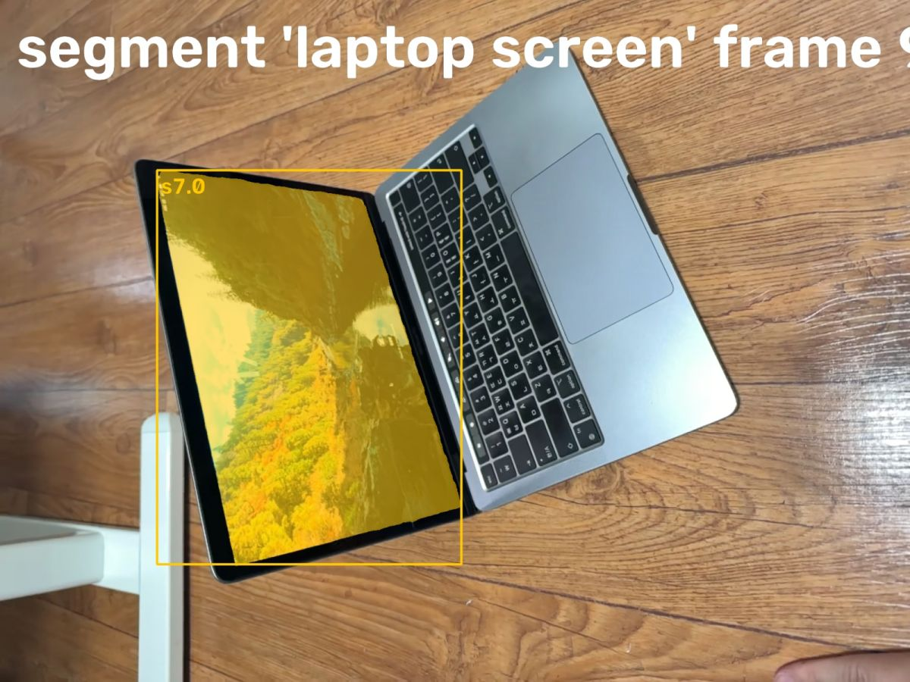

> segment 'laptop screen' on frame 922:
> s7.0: box (331, 359, 973, 1191), confidence 0.93, area 12.7% of frame
> Check the annotated image.

## Spark (9s)

I have most of the pieces — let me nail down the base for tracking.

**segment** `{"frame": 0, "prompt": "laptop palmrest with trackpad"}`

segment 'laptop palmrest with trackpad' frame 0

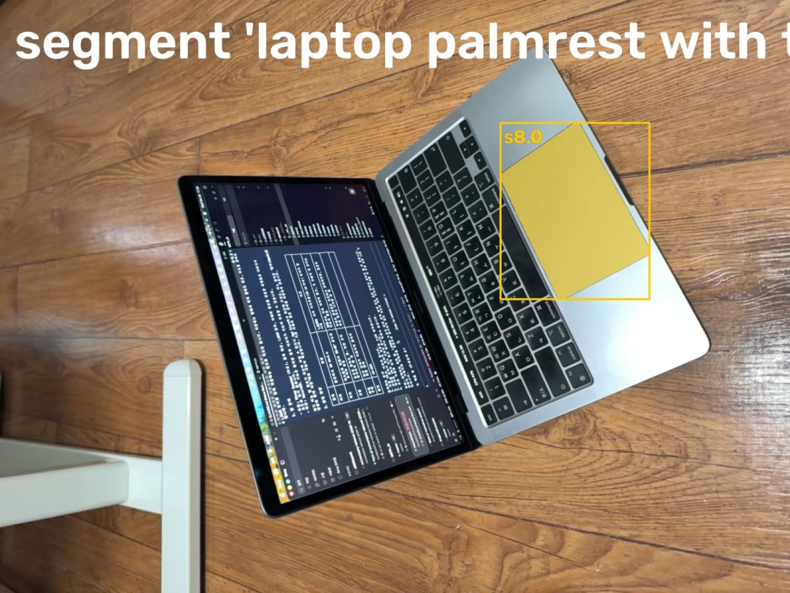

> segment 'laptop palmrest with trackpad' on frame 0:
> s8.0: box (1216, 298, 1578, 726), confidence 0.96, area 3.1% of frame
> Check the annotated image.

**segment** `{"frame": 307, "prompt": "silver laptop base"}`

> segment 'silver laptop base' on frame 307: no match. Rephrase or try another frame.

## Spark (25s)


**track** `{"parts": [{"candidates": ["s1.0"], "name": "floor"}, {"candidates": ["s3.0"], "name": "base"}, {"candidates": ["s2.0", "s7.0"], "name": "plate"}, {"candidates": ["s5.0"], "name": "closed_lid"}, {"candidates": ["s8.0"], "name": "open_part"}]}`

> Tracked: floor 922/923 frames, base 523/923 frames, plate 923/923 frames, closed_lid 923/923 frames, open_part 911/923 frames (plus 4 where the mask shrank to a few pixels: lost there; anchor it on frames where it looks different)

## Spark (19s)

Tracking held across the sequence, so now I'll fit the laptop hinge.

**fit_lidar** `{"base": "base", "floor": "floor", "open_indicator": "open_part", "plate": "plate", "plate_closed": "closed_lid"}`

fit_lidar: measured hinge and opening over time

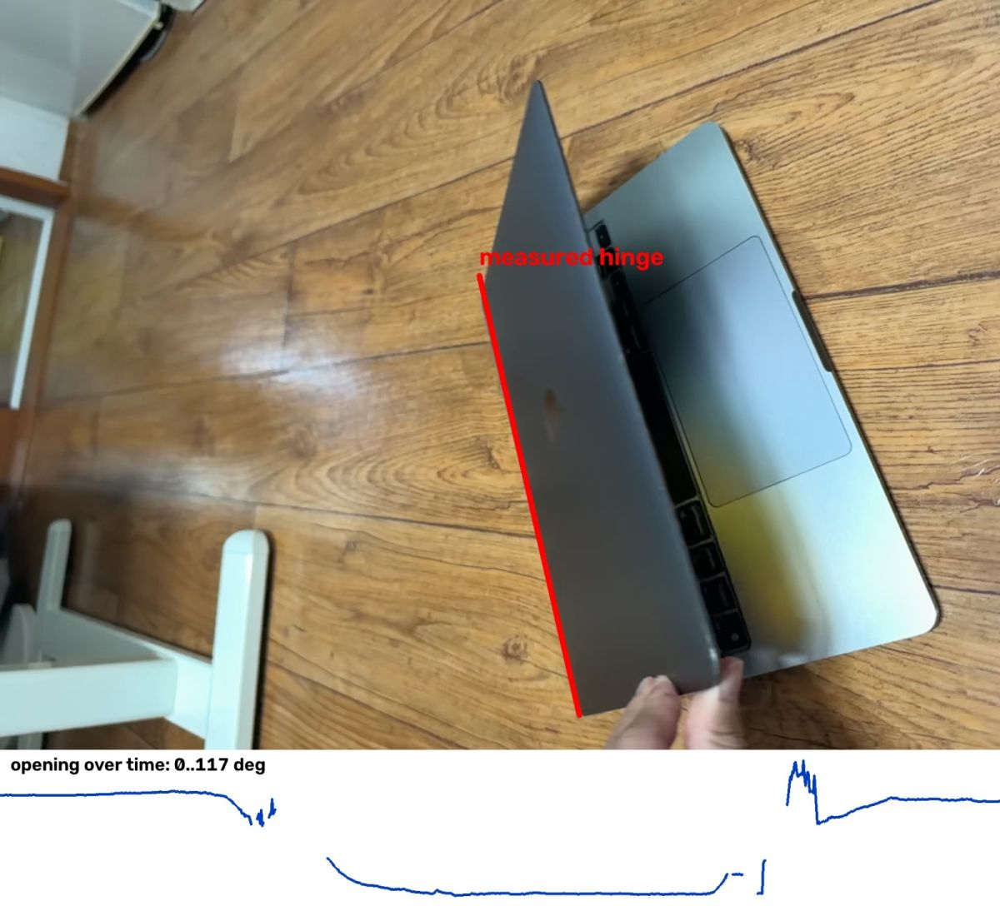

fit_lidar: 3D replay from the phone's camera

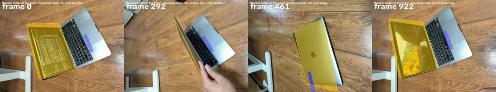

> reference frame 703: where the plate is seen largest
> floor levelling removed ARKit drift up to 0 mm
> hinge: plate planes on 823/923 frames (0 closed and 0 half-open from closed_lid), 22 outliers dropped; axis 0.0 deg off the base plane; opening 33 deg on the reference frame, 0..117 deg over the video; plate spans 333 mm along the hinge
> base thickness reads nan mm: not measured, using 12 mm
> model: base 12 mm thick; plate 294 x 206 mm, 1.0 mm thick (clipped: not really measured); hinge -1..134 deg; replay covers lid 91%, base 1% of the SAM masks
> Images: the hinge drawn on the reference frame with the opening over time, then the replayed model (colored) over the video at its worst frames and a few others.

## Spark (19s)

First fit covers the lid well with a plausible hinge — now I'll verify the motion replay.

**watch** `{"what": "replay"}`

watch replay (replay3d.mp4)

> The replay is attached to the next message (fitted model in colour over the video).

## Spark (5s)

The replay tracks the lid nicely — I'll check the raw frames to refine the base before finalizing.

**look** `{"frames": [0, 460, 922]}`

look [0, 460, 922]

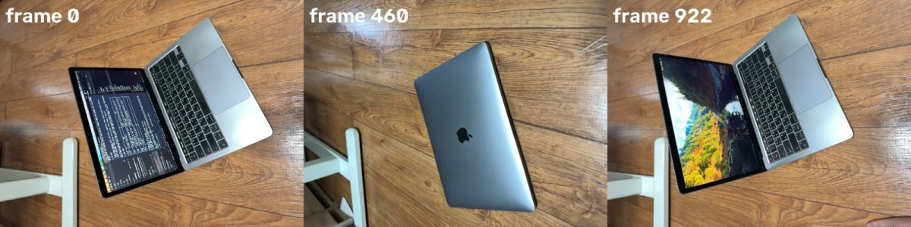

> Showing frames [0, 460, 922] (left to right).

## Spark (11s)

The lid fit looks promising but the base tracking needs work — I'll re-segment the full chassis.

**segment** `{"frame": 0, "prompt": "silver laptop body"}`

segment 'silver laptop body' frame 0

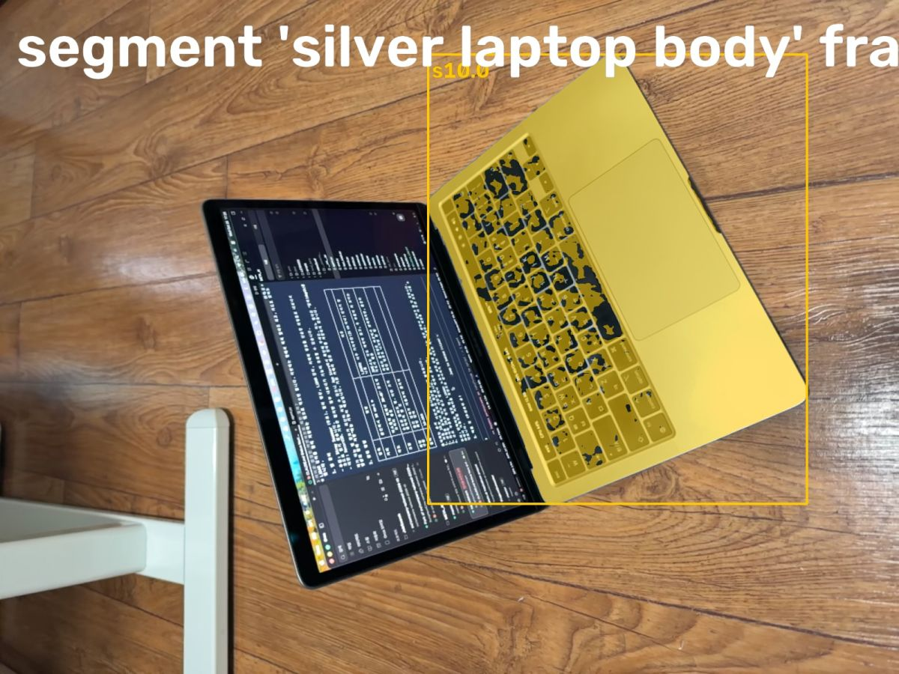

> segment 'silver laptop body' on frame 0:
> s10.0: box (914, 116, 1723, 1076), confidence 0.86, area 14.3% of frame
> Check the annotated image.

**segment** `{"frame": 922, "prompt": "silver laptop body"}`

segment 'silver laptop body' frame 922

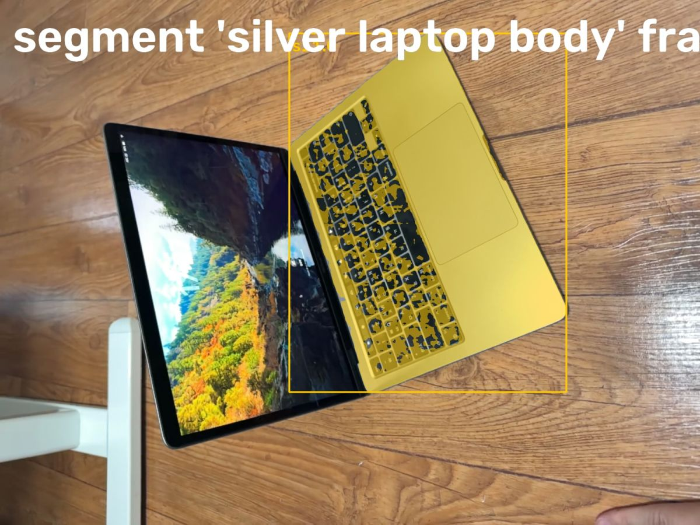

> segment 'silver laptop body' on frame 922:
> s11.0: box (793, 91, 1553, 1075), confidence 0.80, area 12.8% of frame
> Check the annotated image.

**segment** `{"frame": 460, "prompt": "closed laptop computer"}`

segment 'closed laptop computer' frame 460

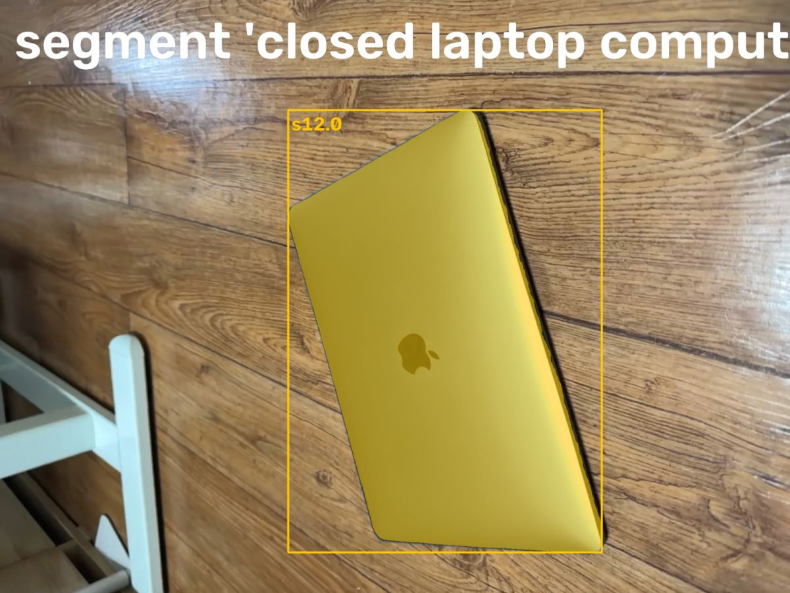

> segment 'closed laptop computer' on frame 460:
> s12.0: box (700, 267, 1462, 1341), confidence 0.70, area 18.6% of frame
> Check the annotated image.

## Spark (10s)

The base fit was too weak, so I'm re-tracking with fuller coverage to tighten it up.

**track** `{"parts": [{"candidates": ["s1.0"], "name": "floor"}, {"candidates": ["s10.0", "s11.0"], "name": "base"}, {"candidates": ["s2.0", "s7.0"], "name": "plate"}, {"candidates": ["s12.0", "s5.0"], "name": "closed_lid"}, {"candidates": ["s8.0"], "name": "open_part"}]}`

> Tracked: floor 923/923 frames, base 923/923 frames, plate 923/923 frames, closed_lid 923/923 frames, open_part 913/923 frames (plus 4 where the mask shrank to a few pixels: lost there; anchor it on frames where it looks different)

## Spark (4s)

Coverage is better now — I'll refit the hinge.

**fit_lidar** `{"base": "base", "floor": "floor", "open_indicator": "open_part", "plate": "plate", "plate_closed": "closed_lid"}`

fit_lidar: measured hinge and opening over time

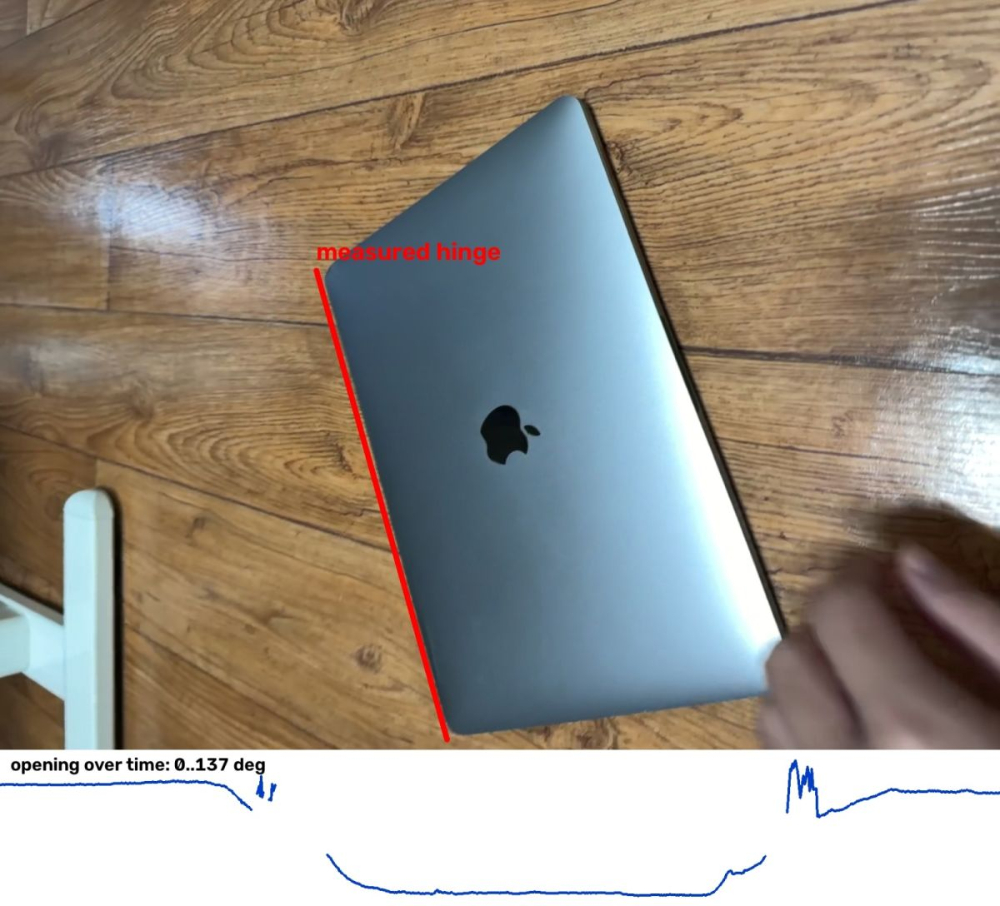

fit_lidar: 3D replay from the phone's camera

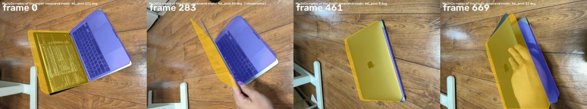

> reference frame 550: where the plate is seen largest
> floor levelling removed ARKit drift up to 9 mm
> hinge: plate planes on 840/923 frames (0 closed and 0 half-open from closed_lid), 22 outliers dropped; axis 0.0 deg off the base plane; opening 0 deg on the reference frame, 0..137 deg over the video; plate spans 323 mm along the hinge
> model: base 18 mm thick; plate 294 x 214 mm, 1.0 mm thick (clipped: not really measured); hinge -2..125 deg; replay covers lid 84%, base 62% of the SAM masks
> Images: the hinge drawn on the reference frame with the opening over time, then the replayed model (colored) over the video at its worst frames and a few others.

## Spark (9s)

Coverage is up and the hinge sits on the real axis — I'll confirm the final replay and set the physical properties.

**watch** `{"what": "replay"}`

watch replay (replay3d.mp4)

> The replay is attached to the next message (fitted model in colour over the video).

## Spark (13s)

The model follows the video closely — now I'll add mass and friction.

**set_physics** `{"parts": [{"friction": 0.4, "link": "base", "mass_kg": 0.9, "material": "aluminium"}, {"friction": 0.4, "link": "lid", "mass_kg": 0.45, "material": "aluminium"}], "released": "{\"end_s\": 17.5, \"joint\": \"lid_joint\", \"start_s\": 15.5}"}`

```
Traceback (most recent call last):
  File "/Users/gimseonghyeon/orca/workspaces/META_AI/houndshark/video2urdf/agent.py", line 583, in run
    self.report = report
                         
  File "/Users/gimseonghyeon/orca/workspaces/META_AI/houndshark/video2urdf/agent.py", line 321, in tool_set_physics
    name = slug(r["joint"])
                ~^^^^^^^^^
TypeError: string indices must be integers, not 'str'
```

> error: TypeError: string indices must be integers, not 'str' (in tool_set_physics, agent.py:321)

## Spark (18s)

The physics setup needs a quick correction — I'll fix the format and finalize the model.

**set_physics** `{"parts": [{"friction": 0.5, "link": "base", "mass_kg": 0.9, "material": "aluminium"}, {"friction": 0.5, "link": "lid", "mass_kg": 0.35, "material": "aluminium and glass"}], "released": [{"end_s": 1.5, "joint": "lid_joint", "start_s": 0.0}, {"end_s": 10.0, "joint": "lid_joint", "start_s": 8.0}]}`

> base: aluminium, 0.900 kg over 1.163 l of measured solid (774 kg/m^3)
> lid: aluminium and glass, 0.350 kg over 0.076 l of measured solid (4624 kg/m^3)
> lid_joint: held by itself on 64 frames between 111 and 112 deg; gravity torque there up to 0.140 N m -> friction 0.176 N m. Released in MuJoCo for 2 s at 5 held angles it moves 0.1 deg (without that friction: 14 deg)

## Spark (6s)


**finish** `{"report": "Laptop (MacBook-type) on wooden floor: 2 links, 1 revolute hinge.\n\nModel: base (keyboard chassis, static in world) + lid (screen) hinged at rear edge. fit_lidar: hinge axis 0.0deg off base plane, on real hinge line (see hinge image). Opening 0..137deg over video, limits -2..125deg. Ref frame 550 (closed).\n\nSizes (LiDAR metric): plate/lid 294x214mm, hinge length 323mm along axis, base thickness 18mm, lid thickness 1.0mm CLIPPED (not really measured - LiDAR sees only inner face + outer lid, edge-on thickness unmeasured). Floor levelling removed 9mm ARKit drift.\n\nTracking: floor 923/923, base 923/923, plate/screen 923/923, closed_lid 923/923. Replay covers lid 84%, base 62% of SAM masks; replay follows video open-hold-close (0-5s open ~111deg, 6-12s closed 0deg, 13-18s reopen to ~103deg).\n\nPhysics: base aluminium 0.9kg, lid aluminium+glass 0.35kg. lid_joint friction 0.176Nm measured where lid stood at 111-112deg no-hand (0-1.5s) + closed dwell 8-10s; MuJoCo release test: 0.1deg drift in 2s at 5 angles (vs 14deg without friction)."}`

> done
