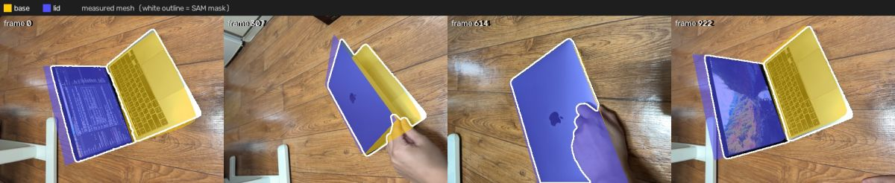
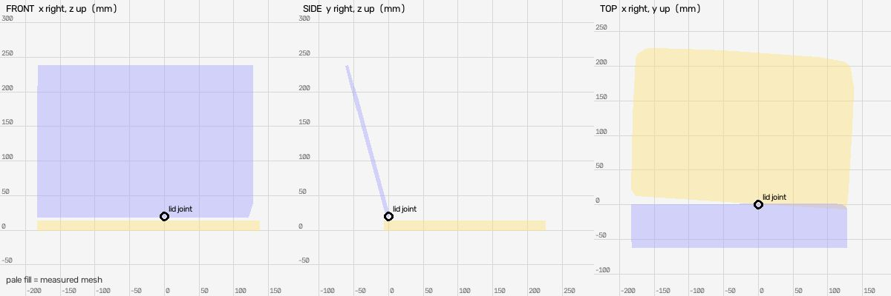
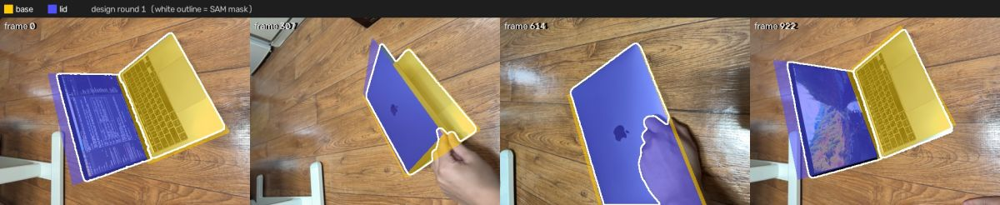
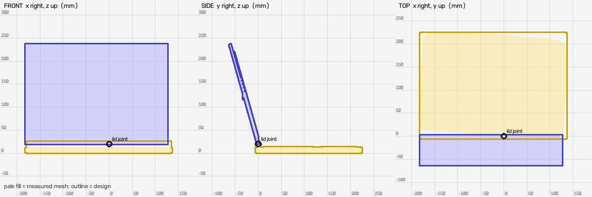
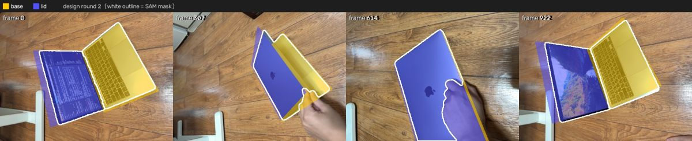
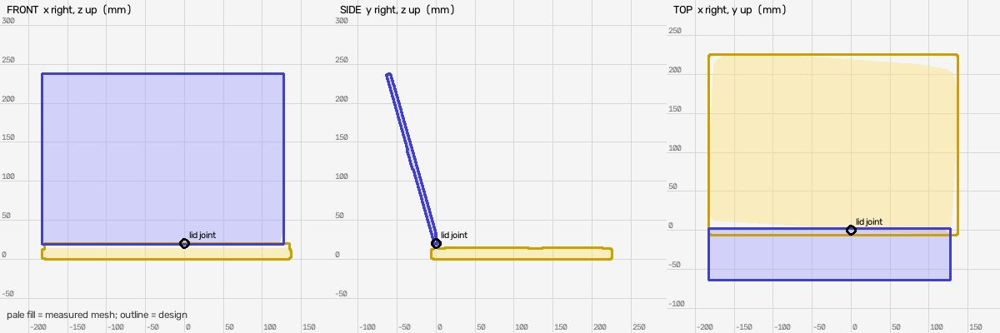

# Shape design (muse-spark-1.3-contributor)

Measured mesh IoU: `{"base": {"iou": 0.822, "mask_covered": 0.855, "f_near": 0.886, "frames": 9}, "lid": {"iou": 0.729, "mask_covered": 0.867, "f_near": 0.886, "frames": 16}}`

## Round 1: Apple MacBook laptop (silver)

Parts: `{"base": "base chassis / keyboard deck with keyboard, trackpad and hinge barrel", "lid": "display lid with LCD screen and Apple logo"}`

Mean near-F 0.881 (measured mesh 0.886); per link `{"base": {"iou": 0.801, "mask_covered": 0.882, "f_near": 0.879, "frames": 9}, "lid": {"iou": 0.726, "mask_covered": 0.863, "f_near": 0.882, "frames": 16}}`

Assumptions: ['lid thickness set to 6mm vs measured 4.9mm thin shell (back surface never seen), tilt ~15.8deg back captured by bar from [0,0] to [-61.3,217.5] to match measured y/z extents', 'base corner radius 4mm chosen as realistic MacBook unibody, not measured', 'hinge barrel radius 6.5mm along x at origin chosen to bridge 6.2mm gap between base top (-6.2) and joint (0,0,0)', 'keyboard 265x105mm at y~12-117mm and trackpad 115x75mm at y~137-212mm estimated from video top view, not in measured bbox', 'display inset 285mm wide with 12mm side bezels and 15mm top/bottom margins estimated from video', 'Apple logo 24mm disc on lid back center estimated from video, axis approximated as y-axis']

Notes: Reference pose is open laptop tilted ~16deg past vertical. Base x-center -22.8 and lid x-center -27.6 preserve measured asymmetry within 10%. Base bottom at -19.8 touches ground, top at -6.2. Both links include joint origin for connectivity.

## Round 2: Apple MacBook laptop (silver)

Parts: `{"base": "base chassis / keyboard deck with keyboard, trackpad and rear hinge", "lid": "display lid with LCD screen and Apple logo on back"}`

Mean near-F 0.885 (measured mesh 0.886); per link `{"base": {"iou": 0.813, "mask_covered": 0.882, "f_near": 0.884, "frames": 9}, "lid": {"iou": 0.731, "mask_covered": 0.871, "f_near": 0.886, "frames": 16}}`

Assumptions: ['lid thickness 5.0mm vs measured 4.9mm cross-section; back face never seen, front display sits proud of shell', 'base top at -6.2mm is 6.2mm below lid joint at 0,0,0 (measured mesh missing hinge gap); 3mm radius hinge centered at z=-3 just reaches joint to keep connectivity with minimal overshoot', 'base corner radius 4mm chosen as realistic MacBook unibody, not measured', 'keyboard 265x105mm at y 12.5-117.5mm and trackpad 115x75mm at y 137.5-212.5mm estimated from top video view', 'display 285mm wide with ~12mm side bezels and 12mm bottom / 14mm top margins along lid estimated from video', 'Apple logo 24mm disc centered on lid back estimated from video']

Notes: Reference pose open ~16deg past vertical. Base x-center -22.85 and lid x-center -27.6 preserve measured asymmetry. Display offset to front face and logo to back face along lid normal. Hinge reduced from 6.5 to 3.0mm radius to reduce z overshoot from 26.2 to 19.8mm while still reaching joint.

## Result

Best round 1 (mean near-F 0.881 vs measured 0.886): applied
