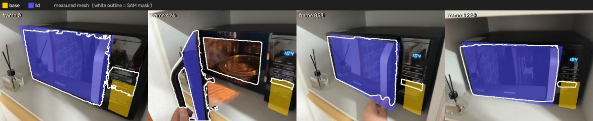
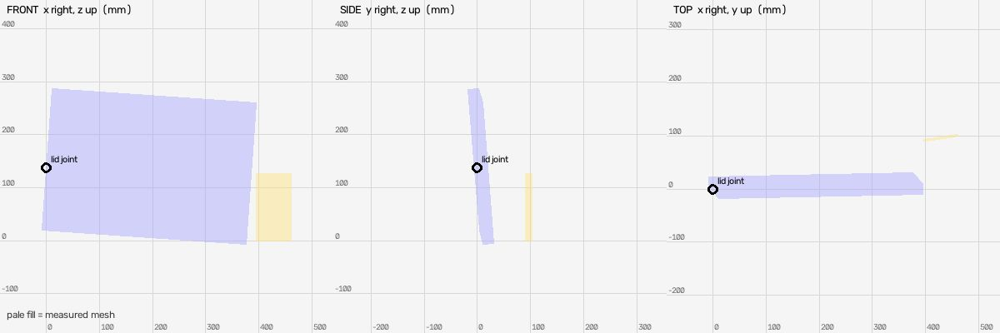
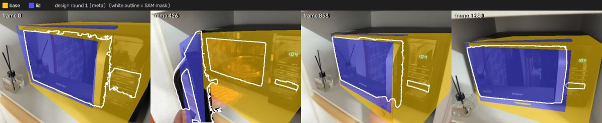
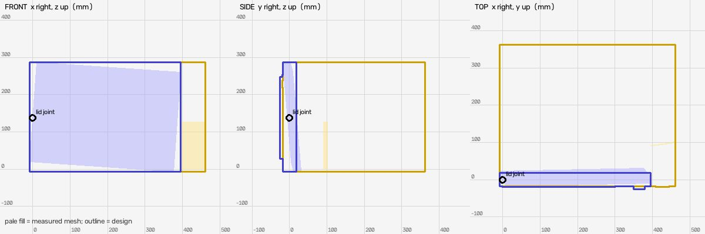
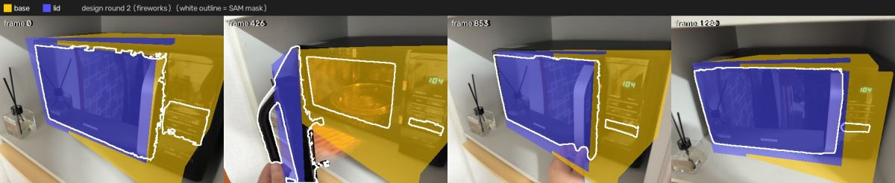
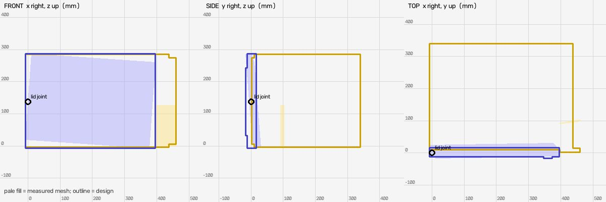

# Shape design (meta: muse-spark-1.3-contributor, fireworks: accounts/fireworks/models/muse-spark-open)

Measured mesh IoU: `{"base": {"iou": 0.151, "mask_covered": 0.487, "f_near": 0.333, "frames": 16}, "lid": {"iou": 0.813, "mask_covered": 0.89, "f_near": 0.944, "frames": 16}}`

## Round 1: microwave oven (from meta, muse-spark-1.3-contributor)

Candidates: meta 0.533, fireworks 0.34

Parts: `{"base": "microwave body with cooking cavity, control panel and turntable", "lid": "microwave door with viewing window and handle"}`

Mean near-F 0.533 (measured mesh 0.638); per link `{"base": {"iou": 0.087, "mask_covered": 0.98, "f_near": 0.197, "frames": 16}, "lid": {"iou": 0.693, "mask_covered": 0.825, "f_near": 0.87, "frames": 16}}`

Assumptions: ['Depth (y) was almost unmeasured (lid 48mm thick, base 11mm thick); assumed realistic microwave depth 380mm from front y=-17.4 to back y=362.6 derived from width/height.', 'Base measured bbox is only a 66x11x127mm fragment of the right control panel; expanded to full body width x -8.4 to 461.7 and full height z -144.5 to 149.1 to match lid front, to enclose cavity seen in video and to reach hinge joint at (0,0,0).', 'Base height expanded from measured partial 127mm to full 293.6mm because overlay shows interior light and turntable that measured mesh does not cover.', 'Handle protrudes forward of measured y-min by ~8mm; kept as recognisable silver vertical handle detail.', 'Control panel width 70mm taken from measured base width 66.5mm; display blue and turntable glass colours from video.']

Notes: Black Samsung-type microwave with right control panel and left-hinged door. Base built as hollow carcass (top/bottom/left/right/back + front control strip) so door opening reveals cavity and glass turntable. Lid door matches measured width 403.7 and height 293.6, with dark window, silver vertical handle on right edge, and white logo. Base left wall and panels reach lid joint at origin to keep connection.

## Round 2: microwave oven (from fireworks, accounts/fireworks/models/muse-spark-open)

Candidates: meta 0.53, fireworks 0.562

Parts: `{"base": "microwave cabinet with cooking cavity and right-hand control panel", "lid": "hinged door with window and vertical handle"}`

Mean near-F 0.562 (measured mesh 0.638); per link `{"base": {"iou": 0.102, "mask_covered": 0.976, "f_near": 0.229, "frames": 16}, "lid": {"iou": 0.731, "mask_covered": 0.874, "f_near": 0.895, "frames": 16}}`

Assumptions: ['Base measured y-extent 11.3 mm and z-extent 127.4 mm are fragments – overlay shows full cabinet height ~293.6 mm matching lid, and cavity depth seen when door open; depth assumed 330 mm (y from ~10 to 340) from typical microwave proportions and lid width.', 'Base x overall 446 mm (x -8 to 438) = lid width 403.7 + control panel 64 mm measured 66.5 mm, so front width stays within 10% of measured control panel width.', 'Base front face placed at y=2.5-8.5 behind door thickness so door (y -12 to +16) stays in front and does not get occluded; top/bottom placed to reach lid hinge joint at (0,0,0) via left wall.', 'Interior turntable depth position assumed middle of cavity y~170 mm, not measured.']

Notes: Microwave with left hinge. Base is open-front cabinet (top/bottom/left/back/right walls) plus right control-panel front; cavity open to door, so when closed only control strip is visible on right, when open cavity interior is visible – matching SAM masks in frames 426/853. Lid door width/height taken directly from measured 403.7x293.6 mm, thickness 28 mm, with dark window and silver vertical handle. Placement keeps joint at left edge and housing behind door to avoid the previous large yellow overspill.

## Result

Best round 2 (mean near-F 0.562 vs measured 0.638): NOT applied; much worse on ['base']

**Warning:** Measured model doesn't match the object: measured base bbox is only a 66.5x11.3x127.4 mm fragment of the right control panel front; FRONT/SIDE/TOP pales show lid as a thin door slab (403.7x47.9x293.5 mm) and base as a tiny vertical strip at x=395-462, missing the whole cabinet depth, top, bottom, back and cavity walls seen in video when door is open. Fitting a closed box inside that fragment gives a wrong object; the cabinet must extend behind the door.
