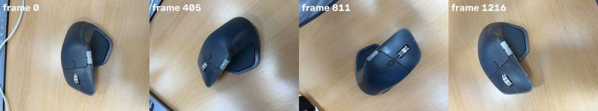
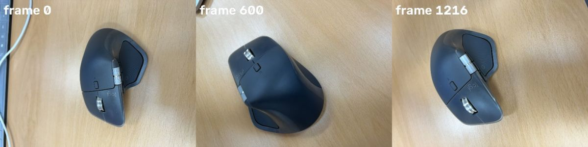
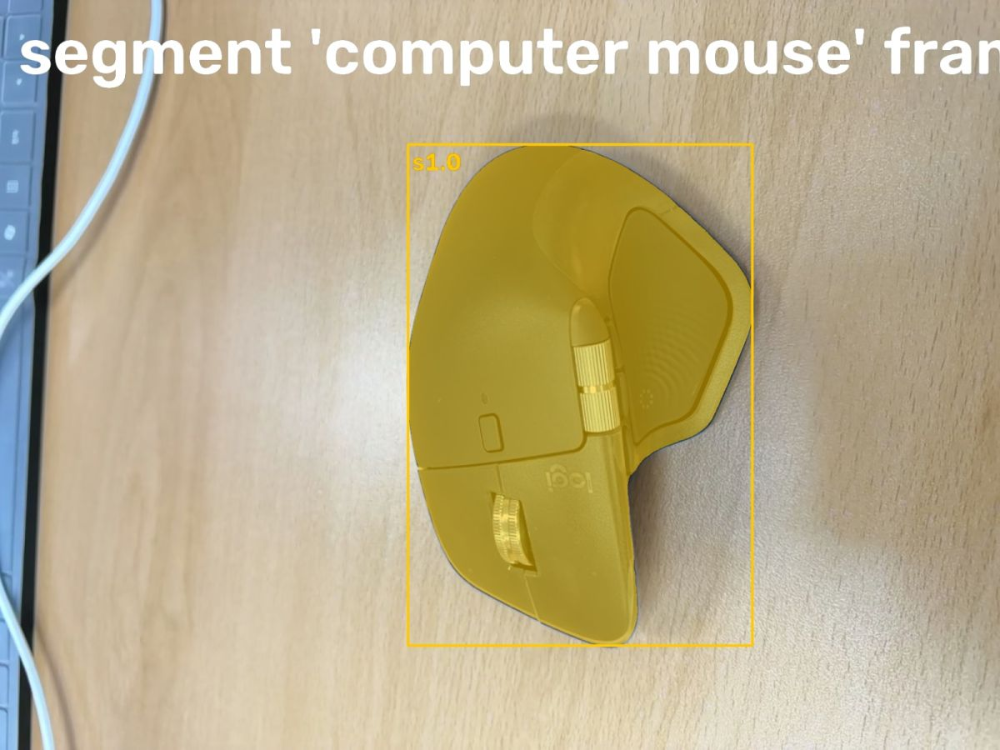
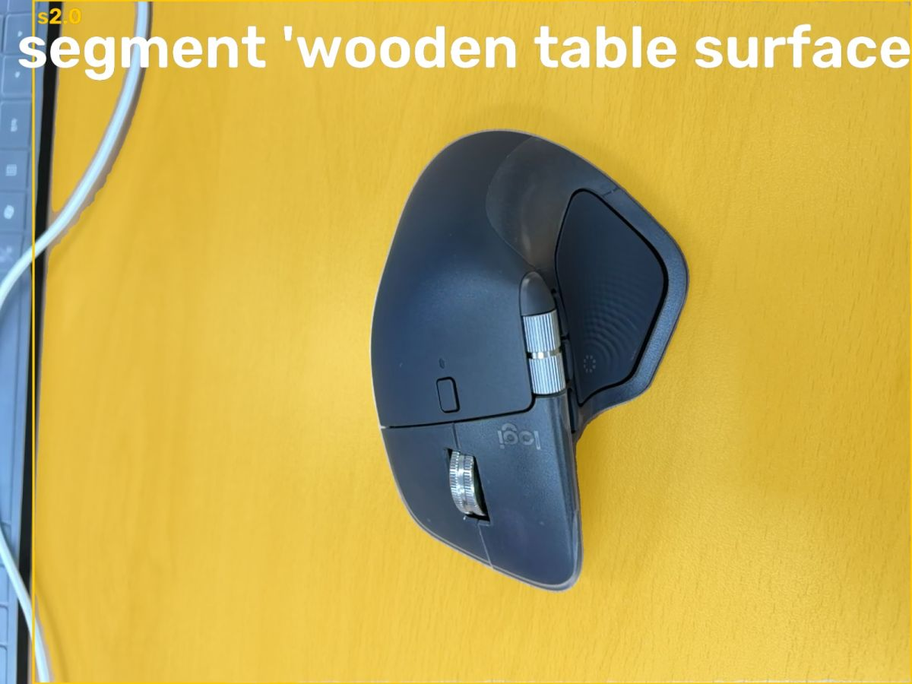
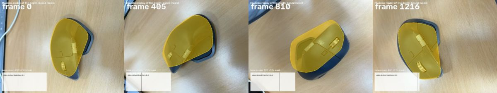

# Video2URDF agent: mouse_lidar.mp4

model muse-spark-1.3-contributor

watch video (mouse_lidar.mp4)

look [0, 405, 811, 1216]

## Spark (7s)

Your mouse shows no moving parts — I'll check the video to confirm a static model.

**watch** `{"what": "video"}`

watch video (mouse_lidar.mp4)

> The video is attached to the next message.

## Spark (6s)

The video shows a stationary mouse, so I'll fit a static box model.

**look** `{"frames": [0, 600, 1216]}`

look [0, 600, 1216]

> Showing frames [0, 600, 1216] (left to right).

## Spark (7s)

I see a rigid stationary mouse on the table. I'll segment it and the table surface.

**segment** `{"frame": 0, "prompt": "computer mouse"}`

segment 'computer mouse' frame 0

> segment 'computer mouse' on frame 0:
> s1.0: box (783, 277, 1444, 1239), confidence 0.98, area 15.6% of frame
> Check the annotated image.

## Spark (4s)

Mouse masked well. Now I'll segment the table.

**segment** `{"frame": 0, "prompt": "wooden table surface"}`

segment 'wooden table surface' frame 0

> segment 'wooden table surface' on frame 0:
> s2.0: box (70, 0, 1919, 1439), confidence 0.98, area 77.3% of frame
> Check the annotated image.

## Spark (4s)

Both parts segmented — I'll track them through the video.

**track** `{"parts": [{"candidate": "s2.0", "name": "floor"}, {"candidate": "s1.0", "name": "mouse"}]}`

> Tracked: floor 1217/1217 frames, mouse 1217/1217 frames

## Spark (4s)

Tracking complete. Now I'll fit the static box approximation.

**fit_static** `{"floor": "floor", "part": "mouse", "shape": "box"}`

fit_static: box model replay

> Hull capped at the depth-measured top, 56 mm above the floor.
> Visual hull from 48 views spanning 329 deg around the object: 43871 voxels.
> Static box: observed envelope [121.3, 75.2, 54.7] mm; generated size [121.3, 75.2, 54.7] mm; replay coverage 1217/1217 frames.
> The shape is the visual hull of the masks seen from around the object (convex hull of it); concave dents facing no camera are filled.
> Inspect whether this envelope follows the object.

## Spark (5s)

Static box fitted — I'll watch the replay to verify envelope coverage.

**watch** `{"what": "replay"}`

watch replay (replay3d.mp4)

> The replay is attached to the next message (fitted model in colour over the video).

## Spark (12s)

Replay confirms the box stays on the mouse. I'll add physical properties.

**set_physics** `{"parts": [{"friction": 0.5, "link": "base", "mass_kg": 0.14, "material": "plastic"}], "released": []}`

> base: plastic, 0.140 kg over 0.353 l of solid geometry (397 kg/m^3)

## Spark (8s)

Video shows a Logitech MX Master-style wireless mouse sitting stationary on a wooden desk while the camera orbits ~329 deg around it. No button press, wheel roll or other articulation is operated; the mouse is rigid for the whole 20.3 s.

Model:
- `floor`: static wooden table plane from RGB-D.
- `base`: mouse approximated as single static box, visual-hull envelope from 48 views / 43871 voxels over 1217/1217 frames.
- Size: 121.3 x 75.2 x 54.7 mm, top 56 mm above floor from depth. Consistent with MX Master ~125x84x51 mm; concave dents / side scoops facing no camera are filled by convex hull, as expected for fit_static.
- No joints: 0-DoF rigid object on table. Replay covers 73-99% of mask, typically ~85-95%, staying on the mouse body through the orbit.
- Physics: base plastic, 0.14 kg, friction 0.5. 0.353 l solid -> ~397 kg/m3 bulk density, plausible for hollow plastic shell + electronics/battery.

Limitation: buttons, main scroll wheel and thumb wheel are real micro-joints but never actuated in this video and too small for depth to resolve. Model treats mouse as one rigid body. To capture clicks/wheels, reshoot close-up top-down with finger operating each control.

## Spark (4s)

**finish** `{"report": "Video shows a Logitech MX Master-style wireless mouse sitting stationary on a wooden desk while the camera orbits ~329 deg around it. No button press, wheel roll or other articulation is operated; the mouse is rigid for the whole 20.3 s.\n\nModel:\n- floor: static wooden table plane from RGB-D.\n- base: mouse approximated as single static box, visual-hull envelope from 48 views / 43871 voxels over 1217/1217 frames.\n- Size: 121.3 x 75.2 x 54.7 mm, top 56 mm above floor from depth. Consistent with MX Master ~125x84x51 mm; concave dents / side scoops facing no camera are filled by convex hull, as expected for fit_static.\n- No joints: 0-DoF rigid object on table. Replay covers 73-99% of mask, typically ~85-95%, staying on the mouse body through the orbit.\n- Physics: base plastic, 0.14 kg, friction 0.5. 0.353 l solid -> ~397 kg/m3 bulk density, plausible for hollow plastic shell + electronics/battery.\n\nLimitation: buttons, main scroll wheel and thumb wheel are real micro-joints but never actuated in this video and too small for depth to resolve. Model treats mouse as one rigid body. To capture clicks/wheels, reshoot close-up top-down with finger operating each control."}`

> done
