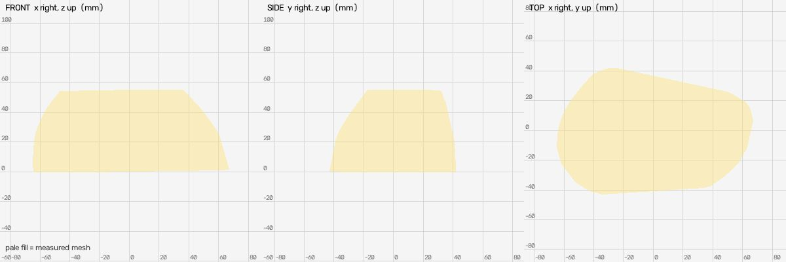
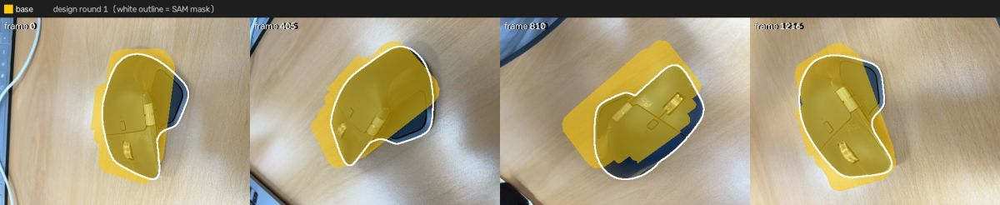
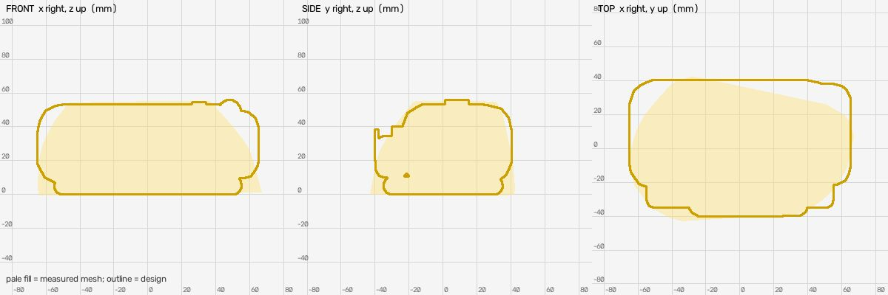
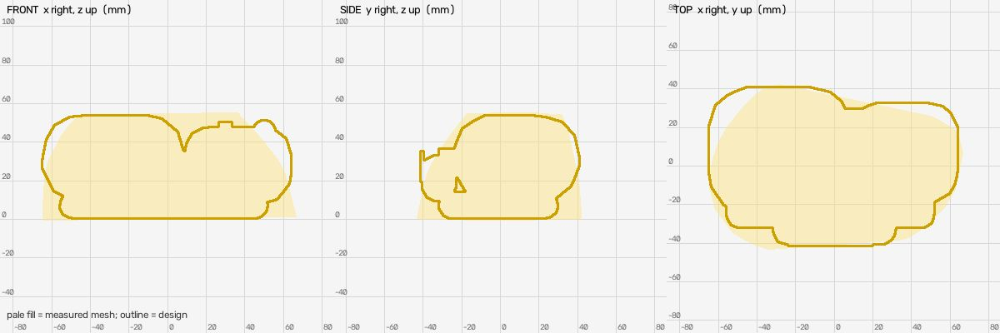

# Shape design (muse-spark-1.3-contributor)

Measured mesh IoU: `{"base": {"iou": 0.804, "mask_covered": 0.874, "f_near": 0.935, "frames": 16}}`

## Round 1: ergonomic wireless computer mouse - Logitech MX Master style

Parts: `{"base": "complete mouse body with palm hump, front click nose, thumb-rest wing, main metal scroll wheel, mode button and side thumb wheel"}`

Mean near-F 0.861 (measured mesh 0.935); per link `{"base": {"iou": 0.684, "mask_covered": 0.926, "f_near": 0.861, "frames": 16}}`

Assumptions: ['Front (+X, narrow nose with scroll wheel) vs rear (-X, high palm) orientation inferred from video and top-view silhouette; mirror in Y would be equivalent.', 'Underside assumed flat sitting on table at z=-27.5 to close measured bottom; underside detail not seen.', 'Rounded corner radii (15/10/6/5mm) estimated from video to get blobby ergonomic look.', 'Main scroll wheel slot and click split lines not modeled as geometry; wheel shown protruding above top surface.', 'Thumb pad shown as thin rubber inset on side of thumb wing; texture not modeled.', 'Colours for dark slate body and silver metal wheels sampled from video frames.']

Notes: Single static link fills measured bbox X[-65,65] Y[-40,40.5] Z[-27.5,28.5] vs measured [-64.4,64.5] [-40.7,41.5] [-27.6,27.7], matching length 129mm of MX Master.

## Round 2: ergonomic wireless computer mouse - Logitech MX Master style

Parts: `{"base": "complete mouse body with high rear palm hump, narrower front click nose, side thumb-rest wing, main metal scroll wheel, manual-shift button and side thumb wheel"}`

Mean near-F 0.893 (measured mesh 0.935); per link `{"base": {"iou": 0.731, "mask_covered": 0.889, "f_near": 0.893, "frames": 16}}`

Assumptions: ['Front is +X narrow nose with main scroll wheel, rear is -X high palm; orientation inferred from video.', 'Top silhouette tapers from wide rear to narrower front, so rear is made wider than front with large corner radii to avoid boxy rectangular projection.', 'Underside assumed flat at z=-27 to close measured bottom; underside detail not seen.', 'Corner radii 21/15/7/8 estimated from video to get domed ergonomic look.', 'Dark slate body and silver metal wheels sampled from video; thumb pad darker rubber.']

Notes: Fits measured bbox X[-65,64] Y[-41.5,41] Z[-27,27] vs measured [-64.4,64.5] [-40.7,41.5] [-27.6,27.7]. Two overlapping rounded volumes replace single boxy slab to give curved dome and tapered top view.

## Result

Best round 2 (mean near-F 0.893 vs measured 0.935): applied
