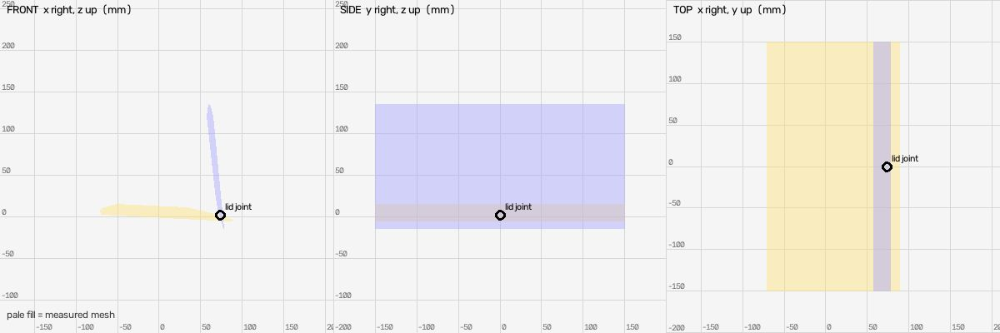
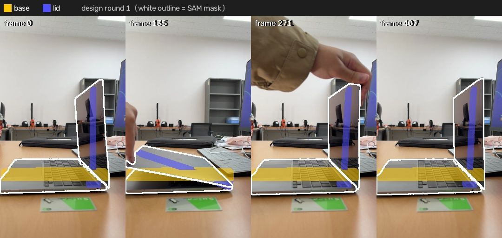
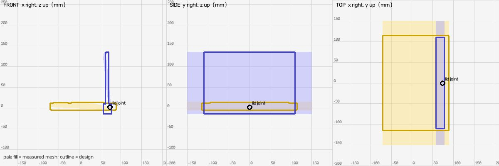
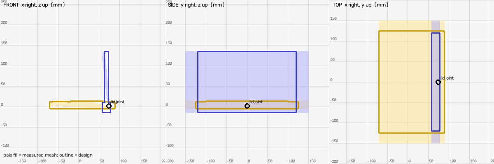

# Shape design (muse-spark-1.3-contributor)

Measured mesh IoU: `{"base": {"iou": 0.292, "mask_covered": 0.307, "f_near": 0.595, "frames": 16}, "lid": {"iou": 0.241, "mask_covered": 0.259, "f_near": 0.597, "frames": 16}}`

## Round 1: silver laptop computer, open on desk

Parts: `{"base": "laptop base chassis with keyboard and trackpad, hinge at rear", "lid": "laptop display lid with screen on inner face, hinged to base"}`

Mean near-F 0.594 (measured mesh 0.596); per link `{"base": {"iou": 0.343, "mask_covered": 0.384, "f_near": 0.635, "frames": 16}, "lid": {"iou": 0.214, "mask_covered": 0.243, "f_near": 0.553, "frames": 16}}`

Assumptions: ['y extent was unmeasured placeholder: base and lid width set to 230mm = 1.45 x measured base depth 158.9mm, normal laptop width/depth ratio, centered at y=0']

Notes: base chassis exactly spans measured x -70.4 to 88.5 and z -4.8 to 12.0, keyboard top to 13.5 to match measured max 15.1 within 10%. Lid hinge_mount spans measured x -16.0 to 4.2 and z -16.4 to 8.0, lid panel to z 134.0 to match measured max, so overall lid extent matches measured 20.2 x 150.3 while panel itself is realistically thin 7mm with black screen inset facing -x (toward keyboard when closed). Hinge at base [73.3,0,1.7] and lid origin are both enclosed for connectivity.

## Round 2: silver laptop computer, open on desk

Parts: `{"base": "laptop base chassis with keyboard and trackpad, hinge at rear", "lid": "laptop display lid with screen on inner face, hinged to base"}`

Mean near-F 0.621 (measured mesh 0.596); per link `{"base": {"iou": 0.357, "mask_covered": 0.4, "f_near": 0.649, "frames": 16}, "lid": {"iou": 0.253, "mask_covered": 0.288, "f_near": 0.594, "frames": 16}}`

Assumptions: ['y extent was unmeasured placeholder: base width set to 250mm and lid width to 240mm = ~1.55x measured base depth 158.9mm, normal laptop width/depth ratio, centered at y=0, increased from round 1 to better cover SAM width in oblique views', 'lid panel thickened to 9mm to better match edge-on width in side views while hinge_mount retains full measured x/z extremes which are blobby']

Notes: base spans measured x -70.4 to 88.5 and z -4.8 to 13.5 within 10% of measured 19.9. Lid hinge_mount spans measured x -16.0 to 4.2 and z -16.4 to 8.0, panel to z 134.0 so overall lid 20.2 x 150.4 matches measured. Panel thin 9mm at x -9.5 to -0.5 with black screen inset facing -x toward keyboard. Hinge at base [73.3,0,1.7] enclosed for connectivity.

## Result

Best round 2 (mean near-F 0.621 vs measured 0.596): applied

**Warning:** Scale: measured base depth 158.9mm and lid height 150.3mm are ~25-30% smaller than a normal 13-14in laptop depth/height ~210-220mm and width ~300-320mm. No scale source was given, so absolute scale is likely underestimated. Measured sizes are kept and unmeasured width is derived proportionally, so model width 250mm is also below typical.
