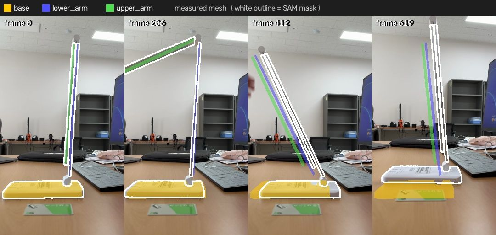
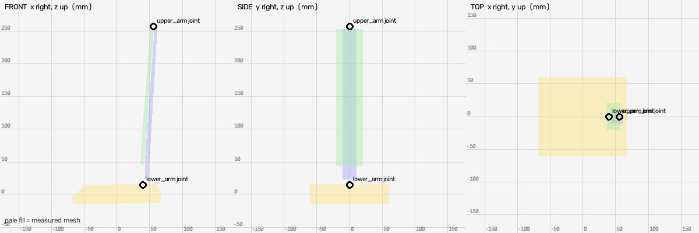
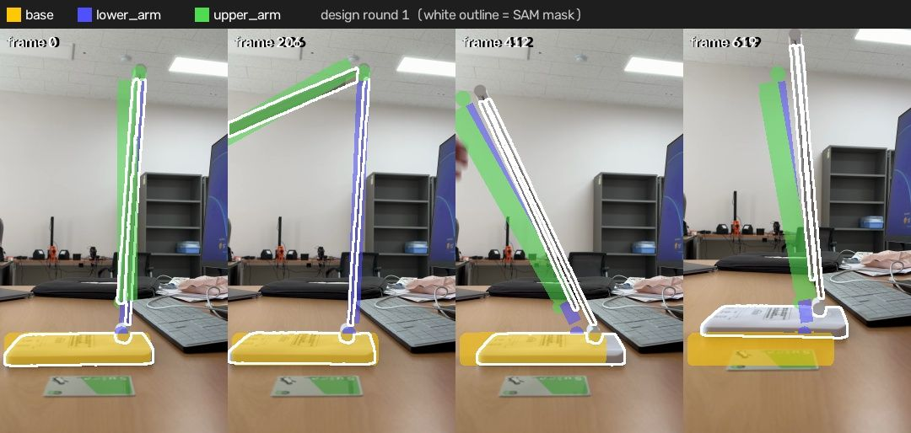
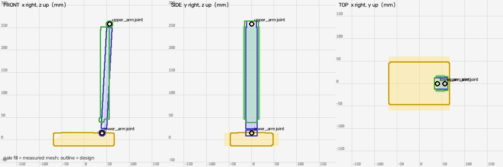
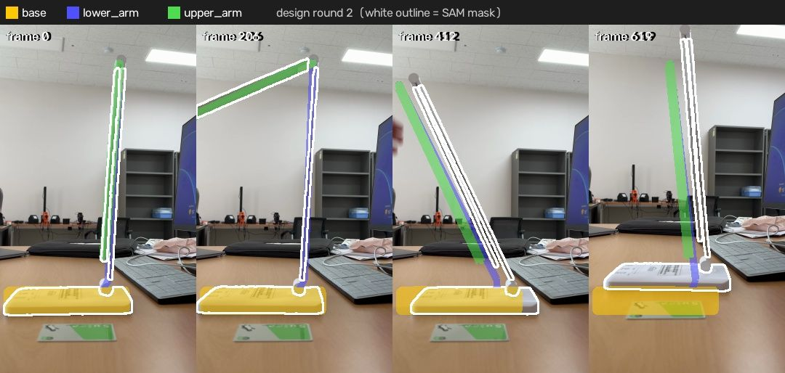
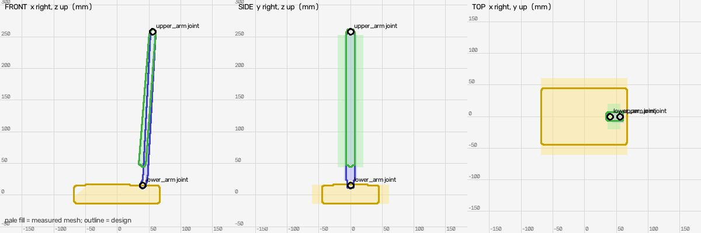

# Shape design (muse-spark-1.3-contributor)

Measured mesh IoU: `{"base": {"iou": 0.763, "mask_covered": 0.864, "f_near": 0.92, "frames": 16}, "lower_arm": {"iou": 0.317, "mask_covered": 0.366, "f_near": 0.617, "frames": 16}, "upper_arm": {"iou": 0.351, "mask_covered": 0.389, "f_near": 0.604, "frames": 16}}`

## Round 1: white foldable LED desk lamp

Parts: `{"base": "flat rectangular weighted base with touch controls", "lower_arm": "slim vertical support pole / lower folding arm", "upper_arm": "slim LED light bar / upper folding arm with diffuser"}`

Mean near-F 0.664 (measured mesh 0.714); per link `{"base": {"iou": 0.748, "mask_covered": 0.894, "f_near": 0.913, "frames": 16}, "lower_arm": {"iou": 0.21, "mask_covered": 0.354, "f_near": 0.501, "frames": 16}, "upper_arm": {"iou": 0.241, "mask_covered": 0.639, "f_near": 0.577, "frames": 16}}`

Assumptions: ['y depth unmeasured: base depth 95mm assumed rectangular ~135x95mm from top view and keyboard scale', 'arm cross-section unmeasured in y: lower pole width 26mm in y, thickness 12mm in x; upper housing width 32mm in y, thickness 18mm in x, typical flat LED bar proportions derived from 17-19mm measured thin edge', 'both arms silver-white aluminium, base white plastic, diffuser warm-white LED strip placed on outer -x face, side not clearly seen', 'hinge barrels along y-axis at both pivots, radius 6-7mm, to keep joints connected']

Notes: 2-bar folding lamp: base joint at rear of base, lower pole leans +x to elbow at 242mm, upper light bar in own frame extends -z ~213mm with slight -x offset, folded parallel to lower in reference. Overall height ~260mm folded, ~450mm extended, within typical desk lamp size.

## Round 2: white foldable LED desk lamp

Parts: `{"base": "flat rectangular weighted base with controls", "lower_arm": "slim lower support pole", "upper_arm": "slim upper LED light bar"}`

Mean near-F 0.696 (measured mesh 0.714); per link `{"base": {"iou": 0.75, "mask_covered": 0.894, "f_near": 0.913, "frames": 16}, "lower_arm": {"iou": 0.207, "mask_covered": 0.296, "f_near": 0.566, "frames": 16}, "upper_arm": {"iou": 0.358, "mask_covered": 0.556, "f_near": 0.609, "frames": 16}}`

Assumptions: ['y depth unmeasured: base depth 90mm assumed, arm width 14mm in y typical flat LED bar, much thinner than round1 26-32mm to match thin SAM masks', 'arm thickness in x 8-9mm derived from 17-19mm measured x-width which includes diagonal lean, previous 12mm plus large pivots was too thick', 'pivot barrels along y with small radius 4-4.2mm to stay connected with minimal overshoot']

Notes: Slimmed arms in y and x to raise IoU/near-F. Lower mesh starts 8mm above its joint and child joint is 5mm above mesh top, upper origin is outside mesh, so small overshoot beyond measured bbox is required for connectivity; measured mesh is detached in SIDE view.

## Result

Best round 2 (mean near-F 0.696 vs measured 0.714): applied
