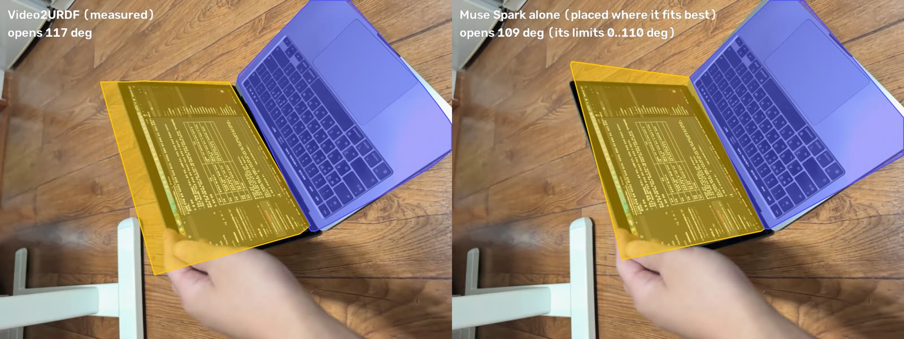
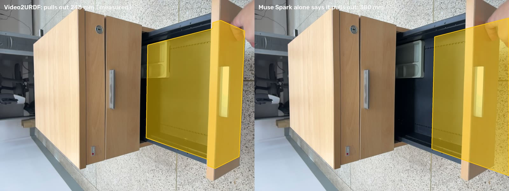

# Why not just ask an AI for the URDF?

We asked the same Muse Spark that drives Video2URDF (`muse-spark-1.3-contributor`, Meta Model
API) for a URDF of each object, plainly. It got the same video the agent sees first (480 px,
10 fps), three frames at 1024 px and one request. It had no tools: no SAM, no depth, no fit, no
replay. We took 5 answers per object (10/31; `scripts/spark_alone.py`).

> I filmed this object being moved. Write a URDF of it that I can load into MuJoCo to simulate it.
> - Links: simple box or cylinder geometry, sized in metres to match the real object.
> - Joints: the right type, axis, origin and limits, so the model moves the way the object moves in the video.
>
> Make it as close to the real object as you can tell from the video. Reply with the complete URDF in one ```xml code block.



*The MacBook at its widest opening. Left: Video2URDF's measured model, 117 deg. Right: one of
Spark's answers, placed where it fits best; its joint limit stops it at 110 deg.*

## How the answers were scored

- **Hinged objects:** URDF Doctor places each URDF on the measured model where it fits best: it
  matches the base, and the moving part at seven openings, choosing the best joint value for each.
  This favours the baseline, because its URDF says nothing about where the object is. Its hinge is
  then read against the measured hinge, and on the RBO sequences against motion capture (the same
  `rbo.hinge_errors` the benchmark uses).
- **Joint range:** the span its limits allow against the span the video shows (motion capture on
  RBO, the measured opening elsewhere).
- **Drawer:** the prismatic joint's travel.

## Results

| Object | Check | Muse Spark alone (median, range) | Video2URDF | Truth |
|---|---|---|---|---|
| 13" MacBook Pro, iPhone LiDAR (5 of 5 answers usable) | lid, along the hinge x across | 304 x 212 mm (all 5) | 309 x 205 mm | 304 x 212 mm (spec) |
| | hinge axis vs the measured one | 3.3 (2.9-3.6) deg | (reference) | |
| | hinge position vs the measured one | 10 mm (all 5) | (reference) | |
| | joint range (the video opens it 116 deg) | 112 (110-120) deg; 3 of 5 shorter | 116 deg | |
| Office drawer, iPhone LiDAR (5 of 5) | travel | 380 (360-400) mm, the same for all three drawers | 248 mm seen | not measured |
| RBO laptop01, motion capture (5 of 5) | hinge axis | 6.5 (2.2-7.3) deg | 1.8 deg | 0 |
| | hinge position | 15 (13-20) mm | 25 mm | 0 |
| | joint range | 109 (90-110) deg; 5 of 5 shorter | 132 deg | 117 deg opened |
| RBO laptop02, motion capture (4 of 5: 1 doesn't load) | hinge axis | 1.9 (1.8-2.1) deg | 2.1 deg | 0 |
| | hinge position | 19 (9-60) mm | 32 mm | 0 |
| | joint range | 106 (100-110) deg; 0 of 4 shorter | 116 deg | 99 deg opened |
| RBO laptop05, motion capture (5 of 5) | hinge axis | 1.0 (0.8-3.4) deg | 0.9 deg | 0 |
| | hinge position | 8 (6-16) mm | 20 mm | 0 |
| | joint range | 106 (105-110) deg; 0 of 5 shorter | 100 deg | 97 deg opened |

## What it shows

1. **It recognises products and recalls their specs.** The MacBook's lid came out at the spec's
   304 x 212 mm in all five answers. Its hinge sits 3.3 deg / 10 mm from the measured one (the
   spec URDF scores 2.7 deg / 9 mm).
2. **On a laptop its hinge prior is good.** The RBO laptops are unknown models. Placed on our
   measured base and lid, Spark's hinge is as close to motion capture as ours in direction on two
   of the three (median 1.9 / 1.0 deg against our 2.1 / 0.9; 6.5 against 1.8 on laptop01) and
   closer in position (15 / 19 / 8 mm against our 25 / 32 / 20 mm): it knows a laptop's hinge
   runs along the back edge of the base.
3. **It can't measure this object.**
   - Joint range: in 8 of 19 hinge answers the range is shorter than the opening the video shows
     (MacBook 3 of 5, laptop01 5 of 5). That model can't reach a pose the real object reaches.
   - Drawer travel: 360-400 mm in all five answers, the same for each of the pedestal's three
     drawers, whatever the video shows. The drawer in the video was pulled out 248 mm; whether
     that was the end of its slide isn't visible, so this doesn't say 380 mm is wrong, only that
     it wasn't read from the video.
   - The answers vary from run to run (joint ranges 90-120 deg).
4. **One answer of 25 didn't load in MuJoCo.** Its inertia was impossible ("A + B >= C").
5. **Nothing in an answer says which numbers are right.** We know the MacBook answer was right
   only because the video measured it.
6. **What it shows about our side.** On RBO, our joint ranges carry outlier frames (132 / 116 deg
   against 117 / 99 truth), and our hinge position (20-32 mm) is worse than the "back edge of the
   base" prior placed on our own geometry (8-19 mm): a prior from Spark could tighten our fit.



*The drawer at the 248 mm the video shows (left) and at the 380 mm Spark gave every drawer
(right). The drawer's full travel wasn't measured.*

## Caveats

- **Placement:** URDF Doctor places Spark's URDF by matching it to our measured model, so the
  motion-capture numbers for Spark include our geometry's error.
- **Left out of the table:**
  - The microwave: the measured model these answers were scored against had only the
    control-panel strip as its body (before the body was completed), so a whole-microwave URDF
    couldn't be placed on it; its five answers read 55-89 deg off, an artefact of the placement.
    They are in the files below, unscored.
  - RBO laptop04, book03 and book05: their measured base or lid can't place another model. Their
    hinges are in the README's RBO table.

## Files

- Every answer: `spark_alone/<case>/run<i>/` holds `response.json` (prompt, the full answer,
  token use), `spark.urdf` (the URDF from the answer) and `score.json` (URDF Doctor's numbers
  and findings; motion-capture scores on RBO). 30 answers: 6 objects x 5.
- The table's numbers: `spark_alone/summary.json`; the measured values each case was scored
  against: `spark_alone/<case>/measured.json`.
- Reproduce (Meta Model API key; about 12k tokens per answer):

  ```bash
  .venv/bin/python scripts/spark_alone.py ask --runs 5
  .venv/bin/python scripts/spark_alone.py score
  .venv/bin/python scripts/spark_alone.py table
  ```
